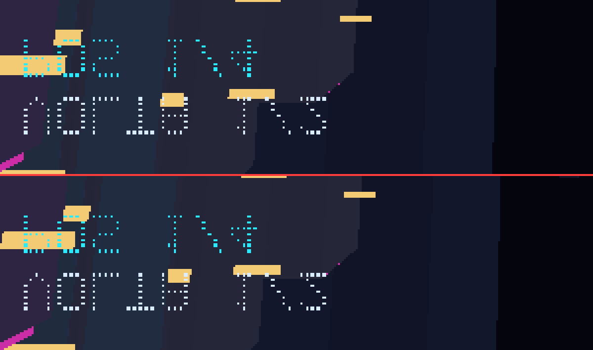

# AGENTS.md — Giochi app

> Handoff técnico deste repositório. Leia antes de continuar o trabalho.
> Atualizado em: 10/11/2026 (com acesso ao aparelho real).

## 0. Estado em uma tela (leia isto primeiro)

> **06/11/2026: os sete jogos antigos foram removidos e o `cobrinha` foi
> reescrito do zero.** Tudo abaixo que citar `volley`, `pacman`,
> `arcade-volleyball`, `spacewar`, `colossal-cave-adventure` ou
> `shattered-pixel-dungeon` é **histórico**: as medições foram reais e servem de
> referência, mas os arquivos não existem mais. O `cobrinha` que existe hoje é
> outro programa — ver [`app/jogos/cobrinha/README.md`](app/jogos/cobrinha/README.md).

O que existe hoje, verificado:

| Item | Estado |
| --- | --- |
| apps em `apps.json` | **6**: `forge`, `store`, `painel`, `loja` (host) + `launcher` (image) + `cobrinha` (image) |
| jogos | **2**: `cobrinha` e `neon-drift` — Rust + GIOCHI-ENGINE-3D/SDL2, passo fixo com teto de 75 fps |
| `validate-app.mjs --all` | 8 apps válidos (1 em scaffold) |
| `tests/run-all.mjs` | 189/189 JS |
| `testar-apps-pc.sh` | 90/90 Python (58 forge + 32 painel) |
| `compilar-launcher.sh --testes` | 223/223 Rust |
| `compilar-loja.sh --testes` | 116/116 Rust |

**Catálogo ausente não vira catálogo inventado.** Sem `index.json` (o normal numa
imagem recém-gravada), o launcher mostra "Nenhum jogo instalado." — antes mostrava
quatro jogos de demonstração que não existem no aparelho, e apertar A dava erro.
Demonstração só com `--demo`. Medido: 122 cores (vazia) contra 318 (`--demo`).

**As duas armadilhas do KMSDRM** (o System documentou em `KMSDRM.md` §8; detalhe
em [`docs/ferramentas.md`](docs/ferramentas.md#duas-armadilhas-do-kmsdrm-relatadas-pela-equipe-da-engine)):

1. quem segura o DRM master é **o launcher**, não um X server — a mensagem do
   Mesa é enganosa e o app agora nomeia o processo;
2. o `giochi-init` **desiste** após 5 quedas em 60 s e estaciona em `sleep 3600`
   com a tela preta; só sai sinalizando-o, e o `inittab` devolve a cota.

O que roda no aparelho: **o launcher e o `cobrinha`**. O launcher desenha com
catálogo vazio (cai no catálogo de demonstração) — medido: 354 cores, 0,00 % de
preto em 1280×720. O `cobrinha` compila para aarch64 (356 KB, `NEEDED` = SDL2 +
libgcc_s + libc) e mediu **45,3 fps com 0 quadros atrasados** a 640×480.

## 1. Objetivo

Este repositório é a **camada de experiência** do projeto Giochi: os apps e jogos
que rodam sobre o sistema gerado pelo **Giochi System**, e que são reunidos com ele
no **Giochi os**.

| Repositório | Função |
| --- | --- |
| **Giochi app** (este) | Apps, jogos, arte e manifesto de requisitos |
| **Giochi System** | Sistema Linux limpo: kernel, rootfs, boot, drivers, painel |
| **Giochi os** | Junta sistema + apps e gera a imagem final por aparelho |

Cada pasta é **repositório Git individual**. A comunicação entre elas é sempre por
**artefato declarado explicitamente**, nunca por caminho relativo presumido.

## 2. Localização

```text
C:\Users\Jussara dias\Desktop\plataforma sistema\Giochi app
```

Repositório no GitHub: `https://github.com/xtrempkch-droid/GIOCHI-APP` (a criar).

## 3. Estado atual

### Concluído

- Estrutura de repositório pronta para GitHub.
- Pasta `app/` com um diretório por app, contendo `src/`, `bin/` e `assets/`.
- `app/apps.json` como fonte da verdade da lista e do status.
- `app/_template/` para criar app novo.
- JSON Schema do `metadata.json` e do `forge.json` em `schemas/`.
- Validador: `scripts/validate-app.mjs` + núcleo em `scripts/lib/apps.mjs`.
- Leitor de dimensão de PNG sem dependência: `scripts/lib/png.mjs`.
- Script de migração do antecessor: `scripts/migrar-do-antecessor.sh`.
- Testes: `tests/validate-app.test.mjs`, runner `tests/run-all.mjs`.
- Workflow de validação em PR e push.
- Documentação em `docs/` (5 páginas).

### Validado nesta sessão (03/11/2026, Linux com toolchain completa)

- `node scripts/validate-app.mjs --all` passou: **7 apps** (6 em `scaffold`, o
  launcher em `ready`).
- `node tests/run-all.mjs` passou: **86/86** (43 de validação + 17 do verificador
  de quadro + 13 de capacidades de entrada + 13 do gerador de catálogo).
- `cargo build --workspace` em `app/launcher`: **compila e linka**, zero erro e
  zero aviso (rustc 1.99, SDL2 2.32.10, SDL2_ttf 2.24.0).
- `cargo test --workspace` em `app/launcher`: **153/153** (59 no `core`, 94 no
  `ui-sdl`). As contagens estiveram invertidas por várias rodadas: quem tem mais
  testes é o `ui-sdl`, não o `core`.
- O launcher **roda**: Home desenhada de verdade e gravada em BMP com
  `--dump-frame`, sem tela (`SDL_VIDEODRIVER=dummy`).
- `bash -n scripts/migrar-do-antecessor.sh` e `bash -n
  scripts/compilar-launcher.sh`: **sem erro de sintaxe**.
- `bash scripts/aparelho.sh` — todos os subcomandos **executados contra o
  aparelho real**: `procurar`, `diagnostico`, `instalar`, `subir`, `parar`,
  `verificar`, `log`, `input`, `ajuda`. `verificar` fechou o ciclo completo:
  capturou 720×1280, gerou a referência 1280×720 no PC e comparou com **99,9 %**
  de acerto na rotação `ccw` e **10,9 %** em `cw`.
- O workflow ganhou `launcher-core` (testa os 48 do núcleo, sem SDL) e
  `launcher-build` (compila o workspace com SDL2). Os dois comandos passam
  localmente com `--locked`; o YAML foi parseado, mas os jobs **não rodaram no
  GitHub** ainda.

### Verificado NO APARELHO (03/11/2026)

Aparelho `giochi-system-x55`: Buildroot 2024.02, aarch64, kernel 6.12.0,
glibc 2.38, SDL2 2.28.5, PMIC `rk817`, painel DSI 720×1280, 1968 MB de RAM.
Acesso por `ssh root@<ip>` — **o IP muda a cada boot** (DHCP), então use
`bash scripts/aparelho.sh procurar` em vez de decorar um endereço.

> **04/11/2026: o X55 apareceu em `192.168.1.6`, pela rede, sem `usb0`.** O
> gadget USB dele está `not attached` (`giochi-selftest` → `UDC:
> fcc00000.usb · estado not attached`), então a rota fixa `10.55.0.2` só
> funciona quando o cabo de dados está no modo certo. `procurar` com
> `GIOCHI_SUBREDE=192.168.1` acha os dois casos.

- **Cross-compile aarch64 funciona**: `scripts/compilar-launcher-arm64.sh`
  gera o binário do zero (sysroot + libs do aparelho + wrapper de link).
- **O launcher RODA no aparelho**: `SDL_VIDEODRIVER=kmsdrm` abre o DRM real,
  desenha e grava frame; 6 descritores de DRM e 5 de `/dev/input` abertos.
- **Rotação para painel retrato**: antes ~40 % da tela era letterbox preto e a
  UI saía deitada; agora 0 % de preto e o layout encaixa.
- **Instalado** em `/opt/giochi/apps/launcher/bin/giochi-launcher`, o caminho
  que o `giochi-init` espera, com sha256 idêntico ao do repositório —
  conferido por `aparelho.sh instalar` a cada rodada.
- **Corrigido o sentido da rotação**: o primeiro teste mostrou a UI de cabeça
  para baixo. Horário e anti-horário diferem 180°; o X55 precisa de
  anti-horário. Confirmado por comparação de frame: **99,9 %** igual à
  referência, contra **10,9 %** no sentido oposto.
- **Config de rotação com recarga ao vivo**: o arquivo é relido a cada segundo,
  então trocar o sentido não exige reabrir o launcher.
- **Corrigido um bug que impedia os botões de funcionar**: o
  `/etc/giochi/buttons.map` tem comentário no fim de cada linha
  (`up = BTN_DPAD_UP  # gpio4 PA0`), e o parser não cortava o `#`. Resultado:
  **1 de 13** botões parseados, os outros 12 descartados em silêncio. Agora
  corta e tem teste com o conteúdo real do mapa.
- **Botão de energia, volume, brilho, desligar e reiniciar: exercitados no
  hardware.** Não são mais suposição — ver §12.
- **Os 20 códigos de tecla declarados pelo kernel têm entrada no app.** O
  `B: KEY=` de `/proc/bus/input/devices` foi decodificado e cruzado com
  `code_for` e com o `buttons.map`: cobertura completa.
- **O `inittab` da imagem de 03/11 NÃO inicia o `giochi-init`** — não há entrada
  `::respawn:`, então o launcher não sobe no boot; só por SSH. **Corrigido nas
  imagens de 04/11** (conferido dentro do `rootfs.ext4`, ver §3).
- `app/launcher/bin/giochi-launcher` versionado; o app passou a **`ready`**.
- `capa.png` 320×320 gerada da paleta do tema (provisória).
- O validador foi exercitado contra: versão fora de semver, runtime inválido,
  arquitetura inválida, campo desconhecido, entrypoint fora de `bin/`, entrypoint
  com `..`, entrypoint inexistente, capa fora de 320×320, capa que não é PNG,
  `bin/` ausente, nome de pasta inválido, `forge.json` inválido, licença em formato
  inválido e **GPL declarada na imagem assinada**.

### X35H — PRIMEIRO TESTE EM HARDWARE (04/11/2026)

**A arquitetura passou.** O mesmo binário, sem nenhuma linha específica de
aparelho, roda no X35H: a orientação veio de `fbcon/rotate=0`, o letterbox de
25% é o esperado para 4:3, e o mapa de 16 botões sem `home` foi aceito sem aviso.

| Medido | Valor |
| --- | --- |
| painel | **640×480** (4:3), `fbcon/rotate=0` → `Rotation::None` |
| frame | 640×480, **25,00%** de preto (60 px por lado) |
| comparação com a referência do PC | **99,9%** (34240 amostras) |
| RAM | **964 MB** (a pergunta que faltava responder) |
| códigos de tecla | **19**: 16 do controle + vol(2) + power(1) — **sem `BTN_MODE`** |
| cores com texto / sem texto | **180 / 97** — prova que os glifos desenham |

Acesso por **`usb0`**: `10.55.0.2`, senha `giochi-dev`. Nossa chave foi
instalada em `/root/.ssh/authorized_keys`, então o toolkit funciona sem senha. O
host key muda quando a imagem é regravada — `ssh-keygen -R` resolve, e o erro que
aparece antes disso fala de ataque MITM, não de chave nova.

### Layout adaptativo: escala 1,0 em qualquer painel (04/11/2026)

**A faixa preta sumiu e o texto dobrou de tamanho**, resolvendo as duas queixas
do usuário ("faixa em cima e embaixo", "fonte muito pequena em telas menores").

A causa era uma só: o espaço de projeto era **fixo em 1280×720** e o SDL
escalava. Num painel 640×480 isso dá escala **0,5** — e aí `F_TINY` (9 px) vira
**4,5 px de device**, ilegível, além da faixa.

| | antes | agora |
| --- | --- | --- |
| espaço de projeto | 1280×720 fixo | **o painel** (640×480) |
| escala | 0,5 | **1,0** |
| `F_TINY` no device | 4,5 px | **9 px** |
| fração da largura | 0,70 % | **1,41 %** |
| faixa preta | 25 % | **0 %** |

`draw::projecao(rot, output)` devolve o espaço de projeto e o lógico:
- **sem giro** → projeto = painel (4:3 usa 4:3 inteiro);
- **com giro** → painel é retrato, projeto é paisagem com medidas trocadas.

O espaço lógico continua sendo o do dispositivo, então a escala é 1,0 **sempre** —
a fonte nunca encolhe. Em troca, o layout passou a ser proporcional:
`views::Moldura` calcula margens, barras e espaçamentos a partir do tamanho do
painel, usando o desenho de 1280×720 só como **proporção de referência**.

Num painel 1280×720 o resultado é **idêntico** ao anterior (`k = 1,0`), o que
permite conferir a mudança comparando frames. Medido:

```text
640x480    640x480, 0,00% de preto, 351 cores, 99,8% de acerto contra o PC
1280x720   1280x720, 0,00% de preto, 392 cores  (sem regressão)
720x1280   720x1280 girado, 0,00% de preto, 348 cores  (X55, sem regressão)
```

3 testes novos fixam a regra: `projecao_acompanha_o_painel_e_nao_encolhe`,
`projecao_com_giro_troca_as_medidas`, `projecao_de_16_9_nao_muda_nada`.

### O que aconteceu com o diagnóstico da faixa

A faixa era **esperada** (16:9 num painel 4:3) e estava **simétrica** — o BMP
mentia sobre a posição, porque `read_pixels` ignora o deslocamento do viewport.
Registrado em `docs/ferramentas.md`. O layout adaptativo resolve a faixa por
outro caminho: não há mais letterbox porque o projeto acompanha o painel.

### O que a imagem do X35H ainda NÃO tem

- **`::respawn:` no `inittab`** — **só na imagem em uso.** Ela é a de 03/11
  19:17, anterior à correção do `post-build` (19:32); a UI não sobe sozinha.
  As imagens de 04/11 **têm a linha** nos dois aparelhos — verificado com
  `debugfs` no `rootfs.ext4`, não no fonte. Falta gravar o cartão.
- **`readelf`** — sem ele o `giochi-selftest` não consegue provar que o
  `SDL2_ttf` usa harfbuzz (fica `[SKIP]`).

### Um `FAIL` do selftest que era falso

O `giochi-selftest` reporta as cinco bibliotecas como **ausentes**, e as cinco
estão em `/usr/lib`. Causa: `ls /usr/lib/${lib}.so* /lib/${lib}.so*` — o segundo
glob não casa (`/lib` é diretório real, não symlink) e o `ls` retorna 1 mesmo
tendo listado o arquivo do primeiro. A correção é `||` entre dois `ls`, e foi
validada no aparelho: as cinco passam a `PASS`.

### Histórico da validação

O rootfs da imagem do X35H em `out/` foi extraído e inspecionado antes de haver
hardware; depois o teste foi executado.

| Item | Estado |
| --- | --- |
| Texto na imagem (`SDL2_ttf` + harfbuzz + DejaVu) | **funciona em hardware** nos dois aparelhos |
| `::respawn:` no `inittab` | **falta só na imagem em uso**; as de 04/11 têm (verificado com `debugfs`) |
| Imagem do **X55** com as correções | **existe em `out/` (04/11 21:22 UTC), NÃO está gravada** |
| Segundo aparelho (**X35H**) | **testado**, 99,9% de acerto |
| `giochi-selftest` bloco "bibliotecas do launcher" | **existe só na imagem nova**; a do X55 em uso não tem |

A premissa deste repositório era que o mesmo binário serve em hardware diferente
porque orientação, brilho, volume e mapa de botões vêm do sistema. Com um
aparelho só (X55) isso era afirmação; **com dois, ficou verificado**: o X35H
rodou sem uma linha de código específica.

Duas coisas mudaram no ambiente e já estão no toolkit:

- **Acesso por `usb0`**: endereço fixo `10.55.0.2`, autenticação por **senha**
  (`ssh root@10.55.0.2`). Não é preciso tirar o cartão para nada.
  `GIOCHI_SENHA=... bash scripts/aparelho.sh ...` usa essa rota, e
  `aparelho.sh opcoes` mostra qual seria usada.
- **`/root/giochi-boot.log`** é criado pelo init e **é apagado ao regravar o
  cartão**. Ler antes de regravar é o que preserva o diagnóstico.
  `aparelho.sh boot-log` salva em `dist/`.

### Ainda pendente

- **`bin/`:** quatro apps rodam — `launcher`, `volley`, `pacman`, `cobrinha` e
  `arcade-volleyball`. `colossal-cave-adventure`, `spacewar` e `shattered-pixel-dungeon`
  continuam com `bin/` vazia.
- **`capa.png`** existe no launcher, no volley e no arcade-volleyball. Os outros
  não têm 320×320, então não podem ser publicados na loja (o validador avisa).
- **Empacotador `.giochi` e assinatura Ed25519: feitos** (§13). O que falta é a
  **verificação da assinatura no aparelho** — hoje o instalador confere SHA-256,
  tamanho e a estrutura, mas o Ed25519 só é verificado no PC (`verificar-pacote.mjs`).
- **Texto: RESOLVIDO no X55 — ele já roda a imagem de 04/11.** Medido em
  06/11/2026: `/proc/version` diz kernel compilado em `Wed Nov 4 21:04:03 UTC
  2026`, e o `giochi-selftest` já tem o bloco "bibliotecas do launcher", que só
  existe na imagem nova. As cinco `.so` de texto e o `DejaVuSans.ttf` são da
  imagem — **não** são mais a cópia manual que esta seção registrava como
  paliativo. O `readelf` continua ausente, então o selftest segue pulando a prova
  de que o `SDL2_ttf` usa harfbuzz.

  A cópia manual de `libSDL2_ttf`/`libfreetype`/`libharfbuzz`/`DejaVuSans.ttf`
  para `/usr/lib` foi o que permitiu testar enquanto o cartão não era regravado;
  com a imagem nova gravada, ela se tornou redundante.

  Não confie no nome do aparelho para decidir: o `compilar-launcher-arm64.sh`
  **pergunta ao aparelho** se `libSDL2_ttf` existe e compila com ou sem a feature
  conforme a resposta. Foi essa pergunta que evitou um binário sem glifos quando
  a resposta era "não".
- **GLES2: medido no X35H, e é acelerado.** `GIOCHI_GLES=1` sobre KMSDRM abre
  `opengles2` com `textura máx 8192x8192`; sem a variável, `software`. O launcher
  anuncia qual backend abriu de fato na abertura (ver `Painter::new`), porque
  `SDL_RENDER_DRIVER` inválido **cai em silêncio** para outro driver e pedir não
  prova nada. O que continua sem medição é o **desempenho**: não há FPS em campo
  no RK3326 — o contador do HUD existe, mas só aparece com `hud` ligado.
- **Analógico não lido.** Os eixos estão declarados em `adc-joystick` e a
  calibração (`axis_*`) já é parseada, mas normalizar exige `absinfo` por ioctl
  e nada disso foi implementado. Os 13 botões, sim, funcionam.
- **Desempenho no RK3326** não medido — não há contagem de FPS em campo.
- **`bash -n` no `build-device.sh`** — fica no **Giochi System**, fora deste
  repositório, e continua sem verificação.

## 4. Estrutura

```text
Giochi app/
├── app/
│   ├── apps.json              # fonte da verdade: id, pasta, runtime, status, distribution, license
│   ├── _template/             # modelo para app novo
│   ├── forge/                 # empacotador/classificador (host, roda no PC)
│   ├── store/                 # loja (host, roda no PC)
│   ├── painel/                # interface web local (host, roda no PC) — ver §17
│   ├── jogos/                 # GRUPO: não é app, não tem metadata.json
│   │   └── cobrinha/          # Rust + SDL2, 45 fps — ver README do próprio app
│   │       ├── crates/core/   # regras puras, sem SDL (27 testes)
│   │       └── crates/ui-sdl/ # KMSDRM, rotação, evdev, desenho (32 testes)
│   └── launcher/              # Rust + SDL2 (image, native)
│       ├── Cargo.toml         # workspace: crates/core + crates/ui-sdl
│       ├── crates/core/       # núcleo puro, sem SDL
│       └── crates/ui-sdl/     # janela, desenho, evdev, catálogo
├── schemas/
│   ├── metadata.schema.json
│   └── forge.schema.json
├── scripts/
│   ├── validate-app.mjs
│   ├── migrar-do-antecessor.sh
│   ├── compilar-launcher.sh   # resolve SDL2 e compila o launcher
│   ├── compilar-launcher-arm64.sh  # cross-compile + instala no aparelho
│   ├── compilar-jogo-arm64.sh      # idem para os jogos Rust (reusa o cache)
│   ├── compilar-jogo-cpp-arm64.sh  # idem para o jogo C++ (monta o compilador cruzado)
│   ├── aparelho.sh            # operação e diagnóstico do aparelho por SSH
│   ├── verificar-frame.mjs    # decide se o quadro renderizado é a UI ou lixo
│   ├── verificar-telas.mjs    # as 12 telas em 3 tamanhos: cabe? ocupa quanto?
│   ├── verificar-mapa.mjs     # buttons.map contra os símbolos do launcher
│   ├── empacotar.mjs          # app → .giochi assinado (Ed25519)
│   ├── empacotar-pc.mjs       # apps de PC → .pyz + .sh/.cmd + SHA256SUMS
│   ├── verificar-pacote.mjs   # estrutura + sha256 + assinatura
│   ├── verificar-jogos.mjs    # geometria dos jogos: a célula é legível?
│   ├── gerar-catalogo.mjs     # projeta o índice do aparelho
│   ├── capacidades-input.mjs  # códigos que cada /dev/input declara
│   └── lib/
│       ├── tar.mjs            # ustar à mão: ordem, reprodutibilidade, exec bit
│       ├── zip.mjs            # ZIP à mão: mesmo motivo, para o .pyz
│       ├── publicar.mjs       # valida, ordena, assina, verifica o pacote
│       ├── extrair-pacote.sh  # extrator que roda NO aparelho
│       ├── apps.mjs
│       ├── png.mjs
│       └── capacidades.mjs    # bitmask B: KEY= de /proc/bus/input/devices
├── tests/
│   ├── validate-app.test.mjs
│   ├── verificar-frame.test.mjs
│   ├── zip-pyz.test.mjs
│   ├── empacotar-pc.test.mjs
│   ├── consistencia-runtimes.test.mjs
│   ├── capacidades-input.test.mjs
│   └── run-all.mjs
├── docs/
│   ├── README.md
│   ├── adicionar-app.md
│   ├── migracao.md
│   ├── metadata.md
│   ├── forge.md
│   ├── pacote.md
│   ├── godot.md                # por que o Arcade Volleyball não roda como Godot
│   ├── pc.md                   # loja e forge nos três sistemas
│   ├── diario/2026-11-06.md
│   ├── cartao-sd.md
│   ├── loja.md
│   ├── rede.md
│   ├── r35s.md
│   ├── licenciamento.md
│   ├── controles.md
│   ├── integracao.md
│   ├── diagnostico-prototipo.md
│   ├── compilar-launcher.md
│   ├── dependencias-aparelho.md
│   ├── contrato-app-sistema.md
│   ├── ferramentas.md
│   ├── checklist-imagem.md
│   └── mensagem-giochi-system.md   # ponteiro para o canal (fora do repo)
└── .github/workflows/
    ├── validate.yml
    └── pc-apps.yml             # .pyz + matriz Windows/Linux/macOS
```

### Anatomia de um app

```text
app/<slug>/            # ou app/jogos/<slug>/ para jogos
├── metadata.json     # identidade do pacote (obrigatório)
├── forge.json        # requisitos de hardware (opcional)
├── capa.png          # 320x320, capa da loja
├── thumb.png         # opcional
├── src/              # CÓDIGO-FONTE: projeto Godot, Python, C++
├── bin/              # O QUE VAI PARA O APARELHO
├── assets/           # ARTE-FONTE: logos, fontes, arquivos editáveis
└── README.md
```

**A distinção `src/` × `bin/` × `assets/` é a decisão estrutural mais importante.**
`src/` é o que se edita, `bin/` é o que o aparelho executa, `assets/` é material de
trabalho que não viaja. Confundir isso gera pacote de centenas de megabytes com
arquivos editáveis dentro.

## 5. Contratos

### `app/apps.json`

```json
{
  "schemaVersion": 1,
  "apps": [
    { "id": "forge", "folder": "forge", "runtime": "native", "status": "scaffold" },
    { "id": "volley", "folder": "jogos/volley", "runtime": "native", "status": "ready" }
  ]
}
```

- `id` — slug kebab; é a identidade estável.
- `folder` — pasta real em `app/`. **Pode ter um nível de grupo** (`jogos/volley`).
- `runtime` — `godot`, `retroarch`, `proton` ou `native`.
- `status` — `scaffold` ou `ready`.
- `distribution` — `image`, `store` ou `host` (ver abaixo).
- `license` — identificador SPDX ou `Proprietary`; precisa bater com o `metadata.json`.

#### Grupos: `app/jogos/`

Os jogos vivem em `app/jogos/<slug>`; ferramentas e launcher ficam soltos em
`app/`. A separação é organizacional — muda onde o arquivo mora, não o que ele é.

**O que distingue grupo de app é o `metadata.json`.** Pasta com o arquivo é app;
pasta sem ele é grupo, e o validador desce um nível. Não há lista de grupos
escrita à mão: quem cria a pasta e põe `metadata.json` dentro já disse o que ela
é. Uma convenção que morasse em dois arquivos envelheceria diferente nos dois —
que é a mesma razão pela qual `releaseYear` precisou entrar no schema nos três
lugares de uma vez.

Profundidade máxima: 2 (`app/grupo/app`). Mais que isso não é organização.

### `distribution` decide o destino e a licença

| Valor | Onde roda | Efeito no licenciamento |
| --- | --- | --- |
| `image` | dentro da imagem assinada do aparelho | exige licença permissiva |
| `store` | instalado em `/user/apps`, enviado pela loja | aceita GPL |
| `host` | no **computador do usuário** (loja, forge) | não vai para o aparelho |

**A loja roda no PC do usuário**, não no aparelho: ela baixa/paga o pacote e envia
pronto para o dispositivo. Decisão do usuário em 02/11/2026.

Isso é o que permite vender app GPL: o pacote baixado não faz parte da imagem
assinada, e o comprador pode substituí-lo em `/user` — exatamente o procedimento
sem chave que a GPL-3.0 §6 exige. O validador **recusa mecanicamente** GPL/AGPL/LGPL
com `distribution: "image"` (código `licenca_gpl_na_imagem`).

**`scaffold`** significa: existe na árvore, mas a fonte não foi migrada e/ou o
binário não foi exportado. Nesse estado a ausência de `entrypoint` vira **aviso**,
não erro — senão o CI nasce vermelho e ninguém olha mais. Todo o resto continua
sendo erro.

**`ready`** significa: deve estar completo. Qualquer erro reprova.

Pasta em `app/` que não esteja em `apps.json` reprova com `app_nao_registrado`:
um app invisível para a loja é pior que um app quebrado.

### `metadata.json`

Campos obrigatórios: `title`, `developer`, `version`, `arch`, `runtime`,
`entrypoint`. Opcionais: `graphics_api`, `buttons_map`, `license`, `licenseUrl`,
`releaseYear`. `additionalProperties: false` — campo desconhecido reprova.

Semver obrigatório (`1.0.0`, não `1.0`). `arch` só aceita `aarch64`.

**`releaseYear` é opcional e é o ano que o cartão e a ficha mostram.** Ele viaja
numa cadeia de três elos — `metadata.json` → índice da loja (`year`) → catálogo
do launcher — e sem o primeiro elo os outros dois não têm o que repassar. `0` ou
ausente é *desconhecido*, e a UI mostra `—`. Nunca derivar do índice do app: ver
"índice interno não é dado do jogo" em §12.

### `forge.json`

Requisitos de capacidade: `arch`, `runtime`, `graphics_api_min`,
`graphics_api_fallback`, `godot_version`, `ram_min_mb`, `vram_min_mb`,
`display_min_width/height`, `touchscreen_required`. Todas opcionais.

**Nunca declara `BR2_PACKAGE_*`.** O Buildroot descarta símbolo inexistente em
silêncio; um app que declarasse pacote produziria build verde com biblioteca
ausente. As dependências de pacote ficam no `Config.in` do **Giochi System**.

## 6. Comandos

```bash
node scripts/validate-app.mjs --all       # valida todos
node scripts/validate-app.mjs app/store   # valida um
node scripts/validate-app.mjs --all --json
node tests/run-all.mjs                    # 189 testes JS
bash scripts/migrar-do-antecessor.sh <clone>   # migra do antecessor

bash scripts/compilar-launcher.sh         # build do launcher (x86-64), resolve o SDL2
bash scripts/compilar-launcher.sh --testes  # 223 testes do launcher
bash scripts/compilar-launcher-arm64.sh   # cross-compile (acha o aparelho sozinho)
bash scripts/compilar-loja.sh --testes    # 116 testes da loja

bash scripts/compilar-jogo-arm64.sh --jogo cobrinha           # cross-compile aarch64
cd app/jogos/cobrinha && cargo test --workspace               # 59 testes do jogo
```

O `cobrinha` **não** precisa de `RUSTFLAGS=-L`: o `sdl2-sys` acha o SDL2 pelo
`pkg-config`, e o link usa o `cc` do sistema, que respeita `LIBRARY_PATH`.
`bash scripts/compilar-jogo-arm64.sh --jogo cobrinha` resolve o resto.

**Não rode `cargo test --workspace` direto em `app/launcher`.** O crate linka com
`rust-lld`, que ignora `LIBRARY_PATH`; sem `RUSTFLAGS=-L .../giochi-sdl2/root/usr/lib/x86_64-linux-gnu`
o link falha com `unable to find library -lSDL2` **mesmo com o build passando**.
O script já exporta isso — use `--testes`.

### Ferramentas do aparelho

O aparelho vive mudando de IP e não inicia a UI sozinho, então a operação dele
tem script próprio. Guia completo em `docs/ferramentas.md`.

```bash
bash scripts/aparelho.sh procurar         # tenta 10.55.0.2 (usb0), depois varre a /24
bash scripts/aparelho.sh diagnostico      # sistema, tela, áudio, entrada, libs
bash scripts/aparelho.sh instalar         # compila, instala, confere sha256
bash scripts/aparelho.sh subir            # inicia o launcher (o init não faz)
bash scripts/aparelho.sh parar
bash scripts/aparelho.sh verificar        # processo + DRM + frame comparado
bash scripts/aparelho.sh log
bash scripts/aparelho.sh input 15         # eventos crus de /dev/input
bash scripts/aparelho.sh capacidades      # códigos que cada dispositivo declara
bash scripts/aparelho.sh opcoes           # rota e autenticação (rede x usb0)
bash scripts/aparelho.sh boot-log         # salva o log ANTES de regravar o cartão
bash scripts/aparelho.sh catalogo         # gera e publica o índice de apps
bash scripts/aparelho.sh verificar-teste  # launcher-teste × produção, 6 telas
bash scripts/aparelho.sh verificar-efeitos # a camada de efeitos desenha no aparelho

node scripts/gerar-catalogo.mjs --lista   # quem entra no catálogo e quem fica fora
node scripts/verificar-frame.mjs --captura f.bmp [--referencia r.bmp] [--rotacao ccw]
bash scripts/verificar-efeitos.sh        # prova a camada de efeitos do launcher-teste
node scripts/verificar-telas.mjs         # as 12 telas em 640x480, 800x600, 1280x720
node scripts/verificar-jogos.mjs         # a geometria dos jogos nos mesmos 3 tamanhos
node scripts/capacidades-input.mjs [--codigo 116] [--dispositivo gpio]
node scripts/verificar-mapa.mjs --mapa <buttons.map>   # símbolos que o app entende
bash scripts/canal.sh                    # janela de contato com o Giochi System

# Apps de PC (rodam no computador, não no aparelho) — ver §15 e §17
bash scripts/testar-apps-pc.sh           # 90 testes Python (58 forge + 32 painel)
bash scripts/testar-apps-pc.sh --painel  # só o painel
node scripts/empacotar-pc.mjs            # .pyz + .sh + .cmd + SHA256SUMS dos três
app/painel/bin/giochi-painel             # interface web em 127.0.0.1:8710
node scripts/empacotar.mjs tests/fixtures/app-nativo   # pasta do app → .giochi assinado
node scripts/verificar-pacote.mjs dist/pacotes/app-nativo.giochi
```

### Canal com o Giochi System

A conversa entre as equipes vive em `/home/charles/Giochi/chat_de_equipe.txt` —
**fora dos dois repositórios**, porque nenhum dos dois é visível para o outro
lado. Neste repo há só um ponteiro: `docs/mensagem-giochi-system.md`.

**Janela: 08:00–18:50, horário de Brasília.** Fora dela não se responde nem se
inicia rodada. `bash scripts/canal.sh` responde, e `--exigir` sai com 1 para
encadear em script.

`verificar` é o que importa: para o app (o KMSDRM é exclusivo), captura um
quadro, desenha a mesma Home no PC com `SDL_VIDEODRIVER=dummy`, des-rotaciona
pela orientação que o sistema declara e compara pixel a pixel. No X55 dá
**98,9 %** de acerto e no X35H **99,9 %**; com a rotação oposta cai para
**10,9 %**. É essa diferença que distingue "desenhou" de "desenhou de ponta a
cabeça".

A comparação só vale com a **mesma entrada dos dois lados**: catálogo igual e
referência no espaço de projeto (paisagem). As duas coisas já faltaram, e das
duas vezes o launcher pareceu pior sem ter regredido — ver
`docs/ferramentas.md`.

`capacidades` responde a outra pergunta: o que o kernel **promete** emitir.
Cruzando com `input`, que mostra o que ele **entregou**, separa-se driver/DTS
(não declarou, não entrega) de app (`buttons.map` ou `code_for` sem o código).
No X55 o controle declara **17 códigos**, que são os 17 botões do `buttons.map`;
os 4 do direcional estão em `BTN_DPAD_*` (0x220), faixa `BTN_` e não `KEY_`, e
por isso parecem códigos sem nome. Todos os 20 códigos declarados têm entrada no
app — cobertura completa, agora verificável em segundos.

**A mesma distinção vale do lado da imagem**, e a equipe do System chegou nela
pelo mesmo caminho: **biblioteca presente não prova uso.** Um `libharfbuzz.so` no
rootfs não garante que o `SDL2_ttf` o use — só `readelf -d` mostra as
`DT_NEEDED`. O `giochi-selftest` da imagem nova passou a fazer essa verificação.

Regra geral que vale nos dois lados: **existir, declarar e ser usado são fatos
diferentes**, e confundir os três custa uma sessão de diagnóstico.

Três armadilhas que os scripts já tratam e que não devem ser reintroduzidas:
`pkill -f giochi-launcher` mata a própria sessão SSH (use `pidof` + `kill`);
`--dump-frame` sob `x11` grava um BMP **preto** porque o swap esvazia o buffer
(use `dummy` no PC, `kmsdrm` + `software` no aparelho); e o `B: KEY=` do `/proc`
lista as palavras de 64 bits em ordem **decrescente**, então a última coluna é a
palavra 0 — ler da esquerda desloca todos os códigos em múltiplos de 64.

`compilar-launcher.sh` existe porque o `sdl2-sys` precisa de `pkg-config` para
achar `sdl2`/`SDL2_ttf`: sem elas o **link** falha, mesmo com o `rustc`
compilando sem erro. Em máquina sem root o script extrai os `.deb` num prefixo
local. Passo a passo e armadilhas em `docs/compilar-launcher.md`.

Não use `node --test tests/`: o runner spawna um processo por arquivo e sob
sandbox falha com `spawn EPERM`. O runner próprio existe por isso.

## 7. Decisões (02/11/2026)

- **Pasta `app/` (singular)** — escolha do usuário.
- **`src/` para código-fonte** — acrescentada ao template ao descobrir que os jogos
  são projetos Godot, não binários. Sem ela, o projeto iria para `assets/` (que não
  viaja) ou `bin/` (que é artefato).
- **`runtime: "native"` acrescentado ao enum** — o antecessor registrou a lacuna
  (`LOJA.md` §6): com só `godot`/`retroarch`/`proton`, as ferramentas em Python
  (forge, store) não tinham como se declarar.
- **`status: scaffold`** — espelha o padrão `draft` já usado no Giochi System
  (`device/devices.json`). Evita CI vermelho permanente durante a migração.
- **Launcher não vem** — será redesenhado por completo. Trazer o código atual só
  criaria trabalho de remoção.
- **Shattered Pixel Dungeon vem, mas só pela loja** — GPL-3.0 com `distribution:
  "store"`. A análise do antecessor está preservada em `docs/licenciamento.md`: o
  problema não é contaminação (§5), é *anti-tivoization* (§6) contra rootfs
  assinado. Em `/user` o app é substituível e a obrigação se resolve.
- **Licença do repositório: MIT — decidido, sem troca.** O objetivo era distribuir o
  sistema e vender apps; MIT já permite os dois. Exclusividade sobre o sistema foi
  descartada conscientemente: aceita-se que terceiros possam reaproveitar o código.
  Não reabra essa discussão sem o usuário pedir.
- **Licença dos apps próprios: `Proprietary` — decidido.** O comprador não pode
  redistribuir. É o que dá base para cobrar pelo binário.
- **Migração por script, não por cópia manual** — os projetos Godot têm assets
  binários; copiar por API produziria árvore incompleta e sem histórico.

## 8. O que falta para um app ser instalável

```text
src/  (projeto Godot)  ──export ARM64──►  bin/  ──empacotar──►  <slug>.giochi
```

Nenhuma das três etapas funciona hoje:

1. **Export ARM64** — exige template de exportação do Godot para `linux arm64`.
2. **Empacotador `.giochi`** — formato documentado em `docs/pacote.md`, script não
  existe. Precisa respeitar a ordem `metadata.json → capa.png → thumb.png → bin/`,
  porque o extrator no aparelho lê em streaming.
3. **Assinatura** — Ed25519 + SHA-256, herdada do antecessor. Não implementada.

## 9. Como retomar

```bash
node scripts/validate-app.mjs --all
node tests/run-all.mjs
bash scripts/compilar-launcher.sh
cd app/launcher && cargo test --workspace
```

### Com o aparelho na mão

O IP muda a cada boot e o `inittab` ainda não inicia o `giochi-init`. Os scripts
já sabem disso:

```bash
bash scripts/aparelho.sh procurar     # acha o IP pelo hostname
bash scripts/aparelho.sh instalar     # compila, instala, confere sha256
bash scripts/aparelho.sh subir        # faz o que o init deveria fazer
bash scripts/aparelho.sh verificar    # processo + DRM + frame comparado
```

`verificar` é o que prova que está desenhando, e não só vivo: captura o quadro,
gera a referência no PC e compara pixel a pixel (98,9 % no X55 e 99,9 % no
X35H em `ccw`, 10,9 % em `cw`). Guia completo em `docs/ferramentas.md`.

### Quando chegar uma imagem nova do sistema

Siga `docs/checklist-imagem.md`. Ele responde, em ordem, se a UI sobe no boot,
se o texto aparece, se a orientação continua certa e se os botões continuam
chegando — e diz **de quem é o problema** quando algo falha. É o roteiro da
próxima rodada.

Para migrar as fontes do antecessor:

```bash
git clone https://github.com/xtrempkch-droid/GIOCHI-KONSOL-OS.git ~/giochi-antigo
bash scripts/migrar-do-antecessor.sh ~/giochi-antigo
node scripts/validate-app.mjs --all
```

## 10. Arquivos que não devem ser commitados

`dist/`, `out/`, `*.giochi`, `node_modules/`, `.godot/`, `.DS_Store`,
`.vscode/`, `.idea/` e `target/` (build do Rust).

**`bin/` deve ser commitado** — é exatamente o que vai para o aparelho.
**`app/launcher/Cargo.lock` também** — o launcher é binário, e o lock fixa as
versões que foram de fato compiladas.

O `.gitignore` reflete isso. Ele já esteve errado: `target/` estava listado aqui
mas ausente do arquivo, e o build do Rust entrou como não rastreado.

## 11. Ambiente desta sessão — o que dá e o que não dá para verificar

Sessão de 03/11/2026: **Linux x86-64 com a toolchain completa**, mais o aparelho
na rede. Isto encerra a "era sem ferramentas" das versões anteriores deste
arquivo, em que `rustc`, `git` e `bash` não existiam e nada podia ser executado.

| Ferramenta | Estado | Consequência |
| --- | --- | --- |
| `node` | 24.22.0 | validador e testes JS rodam |
| `rustc` / `cargo` | 1.99.0 | launcher compila, linka, roda e testa |
| `git` | 2.53.0 | repositório existe, commits possíveis |
| `bash` | 5.3.9 | `bash -n` nos scripts passa |
| SDL2 / SDL2_ttf | 2.32.10 / 2.24.0 | via prefixo local em `~/.cache/giochi-sdl2/root` |
| cross aarch64 | rustup target + sysroot 2.35 + libs do aparelho | `~/.cache/giochi-arm64` |
| **aparelho** | `ssh root@<ip>`, IP **muda a cada boot** | aarch64 real, KMSDRM funciona |

O aparelho entra e sai da rede (desligamento, troca de IP). Antes de qualquer
comando, `bash scripts/aparelho.sh procurar`.

O que **continua sem verificação**:

1. **Desempenho no RK3326** — os dois backends abrem (software e `opengles2`), mas
   não há medição de FPS em campo.
2. **Eixos analógicos** — declarados pelo kernel, não lidos pelo app.
3. `bash -n` no `build-device.sh` do **Giochi System** — outro repositório.
4. `scripts/migrar-do-antecessor.sh` — sintaxe ok, execução nunca testada (falta
   um clone do antecessor).

### Regra de honestidade

Nada aqui pode ser declarado "funciona" sem ter sido executado. Estado em
03/11/2026, tudo rodado:

- `node scripts/validate-app.mjs --all` → **7 apps OK**
- `node tests/run-all.mjs` → **86/86**
- `cargo test --workspace` → **153/153**
- `cargo build --workspace` → zero erro, zero aviso, nos dois modos de feature
- `--dump-frame` no PC e no aparelho → BMP com conteúdo real (135 cores)
- `aparelho.sh verificar` → frame 720×1280 comparado, **98,9 %** de acerto
  (era 99,9 % antes de a referência passar a usar o catálogo real; a diferença é
  o relógio da barra superior)

"Compila" e "roda" são afirmações diferentes, e agora as duas valem para x86-64
**e** para o aparelho. O que não vale para o aparelho é o **texto** — e isso é
dependência de imagem, não código.

Uma afirmação já caiu por não ter sido testada: o `poweroff` (§12). A lição não
é "cuidado com o kernel", é **testar antes de escrever**.

### Sobre o protótipo HTML

Continua sendo a referência visual e roda sem build. Ele não é o produto: o
produto é o binário Rust.

## 12. Launcher — estado específico

**Stack decidida em 02/11/2026: SDL2 + renderer próprio.** Alternativas
descartadas: egui (desenho custom limitado) e Slint (DSL + runtime grande para
1 GB de RAM). SDL2 já está no Buildroot e o KMSDRM dispensa compositor.

| Item | Estado |
| --- | --- |
| `crates/core` — 7 módulos, 87 testes | **compila, testa e passa** |
| `crates/ui-sdl` — 14 módulos, 116 testes | **compila, linka e roda** |
| `cargo build --workspace` | zero erro, zero aviso, com e sem a feature `texto` |
| Execução real | **roda** — `--dump-frame` grava a Home em BMP |
| Protótipo HTML | **funcional** — `app/launcher/prototipo/launcher.html` |
| Fonte | **DejaVu Sans** — o TTF **não está no repositório**: copiar para `assets/fonts/DejaVuSans.ttf`, ou o binário usa `/usr/share/fonts/...`. |
| **aarch64 no aparelho** | **roda** — KMSDRM real, frame capturado |
| **X35H (640×480, rotação 0)** | **roda sem código novo** — 99,9% de acerto, 25% de letterbox esperado |
| **Texto no aparelho** | **funciona** — 180 cores com glifos contra 97 sem |
| Rotação para painel retrato (720×1280) | **funciona** — anti-horário, 98,9 % igual à referência (relógio e bateria mudam entre as capturas) |
| Execução do caminho instalado | **confirmado** — `/opt/giochi/apps/launcher/bin/`, laço vivo |
| Orientação lida do sistema | **confirmado** — `fbcon/rotate=3` → `Ccw90`, sem override |
| Brilho no painel | **confirmado** — `--brilho 20/70/50` → 333/1166/833, e persiste |
| Despertar por botão | **confirmado no aparelho** — log registra o gesto |
| Botão de energia físico | **confirmado no aparelho** — segurar 1 s abriu o menu |
| Teclas de volume | **confirmado no aparelho** — 70→65→...→100 e `alsactl` em 255/255 |
| Desligar (`poweroff`) | **confirmado no aparelho** — cortou a energia de fato |
| Mixer ALSA | **confirmado** — `Master Playback Volume`, elemento descoberto |
| Cobertura do mapa de botões | **20/20** códigos do kernel têm entrada no app |
| Ferramentas de teste | **9 subcomandos**, todos exercitados no aparelho — ver `docs/ferramentas.md` |
| Layout em 640×480 (X35H) | **medido no aparelho** — 0,00% de preto, 99,4–99,9% igual à referência |
| Renderer `opengles2` | **abre no X35H** — acelerado, textura máx 8192x8192 |
| Leitura do catálogo (`index.json`) | **no aparelho** — `catálogo: 1 app(s)` |
| Lançar jogo e voltar | **no aparelho** — volley rodou e o launcher voltou com texto |
| Jogos instaláveis que rodam | **3**: `pacman`, `cobrinha`, `volley` — os Godot seguem sem `bin/` |
| Catálogo com 3 itens | **medido no X55** — `catálogo: 3 app(s)`, os 3 abrem por `--lancar` |
| Jogo em painel retrato (X55) | **gira** — `projeto 1280x720 (Ccw90)`, preenche o painel |
| Ciclo jogar → sair → voltar | **nos dois aparelhos** — X35H e X55, com rotação |
| `A` no cartão da Home lança | **no X55** — `giochi-cobrinha` com ppid do launcher |
| L2/R2 trocam sub-aba | **no X55** — `r2,r2,r2` dá a volta nos filtros; `r2` cicla categoria |
| L2/R2 físicos emitem evento | **não testado** — o kernel declara 312/313 e o app os lê, mas ninguém apertou os gatilhos |
| R35S: mapa de botões | **verificado sem aparelho** — 19/19 símbolos reconhecidos |
| R35S: tela sem rádio | **preparada e fotografada** com `--sem-radio` |
| R35S: imagem / boot / botões | **não existe** — bloqueado no Giochi System (sem defconfig, sem driver) |
| Instalar `.giochi` do cartão SD | **no X55** — corrompido recusado, bom instalado e aberto |
| Dois cartões (jogos nos dois) | **exercitado no X55 com dois loops** — 2 candidatos, um jogo de cada |
| Cartão do sistema não é montado | **medido** — 0 candidatos com o padrão real |
| Poda de app sem binário | **no X55** — `fantasma fora … (cartão removido?)` |
| Partição de dados (116 GB) | **não existe** — decisão do System, levada ao canal |
| Analógico / desempenho (FPS) | **não exercitados** |
| Leitura de bateria/temperatura | **temperatura: medida** (`40C` no X55, de `cpu-thermal`). **Bateria: não julgada** — o X55 não tem célula (ver abaixo) |
| Aba de configurações | **navegável** — `Zone::SettingsContent` existe; anel de foco medido no X55 (x 446..1107) |
| Wi-Fi: varredura real | **no aparelho** — `wi-fi: 11 rede(s) em wlan0`, lista desenhada |
| Wi-Fi: senha | **corrente de comandos provada** com senha errada; conexão real **não testada** (falta a senha) |
| Bluetooth: varredura real | **no aparelho** — `bluetooth: 1 aparelho(s) conhecido(s)` |
| Bluetooth: pareamento real | **não testado** — sem aparelho disponível; o caminho de erro foi exercitado |
| Telas de rede no X35H | **não testadas** — risco declarado, ver `docs/rede.md` §5 |

### Suposições de API do `sdl2` 0.37 — resolvidas

As três anotadas como risco na sessão anterior foram verificadas na compilação:

1. `load_font` devolve `Font<'static, 'static>` — **procede**. O caminho é vazado
   com `Box::leak` para satisfazer o tempo de vida.
2. `GameControllerSubsystem::open` — **não é usado**: a entrada é por evdev.
3. `Canvas::window_to_logical` — **não existe** na 0.37. A conversão foi refeita
   em `Painter::window_to_logical`, com a mesma matemática do
   `SDL_RenderWindowToLogical` (escala uniforme + letterbox centrado), sem
   `unsafe`.

Outros pontos que o compilador cobrou e que mudaram a forma do código:

- `TextureCreator` agora vive dentro do `Painter`. Antes era criado por chamada de
  texto, e a `Texture` empresta dele — manter os dois vivos exigia guardá-lo.
- `Event::TouchFingerDown` não existe; o evento é `Event::FingerDown`.
- O macro de ícone devolvia referência a temporário; virou `static` local.

### Bugs de comportamento que a compilação expôs

Compilar não prova nada sobre o comportamento — estes só apareceram porque os
testes passaram a rodar:

1. **Quatro `use of moved value`** em `reduce.rs` (`AdjustVolume`,
   `AdjustBrightness`, e dois em `nav`). Foi o único motivo de o crate não
   compilar.
2. **`carousel` dessincronizado do foco.** `views` desenha o cartão central por
   `state.carousel`, mas só `nav` mantinha os dois juntos. Trocar de aba, voltar
   de um overlay e tocar num cartão deixavam destaque e desenho divergentes.
   Corrigido com o helper `focus_on`, por onde passam `FocusAt`, `GoTab`,
   `tab_step` e `go_back`.
3. **Toque em cartão lateral abria o jogo.** O protótipo centrava primeiro e só
   abria se o cartão já era o central. O port abria direto — regressão silenciosa
   que nenhum teste pegaria sem compilar.
4. **`rows = 6` no painel rápido** era um número solto; o núcleo declara
   `QUICK_SETTINGS_ROWS = 8` (6 controles + 2 botões). Agora vem da constante.

### Desligar e reiniciar

O núcleo troca de tela; `crates/ui-sdl/src/system.rs` executa `poweroff` /
`reboot`. `Screen::Reboot` existe separado de `Screen::Boot` porque `Boot` também
é o estado inicial — sem isso ninguém saberia quando chamar `reboot`.

**Medido em 03/11/2026: `poweroff` desliga o X55 de verdade** (o aparelho
precisou ser religado pelo botão).

Isso corrigiu uma conclusão errada minha. Eu tinha afirmado que, sem
`rockchip,system-power-controller` no device tree, o `poweroff` só pararia o
sistema sem cortar energia. A propriedade **está ausente** e o desligamento
funciona assim mesmo. Escrevi a conclusão a partir do comportamento documentado
do kernel, sem testar, e o teste a desmentiu.

`--checar-energia` agora é informativo e diz isso na saída. A regra que fica:
**ausência de propriedade de device tree não autoriza prever o comportamento de
um comando.**

### Descarte silencioso no `buttons.map`

O mapa é do **sistema**; o tradutor de símbolos é do app. Um símbolo que o app
não conhece era descartado em silêncio, e o botão simplesmente não funcionava —
sem pista nenhuma. Aconteceu **duas vezes**: com comentário no fim da linha
(`up = BTN_DPAD_UP  # gpio4 PA0`, que deixava 1 de 13 botões) e com
`KEY_VOLUMEUP`/`KEY_VOLUMEDOWN`.

Hoje `ButtonsMap::parse` acumula `desconhecidos` e `load` avisa uma vez:

```text
aviso: 9 símbolo(s) do mapa não reconhecido(s): axis_x_min = 15, ...
```

Foi esse aviso que revelou que as chaves `axis_*` (calibração do analógico) eram
declaradas pelo sistema e ignoradas pelo app. Agora são parseadas para
`calibragem` e ficam prontas para quando a leitura do analógico entrar — sem
voltar a aparecer como "desconhecido".

### O que o kernel promete × o que ele entrega

Duas perguntas diferentes, e confundi-las é o que faz depurar no escuro:

| Pergunta | Ferramenta | Responde |
| --- | --- | --- |
| o evento chegou? | `aparelho.sh input` | lê `/dev/input` cru, sem mapa |
| o dispositivo declara esse código? | `aparelho.sh capacidades` | lê `B: KEY=` do `/proc` |

Quando um botão não reage, o cruzamento das duas dá o veredito:

| declara? | entrega? | Conclusão |
| --- | --- | --- |
| sim | sim | kernel ok; o problema é `buttons.map` ou `code_for` |
| sim | não | driver ou DTS não registra o evento |
| não | sim | bitmask incompleto; aviso, não veredito |
| não | não | o botão não existe neste hardware |

**O formato do bitmask engana.** O kernel lista as palavras de 64 bits em ordem
**decrescente**, então a última coluna é a palavra 0. Ler da esquerda desloca
todos os códigos em múltiplos de 64 e produz um mapa plausível e errado:

```text
B: KEY=10000000000000 0    → palavra 1, bit 52 → 64+52 = 116 = KEY_POWER
B: KEY=c000000000000 0     → palavra 1, bits 50-51 → 114 e 115 = VOLUMEDOWN/UP
```

`evtest --query` não ajuda: **devolve 0 para qualquer código** nesta imagem. O
`/proc` é a única fonte.

Mapa real do X55, decodificado:

```text
rk805 pwrkey        [event0]  116
gpio-keys-control   [event3]  304,305,307,308,310-318   (13 botões do gamepad)
                              544-547                   (direcional)
gpio-keys-vol       [event4]  114,115
```

Os 4 do direcional são `BTN_DPAD_UP/DOWN/LEFT/RIGHT` — faixa `BTN_` 0x220, não
faixa `KEY_`, e é por isso que parecem códigos sem nome. Somando: **20 códigos**,
e os 20 têm entrada em `code_for` **e** no `buttons.map`. Cobertura completa, e
agora há como provar isso em segundos em vez de conferir 20 linhas à mão.

### O jogo gira com o sistema, não com o aparelho

O `volley` desenhava em paisagem num buffer que podia ser retrato. No X35H
(640×480, `rotate=0`) funcionava por coincidência; no X55 (720×1280,
`fbcon=rotate:3`) o conteúdo saía espremido nos primeiros 480 px de 1280 —
medido no frame, 6 cores e uma faixa morta enorme.

Agora ele lê `/sys/class/graphics/fbcon/rotate`, como o launcher, e desenha em
espaço de projeto com os retângulos girados:

```text
X35H:  volley: painel 640x480,  projeto 640x480  (Nenhuma)
X55:   volley: painel 720x1280, projeto 1280x720 (Ccw90)
```

`GIOCHI_ROTATE` sobrepõe, para testar no PC — mesma precedência do launcher
(`display.rs`), de propósito: um comando que gira um app tem de girar o outro,
senão o teste mente sobre um dos dois.

A matemática de `rotate_rect` foi **copiada** do launcher, não transformada em
dependência compartilhada. São apps diferentes; um não deve poder reclamar do
outro quando quebrar. São 12 linhas com teste de ida e volta do lado do launcher.

### O que a imagem do X55 revelou

O X55 em uso roda a imagem de **03/11 17:22** (kernel `#2 SMP ... Tue Nov 3`), e
não tem `SDL2_ttf`, `freetype`, `harfbuzz` nem fonte. A imagem nova **existe** em
`GIOCHI-SYSTEM/out/powkiddy-x55/` (`rootfs.ext4`, 04/11 21:22 UTC, commit
`70d86a1` — o mesmo da imagem do X35H) e tem as cinco bibliotecas: conferido com
`debugfs` direto no `rootfs.ext4`.

Ou seja: **o aparelho está atrasado, não o repositório.** O `boot-log` do X55
também não existe nesta imagem, e o `giochi-selftest` dela não tem o bloco
"bibliotecas do launcher" — o bloco é da imagem nova.

O selftest do X55 mostra duas coisas que o launcher **não lê** e poderia:

```text
[PASS] bateria: 0% (Not charging)
[PASS] temperatura: 42C
```

Os arquivos existem nos dois aparelhos; a UI mostra `—` porque ler
`/sys/class/power_supply` e `/sys/class/thermal` nunca foi implementado. É
trabalho de UI, não de sistema.

### Catálogo é projeção, não segunda fonte da verdade

**Feito em 06/11/2026** (era a prioridade pedida em 04/11).

Até aqui o `/opt/giochi/apps/index.json` do aparelho era **escrito à mão**. Instalei
`cobrinha` e `pacman` e o aparelho continuou mostrando **um** jogo até eu
reescrever o JSON — e um app instalado fora dele ficava invisível, sem erro em
lugar nenhum: nem no app, nem no log, nem na tela.

Hoje o catálogo sai de `app/apps.json` + os `metadata.json`:

```bash
bash scripts/aparelho.sh catalogo      # gera, confere no aparelho e publica
node scripts/gerar-catalogo.mjs --lista  # só mostra quem entra e quem fica de fora
```

#### O que ficou de fora, e por quê

Cada regra existe por um motivo que já apareceu, não por simetria:

| Regra | Por quê |
| --- | --- |
| `status: scaffold` fica fora | tem `bin/` vazio; cartão que não abre é pior que cartão ausente |
| `distribution: host` fica fora | `forge` e `store` rodam no PC |
| `distribution: store` fica fora | é instalado em `/user/apps` pela loja, não faz parte da imagem |
| `role: shell` fica fora | senão o launcher **lista a si mesmo** |
| `entrypoint` precisa existir | idem scaffold, mas medido no arquivo |

**O `role: shell` foi descoberto pelo próprio gerador.** O launcher tem
`status: ready`, `distribution: image` e binário no lugar — entrava por todos os
critérios, e o cartão "Launcher" abriria um **segundo** launcher, que brigaria
com o primeiro pelo DRM master e falharia com `kmsdrm not available`. O papel é
**declarado** no `apps.json`, não inferido do nome: fixar `id === "launcher"`
funcionaria até alguém renomear a pasta.

#### A conferência que faltava: no aparelho, não no repo

O gerador checa o binário na **árvore do repositório**. Quem importa é o
**aparelho**: um jogo presente no repo e não instalado entraria no catálogo e
viraria cartão morto. `aparelho.sh catalogo` percorre cada `dir/entrypoint` por
SSH e **reduz** o catálogo antes de publicar, dizendo o que tirou e como instalar.

Medido: removi o binário do `cobrinha` do aparelho → `gerado: 3` virou
`catálogo reduzido para 2`; restaurei → 3 de novo. **Projeção de verdade reflete
remoção, não só adição.**

#### O `dir` do aparelho não é derivável do repo

`jogos/pacman` no repositório é `/opt/giochi/apps/pacman` no aparelho. É
convenção do `Giochi System`, e a única informação do catálogo que não vem nem do
`apps.json` nem do `metadata.json` — por isso está explícita em
`scripts/lib/catalogo.mjs` e tem teste.

#### `category` entrou no `metadata.json`

O cartão mostra `Cobrinha · Arcade · 2026`. Sem campo de gênero no metadata, o
gerador não tinha de onde tirar e todos diriam "Aplicativo". Entrou nos três
lugares de sempre: schema, validador e docs — mesma regra do `releaseYear`.

### Três resoluções: 480p, 600p e 720p

**600p (800×600) medido em 06/11/2026.** Não há aparelho com esse painel, então
tudo aqui é medida no PC com `SDL_VIDEODRIVER=dummy` — que **respeita o tamanho
pedido**. É o que permite afirmar antes de o hardware existir.

#### O launcher cabe nos três

`node scripts/verificar-telas.mjs` — as 12 telas, margens e ocupação:

| Tamanho | home | busca | detalhe | sono |
| --- | --- | --- | --- | --- |
| 640×480 | 70% | 38% | 15% | 5% |
| **800×600** | **71%** | **38%** | **13%** | **4%** |
| 1280×720 | 72% | 51% | 17% | 3% |

Ocupação praticamente igual nos três: o layout é proporcional desde o
`Moldura`, então 600p não é um caso especial — é o mesmo desenho num terceiro
tamanho.

#### Os jogos: não é "cabe", é "serve"

`node scripts/verificar-jogos.mjs` mede a **geometria**, não pixels iguais: a
célula de uma grade precisa de tamanho mínimo para ser lida num painel de 3,5".
Piso adotado: **14 px**, que é 25% de folga sobre o menor aparelho real.

| Jogo | 640×480 | 800×600 | 1280×720 |
| --- | --- | --- | --- |
| `cobrinha` — célula | 18,4 px | **23,0 px** | 27,7 px |
| `pacman` — célula | 22,2 px | **28,0 px** | 33,6 px |
| `volley` — raquete | 57 px | **72 px** | 86 px |

Tudo proporcional, tudo acima do piso. O `pacman` em 600p dá 28 px de célula —
entre os dois aparelhos que existem, como esperado.

#### Os jogos ganharam `--tamanho`

Antes o `dummy` devolvia o desktop (1024×768) e não havia como pedir outro
painel: testar 480p ou 600p exigia o hardware na mão. Agora
`giochi-<nome> --tamanho 800x600 --quadro /tmp/x.bmp` funciona nos três, com a
mesma flag do launcher.

#### O que continua sendo afirmação

**Nenhum aparelho de 600p foi tocado.** Tudo acima é medição de renderizador com
painel simulado. O que muda num aparelho real não é o layout — é o driver, o
`fbcon/rotate` e o KMSDRM, que são justamente o que o `dummy` não exercita.

### Bateria e temperatura: o dado existia e ninguém lia

**Feito em 06/11/2026.** A HUD mostrava `—` nos dois campos enquanto o
`giochi-selftest` do sistema imprimia `bateria: 0%` e `temperatura: 42C`. Não era
difícil — nunca ninguém tinha ligado as duas pontas.

`crates/ui-sdl/src/energia.rs` lê `/sys/class/power_supply` e
`/sys/class/thermal`, e `App::tick_energia` despacha `Cmd::SetBattery` e
`Cmd::SetTemperature` a cada **5 s** (ler 4 arquivos de sysfs a 60 Hz seria
desperdício, e nenhum dos dois valores muda entre dois quadros).

Medido no X55:

```text
energia: bateria 0% (Not charging) · temperatura 40C
```

#### Eu errei sobre a bateria, e o dono do projeto corrigiu

Registrei que `0% (Not charging)` era "leitura válida com valor ruim". **Não é:**
o X55 **não tem bateria**. Ela foi removida fisicamente para dar acesso à serial
(TTL). O `rk817-battery` continua no sysfs publicando `0%` porque o nó do PMIC
existe — não porque haja célula atrás dele.

Consequência que fica: **este módulo não pode ser julgado no X55.** Quem valida
bateria é o outro aparelho, que tem célula. O que dá para conferir aqui é
temperatura, que é sensor do SoC e independe da bateria — e essa fecha:
`cpu-thermal = 39444` no sysfs contra `40C` na tela.

A lição é a de sempre, e é a terceira vez nesta semana: **um número no sysfs não
prova que o hardware existe.** Existir, declarar e ser usado são fatos
diferentes, e aqui o primeiro enganava o segundo.

#### Por que a temperatura entra na mesma linha de log

A primeira versão logava só quando a **bateria** mudava. Uma leitura de
temperatura que falhasse (sensor ausente, caminho diferente) ficava invisível: a
HUD mostrava `—` e nada dizia se era ausência real ou bug. Agora os dois valores
saem juntos quando qualquer um muda.

### Cartão SD: 116 GB parados, e o caminho por cartão funciona

Pergunta do dono: *"se eu usar um sdcard para por jogos no momento atual tem
suporte?"* Medido no X55, e a resposta tem duas metades.

#### O X55 não tem eMMC — o sistema roda do próprio cartão

```text
mmc1:59b4  type=SD  name=SD128   (128 GB)     mmc3 = SDIO (rádio Wi-Fi)

mmcblk1p1  131072-655359    256 MiB  FAT32  GIOCHI_BOOT
mmcblk1p2  655360-4194303   1,7 GiB  ext4   rootfs (rodando)
--------------------------------------------
último setor usado 4.194.303 = 2 GiB  →  116,5 GiB NÃO ALOCADOS
```

`/dev/mmcblk1p1` **não era montada** e não está no `fstab`. `/user` é diretório
**dentro do rootfs**, não partição.

#### Resolvido do nosso lado

```bash
bash scripts/aparelho.sh instalar-do-cartao
  /dev/mmcblk1p1 montado em /mnt/cartao (somente leitura)
    corrompido.giochi: RECUSADO — sha256 não confere
    pacman.giochi: instalado em /user/apps/pacman
  RESUMO 1 instalado(s), 1 recusado(s)
```

E abre: `1305 ppid=1297 /user/apps/pacman/bin/giochi-pacman`.

O app **monta** a partição read-only porque ninguém monta — mesmo motivo do
`ip link set up` no Wi-Fi, que o `S40wifi` também não faz. E o catálogo é
atualizado **pelo launcher** (`--catalogo-adicionar`), não por `sed`: ele já tem
`serde_json`, e um `sed` no `index.json` produziria JSON inválido no primeiro
campo com vírgula.

#### Vários cartões e eMMC: nada de nome de dispositivo

O dono avisou: **alguns aparelhos têm dois slots de SD e ainda eMMC** — sistema
num cartão, jogos no outro, e casos de jogos nos dois. A primeira versão tinha
`/dev/mmcblk1p1` fixo. É a mesma classe do `DEFAULT_ROTATION = Ccw90`: acerta num
aparelho e mente no seguinte.

Três armadilhas, **todas medidas**:

| Armadilha | Fato |
| --- | --- |
| `removable` não serve | `/sys/class/block/mmcblk1/removable = **0**` para cartão SD físico. Filtrar por `removable=1` não acha nada, nem com dois slots |
| o glob pega partição | `mmcblk*` casa com `mmcblk1`, `p1` e `p2`; tratar cada um como disco montou a mesma partição **duas vezes** |
| `/dev/root` não é caminho | `/proc/mounts` mostra nome lógico; comparar por caminho nunca casa |

Critério: o disco do sistema é **o que sustenta a partição montada em `/`**,
achado por major:minor em `/proc/self/mountinfo`. Esse disco sai inteiro. Partição
é o que tem `/sys/class/block/<nome>/partition`. O resto com fs legível é
candidato.

**Exercitado, não afirmado:** no PC não há root para `losetup` e no aparelho não
há segundo slot, então o script aceita `CARTOES_PADROES` (só teste) e o caso de
dois cartões rodou de verdade:

```text
ok   2 cartão(ões): /mnt/cartao1 /mnt/cartao2
/mnt/cartao1: pacman.giochi instalado em /user/apps/pacman
/mnt/cartao2: cobrinha.giochi instalado em /user/apps/cobrinha
```

E com o padrão real, **zero candidatos** — o cartão do sistema não é montado.

#### Jogo em cartão não pode virar cartão morto

Com `dir` num cartão removível, a Home mostraria cartão que não abre. O launcher
**poda em tempo de execução** (`Catalogo::podar_sem_binario`) — não na geração,
porque o PC que gera o índice não sabe se o cartão estará lá. Medido:

```text
catálogo: fantasma fora — /mnt/cartao-que-sumiu/fantasma/bin/x não existe (cartão removido?)
catálogo: 1 app(s) de /tmp/cat-teste.json
```

E o `id` é renumerado depois da poda, para continuar sendo a posição em `alvos`.

#### A verificação cobre integridade, NÃO autenticidade

SHA-256 sim; **Ed25519 não** — não há crate disponível offline. Isso é limitação
declarada: a assinatura importa para pacote vindo da rede (loja); aqui o arquivo
vem de um cartão que o dono pôs na mão. O que o hash resolve é corrupção
silenciosa na cópia, que é o erro real do leitor de cartão.

#### Levado ao System com número

Canal, 05:55: **partição de dados nos 116,5 GB** (hoje `/user` está no rootfs, e
regravar a imagem apaga jogo comprado — o que anula o argumento de
`distribution: store` para vender GPL), **montar `GIOCHI_BOOT`** num caminho fixo,
e **automount** (não há `mdev.conf` nem udev).

Limite hoje: `GIOCHI_BOOT` tem **210 MB livres** — dois ou três jogos pequenos,
não uma biblioteca. E é a única partição que um PC lê.

**Duas mensagens no canal:** 05:55 (partição de dados, montar `GIOCHI_BOOT`,
automount) e 06:08 (multi-cartão, com três perguntas objetivas — convenção de
montagem do slot 2, onde ficam os jogos quando houver eMMC, e se "partição de
dados" e "slot 2" são a mesma coisa).

Ver [`docs/cartao-sd.md`](docs/cartao-sd.md).

### O pacote `.giochi` existe — e o download da loja não

**Feito em 06/11/2026**, substituindo a afirmação "nada disso está implementado"
que o `docs/pacote.md` carregava.

```text
app/jogos/pacman ──empacotar──▶ pacman.giochi (+.sig +.manifest.json)
                              ──instalar-pacote──▶ /opt/giochi/apps/pacman
                              ──catálogo──▶ cartão na tela ──▶ jogo
```

**Medido no X55** — o ciclo inteiro:

```text
287  giochi-launcher --lancar pacman     ← pai
300  giochi-pacman                       ← filho, iniciado pelo launcher
quadro depois da volta: 346 cores, 0,00% de preto
```

#### Por que o `tar` é escrito à mão (`scripts/lib/tar.mjs`)

1. **Ordem** — o `tar` do sistema usa a ordem do `readdir`; aqui a ordem é
   contrato e a montagem é uma função só, testável.
2. **Reprodutibilidade** — `mtime`/`uid`/`gid` fixos. Dois empacotamentos do
   mesmo conteúdo dão **o mesmo SHA-256** (conferido). Se mudasse, a assinatura
   deixaria de identificar o conteúdo.
3. **Bit de execução** — `tar --mode` mascara permissão, e o erro só apareceria
   no aparelho como "entrypoint não existe".

Verificado contra o `tar` do sistema: GNU tar lê o ustar escrito à mão, extrai
com as permissões certas e `test -x` passa. Sem essa conferência seria o meu
parser concordando com o meu escritor.

#### `slug`: a identidade não pode vir do título

`metadata.json` ganhou `slug` opcional. Derivar o diretório do **título** faria
"Pac-Man" → "Pac-Man DX" mover o app de lugar, quebrando catálogo e favorito.
Ordem: `metadata.slug` → `id` do `apps.json` → título (último recurso, e o
pacote diz que usou).

Achado real: a primeira instalação foi para `/opt/giochi/apps/pac-man` (do
título) enquanto o catálogo apontava para `pacman`.

#### O catálogo passou a incluir o que veio da loja

Um `.giochi` **não está** no `apps.json`. `aparelho.sh catalogo` agora colhe do
aparelho o que está em `/opt/giochi/apps/*/metadata.json` e o gerador junta,
com o disco vencendo. Sem isso, instalar pela loja deixaria o jogo **invisível
sem erro**.

Segundo achado: substituir a entrada inteira apagava `license` (que só existe no
`apps.json`) — o pacman apareceu no catálogo sem licença. Agora herda.

#### O extrator é script copiado, não `sh -c` aninhado

A primeira versão montava o comando com aspas dentro de aspas dentro de `ssh` e
produziu `sh: "bin/giochi-pacman": unknown operand`. Aninhar três níveis de aspas
para falar com outra máquina não é difícil de escrever — é difícil de **ler
quando falha**. Hoje é `scripts/lib/extrair-pacote.sh`, copiado e executado.

#### App da loja vai para `/user/apps`, não para `/opt`

Correção feita depois de o dono confirmar o desenho: o `instalar-pacote` estava
gravando em `/opt/giochi/apps`, que é o mesmo lugar dos apps **da imagem**.

Funcionava, e destruía o argumento que justifica a loja existir: `distribution:
store` significa "não faz parte da imagem assinada", e é isso que permite vender
app GPL — o comprador substitui o pacote em `/user` e a GPL-3.0 §6 se resolve sem
entregar chave.

Medido depois da correção: `957 ppid=949 /user/apps/pacman/bin/giochi-pacman` —
o launcher inicia de `/user/apps` normalmente. A colheita do catálogo passou a
varrer **as duas** raízes (`/opt/giochi/apps` e `/user/apps`), senão o app da
loja ficaria fora do índice.

**Ressalva honesta:** nesta imagem `/user` é um **diretório comum no rootfs**, não
uma partição separada (`mount` mostra só `/dev/root` em `/`). Ou seja, a
propriedade "substituível pelo comprador" ainda **não é real** — o caminho está
certo, a partição de dados é que falta. Já está no canal, do lado do System.

#### O que NÃO existe: a loja

Nenhuma linha de OAuth, butler/butlerd ou UI de loja foi escrita. Falta
`client_id` registrado no itch.io e rede para testar. Está em
[`docs/loja.md`](docs/loja.md) §2, com as decisões que precisam vir antes (§4) —
inclusive que a chave do formato hoje é única, e multi-assinatura é mudança de
formato.

E a limitação mais dura, que não é de código: **catálogo de jogos de PC não é
catálogo de jogos ARM64**. Hoje existem três jogos escritos aqui e quatro
projetos Godot sem export.

### A aba de configurações não era navegável — e Wi-Fi/BT não existiam

**Duas queixas do usuário em 06/11/2026:**

> "na haba config nao e navegavel"
> "as configuraçoes do wifi e bluetooh nao tem lugar para parear e por senha"

Nenhuma das duas era falta de código: eram **ausências de contrato** entre o
desenho e o núcleo.

| Queixa | Causa real |
| --- | --- |
| aba não navegável | existia `Zone::SettingsSidebar` e **não** existia `Zone::SettingsContent` |
| sem lugar para parear/senha | painel da direita era texto puro: nenhuma linha tinha `hits`, nenhum overlay existia |

O painel desenhava `("Wi-Fi", "Ligado")` de um booleano que **ninguém alternava**.
Informação estável e falsa: sempre "Ligado", houvesse conexão ou não. É a mesma
classe do `year_label()` que formatava o id do cartão — **texto desenhado não é
funcionalidade**, e o usuário descobre isso apertando A e nada acontecendo.

Hoje: `→` entra no painel, `←` volta, andar na coluna troca a categoria na hora,
e as linhas de rede abrem lista de Wi-Fi, lista de Bluetooth e teclado de senha.
O valor das duas linhas passou a ser o que o sistema **respondeu** (SSID
conectado, nome do aparelho) em vez do booleano decorativo.

**Medido no X55:** anel de foco no painel da direita em x 446..1107; `wi-fi: 11
rede(s) em wlan0`; `bluetooth: 1 aparelho(s) conhecido(s)`. Desenho completo,
armadilhas e o que **não** foi provado em [`docs/rede.md`](docs/rede.md).

#### A senha errada provou a corrente inteira

Não tenho a senha de nenhuma rede do usuário, então a conexão real não foi
testada. Mas `--conectar "ORLEANS:senha-errada-de-proposito"` provou duas coisas
que nenhum teste de unidade provaria:

1. `add_network` criou a rede com o SSID certo e `set_network`, `enable_network`
   e `select_network` responderam OK — a corrente de comandos executou. Uma falha
   de sintaxe apareceria como `set_network: FAIL`, não como estado do supplicant.
2. **`save_config` não rodou**: `/etc/wpa_supplicant.conf` ficou intacto. É a
   guarda funcionando — senha errada não é persistida, então o aparelho não tenta
   sozinho no próximo boot e falha sem ninguém entender por quê.

#### Esperar a associação é o que separa "aceitou" de "conectou"

`select_network` responde OK antes de qualquer associação. Sem esperar
`wpa_state=COMPLETED`, a tela diria "Conectado" para uma rede que nunca conectou.
A espera tem 12 s e, ao falhar, devolve **o último estado do supplicant** — não
"deu errado". `4-WAY_HANDSHAKE` é senha recusada; `SCANNING` é a rede fora de
alcance; são ações diferentes do usuário.

#### Três armadilhas de ambiente, todas medidas

- **Não existe `timeout` na imagem.** As janelas usam `--timeout` do próprio
  `bluetoothctl` e espera fixa no `wpa_cli`. Um comando que não existe falha em
  silêncio se ninguém olhar.
- **`wlan0` sobe DOWN.** O `S40wifi` do sistema não levanta a interface quando o
  `wpa_supplicant.conf` está vazio, e o `wpa_cli scan` responde `FAIL-BUSY` com o
  rádio parado. O sintoma é "não acha nenhuma rede", não "erro" — então o app
  chama `ip link set up` antes de varrer.
- **`wpa_cli` está em `/usr/sbin` e `ip` em `/sbin`.** O PATH do `giochi-init`
  cobre os dois, mas o launcher também é iniciado à mão por SSH no diagnóstico.
  `semfio::programa()` procura nos diretórios padrão antes de desistir.

#### O bug da seta esquerda — 169 testes verdes e a tela sem saída

Relatado pelo usuário **depois** de tudo medido e commitado:

> "se eu entrar em uma das configs não consigo voltar… aperto seta para direita
> para trocar o tema depois se eu apertar seta para esquerda ele não faz nada"

A causa era uma linha minha: o `if` de "linha ajustável" rodava **antes** de
`navigate()` e terminava em `return state`, engolindo a seta esquerda de toda
linha que não fosse o volume. O ramo `SettingsContent + ← → Sidebar` existia em
`focus.rs`, estava testado, e era **inalcançável** pelo reducer.

A regra correta separa dado de controle de fluxo:
`state::settings_ajustavel(category, index)`. Linha com valor → setas ajustam;
linha sem valor → setas navegam; `B` sobe um nível sempre, inclusive sem overlay.
Quem desenha consulta a mesma função para escolher as dicas do rodapé — antes o
rodapé prometia `← Categorias` numa linha onde `←` ajustava.

**Como passou por 169 testes:** o teste olhava o estado, não o caminho.
`focus.rs` provava `SettingsContent + ← → Sidebar` isolado; ninguém verificava que
o **reducer** deixava a seta chegar lá. Agora
`sair_do_painel_com_esquerda_funciona_em_toda_linha` percorre as seis categorias ×
todas as linhas.

**E a primeira versão do teste novo também se desculpava:** em linha "ajustável"
ela só verificava que o foco ficava, então `settings_ajustavel` devolvendo `true`
para tudo continuava verde. Corrigido para exigir que o valor **mude**. Verificação
de que o teste vale: o bug foi reintroduzido de propósito e o teste reprovou com
`"declarada ajustável, mas ← não mudou nada — é o 'aperto e não faz nada' de novo"`.
**Um teste que nunca falhou não provou nada.**

**Medido no X55**, anel em espaço de projeto: `--foco conteudo:0` → x 446..1107
(linha "Tema", preso); `--teclas right,left` → x 172..419 (coluna esquerda);
`--teclas right,b` → x 172..419.

#### As linhas de aparência mentiam — e o tema não existe

Junto veio o motivo de o usuário ter apertado `→` esperando algo: "Tema Giochi
Dark" sugeria uma lista de temas e há **um**, constante em `theme.rs`.
"Escala da interface — Letterbox centrado, sem corte" descrevia o layout
**anterior** — desde `draw::projecao` não há letterbox (0,00 % de preto medido).
Agora dizem `"Tema — Giochi Dark (único)"` e `"Escala — acompanha o painel"`.

**Trocar de tema de verdade exige paleta em tempo de execução** e não foi feito:
`theme::ACCENT` é `const` em centenas de lugares, e mexer nisso arrisca o layout
que acabou de ser medido. Declarado, não fingido.

#### A na Home não abria o jogo — o mesmo aviso vazio, uma camada acima

Relatado em 06/11/2026, depois do fix da seta:

> "aba home cards não estão abrindo o jogo quando se escolhe o botão jogar"

`Zone::HomeCarousel` + `A` caía num ramo que **só** trocava o aviso para
`Iniciando X...` e voltava. Nada era iniciado, e nem a ficha abria. É o mesmo
defeito que o botão "Jogar" da ficha tinha: a correção foi feita em
`GameDetailActions` e **este ramo ficou para trás**, com o comentário irmão
apontando o problema no lugar errado.

Pior: o rodapé da Home anuncia literalmente `A — Jogar`. A promessa estava
escrita na tela, então o usuário não tinha como desconfiar.

Agora `A` na Home preenche `state.lancar` — mesmo caminho do `--lancar`, sem
cópia. `X` continua abrindo a ficha (`open_detail`), que é o que o rodapé diz na
tecla ao lado.

**Medido no X55**: `--teclas a` na Home e `giochi-cobrinha` subiu com **ppid do
launcher** (2440 ← 2430). Ciclo completo: iniciou, e o launcher voltou.

O rodapé também ficou honesto por aba: dizia "Jogar" em três abas que fazem
coisas diferentes com o `A` (Home abre o jogo, Biblioteca abre a ficha, Apps não
abre nada porque são de demonstração e não estão no catálogo).

Teste que vale: `todo_caminho_de_iniciar_jogo_pede_lancamento` percorre os três
caminhos, e `a_na_home_pede_o_lancamento_do_jogo_em_foco` é o caso relatado.
Ambos verificados contra o bug reintroduzido — reprovam.

#### L2/R2 trocam de sub-aba — e a sub-aba não arranca o usuário do lugar

Pedido do usuário em 06/11/2026: *"aba jogos a navegação está como somente
esquerda ou direita. acho interessante usar o L2 e R2 como trocar as sub abas."*

Hierarquia de dois níveis, como no controle: **L1/R1 troca de aba, L2/R2 troca de
sub-aba** dentro dela. Na Biblioteca a sub-aba é o filtro (Todos · Favoritos ·
Recentes); nos Ajustes é a categoria. Home e Apps não têm sub-aba, então a tecla
fica **inerte** — a mesma tecla com dois significados é pior que tecla morta.

**Medido no X55:** `r2` → `filtro Favoritos`, `r2,r2` → `Recentes`,
`r2,r2,r2` → `Todos` (dá a volta), `l2` → `Recentes` para trás. Nos Ajustes,
`r2` de `appearance` → `sound` com o destaque acompanhando.

Os dois gatilhos existiam e **eram descartados**: `l2 = BTN_TL2` / `r2 = BTN_TR2`
estão no `buttons.map`, `code_for` os traduz, e o `GamepadFrame` não tinha campo
para eles. Botão declarado, evento chegando, nada acontecendo — a mesma classe do
`axis_*` que apareciam como "símbolo desconhecido".

O kernel **declara** os dois códigos no X55. Bitmask do `gpio-keys-control`,
decodificado com a última palavra como palavra 0:
`f00000000 0 0 0 7fdb000000000000 0 0 0 0` → 304-308, **310-318**, 544-547.

#### A regra que evita o atalho virar obstáculo

`set_filter` — o caminho do `← →` **dentro** da faixa de filtros — move o foco
para a faixa. Reusá-lo no gatilho faria cada toque arrancar o foco da grade: o
usuário trocaria de filtro e teria de descer tudo de novo.

Por isso `trocar_filtro` é separado e preserva a zona, apenas re-clampando o
índice à lista nova. `gatilho_troca_o_filtro_e_o_foco_fica_na_grade` reprova se
alguém "simplificar" de volta — verificado reintroduzindo o `set_filter` de
propósito: reprova com `left: LibraryFilters`.

Casos de borda, todos com teste: filtro mais curto re-clampa; categoria sem
linhas ("Sobre") devolve o foco à coluna; overlay aberto bloqueia; Home/Apps
inerte.

#### O rodapé virou dado testável

Ele já mentiu duas vezes (`A — Jogar` que não iniciava, `Jogar` na Biblioteca
onde `A` abre a ficha). Um `match` enterrado no meio de 40 linhas de desenho não
tem como ser testado, então a mentira só aparecia quando alguém desconfiava da
tela. Agora é `views::dicas(state)` e há dois testes:
`rodape_so_anuncia_gatilho_onde_ele_age` e
`rodape_nao_promete_jogar_onde_a_apenas_abre`. Ambos verificados contra a versão
mentirosa.

#### R35S: preparado no que é do app, bloqueado no que não é

Pedido do usuário: *"crie uma imagem para o r35s e teste tudo para que esse já
fique liberado para uso"*. **A imagem não pode ser construída** — e isso é do
`GIOCHI-SYSTEM`, não deste repositório. O `device/r35s/device.json` de lá tem
`buildrootDefconfig: ""` (vazio), `status: draft`, e o README diz *"Build nunca
executado"*. Falta o loader do fabricante (`px30_bl31`, DDR `px30_ddr_333MHz`,
U-Boot `odroid-go2`) — *"nada disso foi reproduzido por nós"* —, o driver de
botões compilado e o `genimage`. É **outro SoC** (RK3326), então é um segundo
alvo de build. E não há R35S na bancada: só o X55.

O que **é** deste repositório e foi feito, com evidência:

| Item | Estado |
| --- | --- |
| layout 640×480 | **coberto** — mesmo painel do X35H, 12 telas cabem, escala 1,0 |
| 19 símbolos do `buttons.map` do R35S | **todos reconhecidos** (`verificar-mapa.mjs`) |
| sem rádio (não tem Wi-Fi nem BT) | **tela honesta** — "sem rádio neste aparelho", sem spinner |
| memória | **25 MB** medidos (VmRSS) num aparelho de 1 GB = 2,5 % |

**A ferramenta que faltava:** `scripts/verificar-mapa.mjs`. Um símbolo
desconhecido vira botão morto em silêncio (duas ocorrências). A lista de símbolos
vem do **binário** (`--simbolos`), não de uma cópia — mesma razão do catálogo ser
projeção. Teste Rust `lista_de_simbolos_bate_com_o_tradutor` impede a lista de
divergir do `code_for`. É o que permite verificar um aparelho **que não está na
mão**.

**Rádio ausente é capacidade, não erro.** `SemFio::tem_wifi`/`tem_bt` são
`Option<bool>`: `None` = não sondado, e `None` **não** é ausência. Com
`Some(false)` a linha diz "sem rádio neste aparelho" e o "procurar de novo" fica
inerte — sem essa guarda, apertar A ligaria "procurando…" para sempre.
`--sem-radio` simula o perfil para fotografar a tela.

Ver [`docs/r35s.md`](docs/r35s.md), incluindo §5 (por que a imagem não existe) e
§6 (a ordem do que falta).

**Pedido escrito no canal** (06/11 04:50, fora da janela → próximo dia útil): os
três itens do System e uma pergunta que muda o custo de testar — o
`usb-role-switch` existe no DTB do R35S; se der para forçar o papel de
dispositivo, ele deixa de depender de TTL e passa a aceitar SSH por USB como o
X35H.

#### O que ainda não foi provado

| Alegação | Estado |
| --- | --- |
| conectar com a senha **certa** | **não testado** — falta a senha |
| parear um aparelho BT real | **não testado** — sem aparelho; o caminho de erro foi exercitado (`Device ... not available`) |
| **telas de rede no X35H** | **não testadas** — 640×480 é o único caminho de desenho que o X55 não exercita |

#### Vigiar: foco e desenho descrevem a mesma lista

`settings_rows()` no núcleo decide até onde o foco anda; `views::linhas_da_categoria`
monta o que é desenhado. Dois lugares descrevendo a mesma lista foi exatamente
como o carrossel ficou dessincronizado do foco. Agora há um teste
(`foco_e_desenho_concordam_no_numero_de_linhas`) que reprova se divergirem —
antes a divergência não dava erro em lugar nenhum.

### O BOOT AUTOMÁTICO FUNCIONA — medido em 06/11/2026

Este era o teste que **nunca tinha rodado em aparelho nenhum**: em todas as
rodadas a interface foi iniciada por SSH. O X55 foi desligado e religado, e a
cadeia inteira aconteceu sozinha.

Evidência, lida do `/proc` e não do log:

```text
uptime                     141 s
giochi-init   pid=216  ppid=1      <- ::respawn: do /etc/inittab
giochi-launcher pid=224 ppid=216   <- filho do giochi-init
início dos dois            29 s depois do boot
```

O `ppid` é o que prova: o launcher **não** foi iniciado por SSH, foi filho do
`giochi-init`, que por sua vez é filho do busybox init. O `pidof` mente para
scripts neste busybox — foi `ps` e `/proc/<pid>/stat` que responderam.

Quadro no painel depois do boot, sem tocar em nada:

```text
351 cores · 0,00% de preto · 99,5% de acerto · texto 0,99
```

É o melhor resultado já medido no X55 (era 98,9% e 0,98).

**O `pidof` não serve para `giochi-init`.** `pidof giochi-init` devolve vazio
enquanto `ps` mostra o processo: ele é um script `sh` e o `pidof` casa pelo
`comm`, que não é o nome do arquivo. Ontem eu li "AUSENTE" e quase abri um bug
que não existia.

### Lançar um jogo: agora existe caminho, e existe jogo

Até 04/11/2026 o botão **"Jogar"** mostrava `Iniciando Spacewar...` e não abria
nada — o reducer só trocava o toast. Pior: não havia o que abrir. Os quatro jogos
do catálogo eram projetos Godot nunca migrados (`bin/` com só `.gitkeep`) e o
X35H **não tem runtime Godot** (nem Python, nem RetroArch, nem Lua — só binário
nativo aarch64).

Então a integração não tinha como ser testada. Resolvido em três partes:

| Peça | O que faz |
| --- | --- |
| `app/jogos/volley` | jogo nativo em Rust+SDL2, escrito aqui, que roda no aparelho |
| `catalogo.rs` | lê `/opt/giochi/apps/index.json` e resolve `id → dir + entrypoint` |
| `system::lancar` | executa o app com `cwd` e `GIOCHI_APP_ID`, espera e volta |

**O display precisa ser solto, e isso é medido.** Com o launcher vivo segurando
o DRM master, um segundo processo recebe `kmsdrm not available` (testado no
X35H). Por isso `App::encerrar()` **consome** o `App`: destruir o `Painter`
destrói o `WindowCanvas`, que é quem segura o master. Não há como "pausar" o
desenho e liberar o dispositivo — só fechar.

Ciclo verificado no aparelho, ponta a ponta:

```text
catálogo: 1 app(s) de /opt/giochi/apps/index.json
--lancar: pedido de lançamento para o app 0 (volley)
sistema: iniciando volley (/opt/giochi/apps/volley/bin/giochi-volley)
volley: 5 dispositivo(s) de entrada abertos
volley: painel 640x480, renderer software
volley: fim — jogador 0 x 1 cpu
sistema: volley terminou (código 0)
rotação: None … / renderer: software … / volume: 75%      ← launcher voltou
```

Quadro depois da volta: **279 cores, 0,00% de preto, 99,9%** igual à referência
do PC.

#### O bug que só aparece na segunda janela

Recriar a janela expôs um defeito que a abertura única escondia: `ttf::init()`
não pode ser chamado duas vezes. A segunda chamada devolve
`SDL2_TTF has already been initialized`, o launcher voltava do jogo **sem
nenhum texto** e o único sinal era uma linha de aviso no log.

Corrigido com um `Sdl2TtfContext` por thread (`draw.rs`), guardado em
`thread_local` para não exigir `Send`/`Sync` de um tipo que guarda ponteiro cru
do SDL. Antes da correção o quadro voltava com ~70 cores; depois, 279.

A lição é a mesma de sempre: **"abre" e "abre de novo" são afirmações
diferentes.** O caminho de reabertura nunca tinha sido exercitado porque não
havia como voltar de um jogo.

#### Duas variáveis para diagnosticar sem dedo no aparelho

- `GIOCHI_CATALOGO=<arquivo>` — aponta outro catálogo. Existe porque no PC não
  há `/opt/giochi/apps/`, e testar exigiria root.
- `--lancar <id|slug>` — pede o lançamento já na abertura. Escreve em
  `state.lancar`, o **mesmo** campo que o botão "Jogar" preenche, então exercita
  o mesmo código e não uma cópia.

Verificação que depende de dedo não entra em rodada automatizada; foi por isso
que o caminho ficou tanto tempo sem prova.

### O contrato com o `giochi-init` — `fork`+`wait`, não `exec`

O `giochi-init` (do **Giochi System**) é quem sobe a interface no boot, via
`::respawn:/usr/bin/giochi-init` no `/etc/inittab`. Os caminhos batem com os
nossos, e conferi no artefato:

| Variável | Valor | Confere? |
| --- | --- | --- |
| `GIOCHI_LAUNCHER` | `/opt/giochi/apps/launcher/bin/giochi-launcher` | **sim** — é onde instalamos |
| `GIOCHI_CONTROLLERS` | `/opt/giochi/apps/controllers/bin/giochi-controllers` | nome igual ao nosso desenho; binário não existe |
| `GIOCHI_CONFIG_DIR` | `/user/.config/giochi` | **sim** — brilho, volume, rotação |

**A divergência é o `exec`.** O cabeçalho do `giochi-init` afirma que o launcher
faz `exec` no jogo; o `post-build.sh`, no mesmo repositório, diz que não. Medido
nos dois aparelhos: **`fork`+`wait`** — o PID do launcher não muda enquanto o
jogo roda.

Consequência prática: com `fork`+`wait` o launcher **nunca sai** quando um jogo
roda, então o `giochi-init` fica bloqueado no `"$LAUNCHER"` e a cadeia
"jogo termina → init reinicia o launcher" não acontece — não precisa acontecer.
Um watchdog escrito sobre a premissa do `exec` mataria um launcher saudável no
meio de uma partida.

**Não trocar para `exec` sem a linha do init confirmada em campo.** Com `exec`,
o launcher deixa de existir no instante do jogo; se o aparelho desligar no meio
dele, não há processo para desenhar interface nenhuma. Pergunta enviada no canal
(`§3`): a lógica de `RESTART_MAX` pressupõe qual dos dois?

**Resolvido em 04/11/2026, no fonte deles.** As três perguntas foram
respondidas pelo próprio código, não por mensagem:

| Pergunta | Resposta |
| --- | --- |
| `RESTART_MAX` pressupõe `exec` ou `fork`+`wait`? | **`fork`+`wait`** — o cabeçalho do `giochi-init` foi reescrito aceitando a medição, e `RESTART_MAX` passou a contar só saída **anormal** |
| Aceitam `[ "$status" -eq 0 ] && rm -f ...`? | **sim** — implementado com log nos dois ramos |
| argv/env/saída do `giochi-controllers` | **documentados no próprio script**, como eu havia proposto |

Corrigiram também um off-by-one que eu não tinha visto: `restarts` era
incrementado e comparado depois, então `RESTART_MAX=5` produzia "reinício 6 de
5". Agora o limite é checado **antes** de rodar.

A imagem de 04/11 ainda carrega a versão antiga dessas correções — até regravar,
o `giochi-controllers` não deve depender de o sinalizador sobreviver a falha.
Detalhes em `docs/controles.md`.

**O `exec` continua sendo decisão futura nossa**, registrada em
`docs/integracao.md` §4. Com `fork`+`wait` o ciclo funciona; trocar por `exec`
só faz sentido junto com um `giochi-init` que conte o fim de cada jogo como
saída normal.

### Índice interno não é dado do jogo

O cartão da Home mostrava `Spacewar • Ação • #002`. Aquilo parecia informação do
jogo, mas era o **id** do `Game` — o índice do cartão. O protótipo HTML tem um
campo `year` de verdade (1962, 1976, 1988, 2014) e o port nunca o implementou;
no lugar dele, `year_label()` formatava `#{:03}` com o id.

O usuário viu na tela e perguntou o que era. É o tipo de bug que nenhum teste
pega sozinho: o desenho estava correto, o texto era legível, e só quem **lê a
tela como usuário** percebe que ali não há informação.

Corrigido com campo `year: u16` no `Game` (`0` = desconhecido, a UI mostra `—`),
`Game::com_ano()` para o catálogo de demonstração, e um teste que reprova se
`year_label()` voltar a devolver o índice. A regra: **substituto de dado ausente
precisa ser declarado ausente, não preenchido com número interno.**

### Feature `texto`

O crate `ui-sdl` compila em dois modos:

| Build | Feature | Linka contra |
| --- | --- | --- |
| padrão | `texto` | `libSDL2` + `libSDL2_ttf` |
| aparelho hoje | `--no-default-features` | só `libSDL2` |

Sem `texto`, `text_size` devolve altura aproximada para o layout não colapsar e
`text` não desenha nada. Existe porque o aparelho **não tem** `SDL2_ttf` nem
freetype nem fonte — ver `docs/dependencias-aparelho.md`.

### Sono, despertar e backlight

Três regras, todas nascidas de bug real no aparelho:

1. **Qualquer entrada de pessoa acorda.** `Cmd::is_user_input` separa "um dedo
   apertou" de "o sistema reportou" (bateria, HUD, presença de controle). O
   reducer intercepta em `Sleeping`/`Shutdown` **antes** do `match`, e a entrada
   é consumida pelo despertar — o botão que acorda não age. Antes disto, só
   toque e teclado chamavam `Wake`; nenhum botão do gamepad acordava, embora a
   tela de sono prometesse "pressione qualquer botão".
2. **O botão segurado não pode vazar.** `poll_gamepad` roda `mapper.update`
   mesmo dormindo (senão borda/repetição envelhecem e sai um `Confirm` fantasma
   logo depois de acordar) e **descarta o resto do quadro** quando estava
   travado.
3. **Dormir apaga o backlight.** `crates/ui-sdl/src/backlight.rs` escreve em
   `/sys/class/backlight/*/brightness`. Sem isso a tela mostrava a lua a 50 % de
   brilho — o "bug de energia" que o usuário suspeitou era real. `apagar` é
   idempotente (dormir duas vezes não salva 0 como "anterior"). Na abertura,
   `destravar_tela_apagada` reacende se o valor veio 0 — proteção para o caso de
   o processo morrer dormindo.
4. **O botão de energia físico funciona.** `rk805 pwrkey` emite `KEY_POWER`
   (116) e o app passou a lê-lo. Toque curto dorme (apaga o backlight); segurar
   1 s abre o menu de energia, **ao atingir o limiar** e não ao soltar — senão
   o usuário segura sem nenhum sinal. Antes disto o `PowerHold` estava ligado
   apenas ao botão START, e o power não fazia nada.
   A medição vive em `crates/ui-sdl/src/power.rs` (puro, 7 testes).
5. **As teclas de volume funcionam e controlam o mixer.** `gpio-keys-vol`
   (event4) emite `KEY_VOLUMEDOWN`/`KEY_VOLUMEUP` (114/115), declarados no
   `buttons.map` — então passam pelo mapa, ao contrário do power. O volume vai
   ao ALSA de verdade (`Master Playback Volume` via libasound), com passo de
   5 % e repetição ao segurar (400 ms, depois 120 ms). Antes era só número na
   tela.
6. **O slider de brilho agora chega no painel.** Antes era decorativo: mudava
   `settings.brightness` e nada em `sysfs`. Agora `definir_fracao` converte para
   a escala do `max_brightness`, escreve e **grava
   `/user/.config/giochi/brightness`** — o arquivo que o `giochi-init` lê no
   boot. Sem essa escrita a escolha do usuário sumia a cada reinício.

Diagnóstico de campo, no próprio aparelho:

```bash
giochi-launcher --testar-backlight   # apaga 2 s e restaura
giochi-launcher --brilho 40          # mesmo caminho do slider, e persiste
giochi-launcher --mostrar-volume     # o que o mixer ALSA diz agora
giochi-launcher --volume 30          # aplica pelo mesmo caminho da UI
giochi-launcher --espiar-input 20    # cada tecla crua que chega do kernel
```

`--espiar-input` é o que separa "o evento não chega ao sistema" de "chega e o
app ignora". Lê `/dev/input/event*` cru, sem mapa, e nomeia cada código.

O botão de energia deixa rastro no log, o que permite diagnosticar sem adivinhar:

```text
botão de energia: toque curto, dormindo
botão de energia: segurado 1.0s, abrindo menu de energia
```

Diagnóstico de campo, sem passar pelo menu de energia:

```bash
giochi-launcher --testar-backlight   # apaga 2 s e restaura
```

Verificado no X55: 833 → 0 → 833.

### Rotação — a orientação é fato do sistema

Painel é retrato (720×1280) e a UI é paisagem (1280×720).

**O sentido já esteve errado e o sintoma foi "de ponta a cabeça".** Horário e
anti-horário diferem exatamente 180°, não há meio-termo.

A primeira correção foi uma remenda: `DEFAULT_ROTATION = Ccw90` com o comentário
"o X55 precisa". Isso ficaria errado na primeira revisão de hardware. Hoje o app
**não contém nome de aparelho nem sentido fixo**: lê a orientação que o sistema
declara em `/sys/class/graphics/fbcon/rotate` (de `fbcon=rotate:N` no cmdline).

Precedência (`crates/ui-sdl/src/display.rs`): `GIOCHI_ROTATE` →
`/user/.config/giochi/rotation` → **`fbcon/rotate`** → dedução pelo formato do
output. O log na abertura diz a fonte:

> **Quando o `fbcon/rotate` diz `0`, o `cmdline` é consultado.** Medido no X55
> em 07/11/2026 (imagem `60e326f`): o `cmdline` pedia `fbcon=rotate:3` e o sysfs
> respondia `0` — o launcher desenhava em projeto 720×1280 num painel retrato e
> o jogo deixava 612 px de sobra. O sysfs continua vencendo quando diz algo
> diferente de zero (é o estado de execução); só o `0` é desempatado pelo
> `cmdline`, e a fonte no log passa a ser `sistema (cmdline; fbcon/rotate dizia 0)`.
> A mesma regra está no `cobrinha` e em `aparelho.sh` — um comando que gira um
> app tem de girar o outro, senão o teste mente sobre um deles.

```text
rotação: Ccw90 (fonte: sistema (fbcon/rotate)) [output 720x1280]
```

`fbcon=rotate:2` (180°) **não é suportado**: o app avisa e pede configuração
manual, em vez de fingir que atendeu.

O arquivo do usuário é relido a cada segundo (troca ao vivo, sem recompilar); a
variável de ambiente é lida só na abertura.

O arquivo é **relido a cada segundo com a tela aberta** (`App::tick_rotation`):
`echo 270 > /user/.config/giochi/rotation` gira na hora e o console registra
`rotação alterada em tempo real: Ccw90`. Foi assim que o sentido foi conferido
sem recompilar entre tentativas. A variável de ambiente, ao contrário, é lida só
na abertura.

Cada primitiva pública mapeia a coordenada **uma vez** e delega para uma versão
`*_dev` em espaço de dispositivo. Sem essa separação, `stroke_round_rect`
chamaria `fill_rect` e giraria duas vezes. O toque desfaz em `unmap_point`.

A matemática (`rotate_point`/`rotate_rect`/`unrotate_point`) é pura e testada sem
SDL — 7 testes, incluindo ida-e-volta, cobertura do painel e a relação de 180°
entre os sentidos. A verificação que vale é no aparelho: frame capturado,
des-rotacionado e comparado com o render x86 → **99,9 % igual**.

### Decisões de desenho

- **Entrada por evdev, não por SDL gamepad.** Os botões dos handhelds vêm de driver
  próprio (`rocknix-joypad`) e o SDL só reconhece controle com entrada no
  `SDL_GameControllerDB`, que não existe para aparelho custom. Além disso,
  `buttons.map` mapeia por código evdev, e o SDL entrega índice. O SDL ficou só com
  janela e desenho. Ver `docs/controles.md`.
- **Múltiplos controles:** uma thread de leitura por `/dev/input/event*`, estado é a
  soma de todos. Analógico ainda não lido — normalizar exige `absinfo` (ioctl).
- **Ícones como dados**, não PNG: lista de linhas/polilinhas/círculos no espaço
  24×24. Sem asset binário, nítido em qualquer DPI.
- **Gradiente por faixas de 4 px**, não shader: mantém o backend software do
  SDL funcionando, que é o plano B do RK3326.
- **Escala via `set_logical_size`**: o SDL letterboxa. O protótipo calculava à
  mão e cortava 106 px de cada lado em 640×480.
- **Toque por registro de retângulos durante o desenho**: quem desenha registra
  a área tocável, então geometria e hit-test não podem divergir.
- **Comandos de ponteiro no núcleo** (`FocusAt`, `GoTab`, `OpenGame`,
  `OpenApp`, `GoSettingsCat`): sem eles a UI teria de simular dezenas de `Nav`
  para chegar ao item tocado.

## 13. Arcade Volleyball: o Godot não roda, o port roda (06/11/2026)

O usuário pediu "instale o arcade-volley no aparelho" e depois esclareceu: "é um
jogo escrito em Godot". As duas coisas são verdade ao mesmo tempo, e a conclusão
medida é que **o Godot não consegue desenhar no X55**.

### O que foi medido, não deduzido

| Medida | Resultado |
| --- | --- |
| o aparelho tem servidor gráfico? | **não** — sem X11, sem Wayland, sem compositor |
| tem libX11 / libwayland-client / libxkbcommon? | **ausentes** |
| tem libEGL / libGLESv2 / libgbm / libdrm? | **presentes** — é por KMSDRM que o launcher desenha |
| `Godot 4.7.2` oficial tem driver KMSDRM? | **não** — só `X11`, `Wayland`, `Headless` |
| e o template de export `linux_release.arm64`? | **também não** — mesmo conjunto |

Ou seja: exportar o projeto para aarch64 produz um binário que tenta X11, tenta
Wayland e cai em `Headless`. Não é configuração; é plataforma compilada fora.
O assunto completo está em [`docs/godot.md`](docs/godot.md).

O projeto Godot em si está são: os testes dele passam com 4.7.2 (o projeto
declara 4.3), com orçamento de 255 MB de RAM e 23,8 MB de VRAM.

### O que foi feito

O antecessor já tinha a resposta no próprio Makefile — *"o projeto Godot vai na
imagem, mas NÃO roda no aparelho… quem roda hoje é este port nativo em
C++/SDL2"*. Ele foi migrado, e o port precisou de três correções:

1. **Rotação e escala explícitas** (`struct Tela`), no lugar de
   `SDL_RenderSetLogicalSize`. O logical size escala **mas não gira**: num painel
   retrato o jogo sairia deitado. A matemática é a de `app/jogos/volley`, que veio
   do launcher.
2. **Entrada por evdev** no lugar de `SDL_GameController`. A API de gamepad do SDL
   devolve `nullptr` para os `gpio-keys` do aparelho — o jogo abriria, desenharia
   e **nenhum botão responderia**, sem erro nenhum no log.
3. **`runtime: "native"`** no `metadata.json`, porque o campo descreve como o app
   roda no aparelho, não de que linguagem veio.

### Medido no X55

```text
arcade-volleyball: painel 720x1280, projeto 1280x720 (Ccw90), escala 1.00, renderer opengles2
arcade-volleyball: 5 dispositivo(s) de entrada abertos
arcade-volleyball: quadro 720x1280 gravado em /tmp/jogo.bmp
```

| Medida | Valor |
| --- | --- |
| rotação | `Ccw90`, de `fbcon/rotate=3` — a mesma fonte que o launcher usa |
| escala | **1,00** — nada encolhe |
| renderer | **`opengles2`** (acelerado) |
| RAM de pico (`VmHWM`) | **19 MB** — o `forge.json` declarava 512 |
| comparação com o PC | **97,9 %**; a diferença é a bola e os jogadores, que se movem |
| geometria (chão, rede, jogador) | **pixels idênticos** aos da referência do PC |
| `640x480` (X35H) | escala 0,50, faixa de **25,00 %** — a mesma proporção do launcher em 4:3 |
| ciclo launcher → jogo → launcher | ppid do jogo = launcher (`fork`+`wait`); volta com 363 cores e 99,1 % |

O `forge.json` passou a dizer `ram_min_mb: 32` (medido 19) e `runtime: native`;
antes declarava 512 MB e Godot, que era requisito de um motor que não roda ali.

### A migração do antecessor rodou pela primeira vez

Estava anotada como pendente desde 03/11 ("`bash -n` passa, execução nunca
testada — falta um clone"). Com o clone em mãos:

```text
Apps:   forge (módulo + atalho), store (módulo + atalho)     OK
Jogos:  arcade-volleyball (Godot + port nativo + documento)  OK
        colossal-cave-adventure, spacewar (+ listing PDP-1)  OK
Resumo: 10 copiado(s), 0 pulado(s), 0 ausente(s).
```

Três defeitos que só apareceram por rodar:

- **os destinos não tinham o grupo `jogos/`** — o script escreveria em
  `app/arcade-volleyball`, criando um app paralelo que o validador reprovaria
  com `app_nao_registrado`;
- **`copy_tree` da pasta do jogo copiou 300 KB de `godot/` para dentro de
  `src/nativo/`** — virou `copy_file` arquivo a arquivo;
- o script não trazia o port nativo, que é justamente o que roda.

### Ferramenta nova: `aparelho.sh verificar-jogo`

Prova que um jogo desenha no aparelho sem ninguém olhar a tela: roda com
`--dump-frame`, traz o BMP e analisa. **Não compara pixel a pixel com o PC** como
`verificar` faz, porque um jogo avança a simulação a cada quadro e o `opengles2`
do aparelho não entrega os quadros no mesmo instante que o render por software do
PC. O que a comparação ainda prova é a geometria.

### `verificar-frame.mjs`: o piso de cores agora é do app

O limiar era 8 fixo e **reprovava um quadro perfeito**: o arcade-volleyball
desenha exatamente as 6 cores da sua paleta. Para o launcher, 6 cores significa
que parou cedo; para um jogo de retângulos, significa que desenhou tudo. Mesmo
número, significados opostos — então `--min-cores` passou a ser do chamador
(padrão 3; use 8 para o launcher). A heurística saiu de dentro do `principal()`
para `avaliarQuadro()`, que é pura e tem 4 testes; reintroduzir o limiar 8 faz o
teste falhar, como manda a regra.

### O jogo não pede nada à imagem — e isso é projeto, não sorte

Medido **do processo vivo** (`/proc/<pid>/maps` de um `arcade-volleyball` rodando
por KMSDRM), que separa "declara" de "usa". Quinze bibliotecas carregadas, **todas
já na imagem**:

| Diretas (as 6 `DT_NEEDED`) | Transitive (9, do SDL2/GLES) |
| --- | --- |
| `libSDL2-2.0.so.0` (2.28.5) | `libdrm.so.2`, `libgbm.so.1` |
| `libstdc++.so.6` (6.0.30) | `libEGL.so.1`, `libGLESv2.so.2`, `libglapi.so.0` |
| `libm.so.6`, `libgcc_s.so.1` | `dri/rockchip_dri.so` (Mesa do RK3566) |
| `libc.so.6` (glibc 2.38) | `libz.so.1`, `libzstd.so.1`, `libexpat.so.1` |
| `ld-linux-aarch64.so.1` | |

**Diferença: zero.** A prova mais forte é o que o pacote instalou — três
arquivos, nenhuma biblioteca (`metadata.json`, `capa.png`, `bin/arcade-volleyball`).

O motivo é a decisão de desenho do port: **sem fonte e sem áudio**. O placar é
desenhado em sete segmentos de retângulo, o resto são retângulos/linhas/círculo.
Nenhuma chamada a `SDL_ttf`, nenhuma a `libasound`. Custa um placar menos bonito
e economiza quatro dependências, uma fonte e a discussão de licença dela.

| App | Precisa a mais |
| --- | --- |
| launcher | `SDL2_ttf`, `freetype`, `harfbuzz`, fonte TTF |
| `arcade-volleyball`, `volley`, `pacman`, `cobrinha` | **nada** |

Replicável: é a regra para jogo neste projeto. Detalhe em
[`docs/dependencias-aparelho.md`](docs/dependencias-aparelho.md#o-que-o-arcade-volleyball-precisa-nada).

### Como reconstruir

```bash
bash scripts/compilar-jogo-cpp-arm64.sh                    # monta o cache e compila
bash scripts/aparelho.sh verificar-jogo arcade-volleyball  # roda e analisa o quadro
node scripts/empacotar.mjs app/jogos/arcade-volleyball     # .giochi assinado
bash scripts/aparelho.sh instalar-pacote dist/pacotes/arcade-volleyball.giochi
```

O compilador cruzado de C++ **não precisa de root**: os `.deb` do Ubuntu são
extraídos em `~/.cache/giochi-crosscpp/root`, os scripts de linker do pacote são
reescritos (eles apontam para caminhos de instalação real) e a `libSDL2` vem do
**aparelho**, não do Ubuntu. O Makefile é a única fonte das bandeiras; o binário
que ele produz tem o sha256 do que rodou no aparelho
(`2dc8b70a…`), conferido nas duas pontas.

## 14. Navegação da aba Jogos: duas verdades sobre as colunas (06/11/2026)

Queixa: **"corrija a navegação livre na aba Jogos."** Havia dois defeitos, e o
segundo era o que doía.

### 1. A grade parava nas bordas

`Zone::wraps()` existia e **nunca era chamado** — a intenção estava no código e
não chegava ao teclado. `→` ia de 0 a 3 e ali morria; `←` não voltava.

### 2. A navegação não seguia a grade desenhada

O defeito real, e mais grave:

| | colunas | paginação |
| --- | --- | --- |
| **desenho** (`views::library`) | escolhidas por geometria (`grade_para`) | 8 por página |
| **navegação** (`focus::navigate`) | **4 fixas** (`Zone::columns`) | nenhuma |

`grade_para(4, 936, 538, 9)` devolve **2×2** — é o caso do aparelho, com 4 jogos
num painel 16:9. A navegação, achando que havia 4 colunas e uma linha só, fazia
`↓` cair no mesmo índice: **`↓` não fazia nada**. E `→` de 1 ia para 2, que
visualmente é a célula de baixo à esquerda — o destaque pulava em diagonal.

Medido em quadro, com o catálogo de demonstração (4 jogos, painel 1280×720):

```text
antes   --teclas r,down    diff contra r:  0 px      ← ↓ não movia nada
depois  --teclas r,down    diff contra r: 2864 px    ← e o x máximo é 635,
                                                       a coluna da esquerda:
                                                       desceu, não foi em diagonal
```

### A correção: um número só, e ele vem do desenho

`grade_para` foi para o **núcleo** (`viewport.rs`), junto com `Grade { cols,
por_pagina }`. A view chama `grade_de(...)`, publica em `Layout`, e o `App` copia
para `State::grade_biblioteca` / `grade_apps` **depois de desenhar**. A navegação
lê esse valor.

Consequência de ordem, que morde: o laço despacha a entrada **antes** de
desenhar, então a navegação usa o arranjo do quadro anterior — irrelevante na
prática (o arranjo só muda se o painel ou a contagem de itens mudar). Mas o
`--teclas` precisou ser movido para **depois** do primeiro `render` e passou a
desenhar um quadro por comando; antes ele aplicava as teclas sobre o padrão de 4
colunas e teria mostrado o comportamento antigo como se fosse o novo.

O `↑` para os filtros passou a olhar a linha **dentro da página**
(`index % por_pagina < cols`), não `index < cols` — a página 2 começa no índice
`por_pagina`, onde o índice é grande embora a linha seja a primeira.

### Testes que fixavam o bug

Dois testes afirmavam o comportamento travado:

```rust
assert!(navigate(&s, Dir::Left).is_none(), "coluna 0 não sai para a esquerda");
assert!(next.is_none(), "à direita do último item não há para onde ir");
```

Reescritos. Novos: `descer_segue_a_grade_desenhada_e_nao_quatro_colunas`,
`grade_de_quatro_jogos_percorre_em_laco`,
`direita_no_fim_da_linha_continua_na_linha_de_baixo`,
`descer_da_ultima_linha_volta_a_topo`,
`subir_da_primeira_linha_da_segunda_pagina_vai_aos_filtros`,
`aba_apps_tambem_percorre_em_laco`, `teclado_da_busca_nao_percorre_em_laco`, e
quatro de `grade_para` no núcleo. Reintroduzir a navegação com 4 colunas faz
**6 testes falharem**; reintroduzir `wraps` só no carrossel faz **6**. A lição
de sempre: teste que passa dos dois lados não prova nada.

O teclado da busca e o da senha **não** entram no laço de propósito: são lidos
como grade de caracteres, e `→` na última tecla de uma linha pular para a
primeira da seguinte atrapalha quem digita.

### `--teclas` deixou de travar no aparelho

Ele ficava no laço depois de imprimir, e o aparelho **não tem `timeout`**
(`sh: timeout: not found`) — a ferramenta pendurava a sessão SSH. Agora sai
depois de imprimir, exceto quando há `--dump-frame`, `--lancar` ou
`--conectar`/`--parear`, que acontecem no laço.

E imprime a grade usada:

```text
--teclas: r,down -> foco LibraryGrid 2 | filtro Todos | categoria appearance | grade 2x4
```

`grade 4x8` nesse campo significa que o desenho não rodou e o número é o padrão —
ou seja, que o diagnóstico não está medindo o que promete.

### Confirmado no aparelho (06/11/2026, 08:1x)

A primeira tentativa ficou sem rodada — o X55 saiu da rede no meio do trabalho.
Com ele de volta, o binário novo foi instalado (sha256 conferido) e cada caso
medido no X55, que tem **4 apps** no catálogo. A grade real é **2×4** (2 colunas,
4 por página):

```text
r                            → LibraryGrid 0   grade 2x4
r,right                      → LibraryGrid 1
r,right,right                → LibraryGrid 2
r,right,right,right          → LibraryGrid 3   (último cartão)
r,right,right,right,right    → LibraryGrid 0   ← dá a volta
r,left                       → LibraryGrid 3   ← volta para trás
r,down                       → LibraryGrid 2   ← a célula DE BAIXO, não em diagonal
r,up                         → LibraryFilters 0
```

`↓` ir de 0 para **2** é a prova: numa grade de 2 colunas, a célula de baixo do
cartão 0 é a 2. Antes ia para 3, em diagonal — ou para lugar nenhum.

Detalhe operacional que custou duas rodadas: **o `inittab` ressuscita o launcher
em ~1 s** e ele toma o DRM. Para rodar `--teclas` em sequência é preciso matar
antes de **cada** execução, e o `--teclas` só começou a sair sozinho nesta sessão
(antes ficava no laço). Com espera de 2,5 s + 1,5 s entre as mortes, todos os
oito casos rodaram.

## 15. Apps de PC: um `.pyz`, quatro execuções (06/11/2026)

Pedido: **"o app do pc, já deixe o workflow pronto para que ele gere suporte para
windows linux e Mac."** Três coisas tiveram de ser feitas, e a primeira era um
defeito silencioso.

### 1. `arch` mentia nos dois apps

O enum tinha **um** valor — `aarch64` — e `store` e `forge` são
`distribution: "host"`, ou seja, rodam no **computador do usuário**. O campo era
obrigatoriamente falso, e nada acusava.

Agora o valor é validado em par com `distribution`:

| `distribution` | `arch` aceito |
| --- | --- |
| `image`, `store` | `aarch64` |
| `host` | `x86_64`, `arm64`, `any` |

Códigos: `arquitetura_de_console_em_app_de_pc` e
`arquitetura_de_pc_em_app_do_aparelho`. Só ampliar o enum teria deixado o campo
voltar a não significar nada — a graça de um valor só era não poder estar errado.

### 2. Empacotamento: `.pyz`, não PyInstaller

Os dois apps usam **só a biblioteca padrão** (decisão de projeto: a loja tem de
funcionar numa máquina limpa). Isso torna o `.pyz` possível — **um** arquivo,
idêntico nos três sistemas — e o PyInstaller desnecessário para quem já tem
Python.

| | `.pyz` | PyInstaller |
| --- | --- | --- |
| artefatos | um | um por sistema e por arch |
| determinístico | **sim** | não |
| tamanho | ~14 KB | ~10 MB |
| precisa de Python | **sim** (3.9+) | não |

`scripts/lib/zip.mjs` escreve o ZIP à mão pela mesma razão do `tar.mjs`: o
`zipapp` oficial grava o `mtime` de cada arquivo de origem, e dois empacotamentos
do mesmo código dariam SHA-256 diferentes — o checksum deixaria de identificar
conteúdo. `scripts/empacotar-pc.mjs` gera `.pyz` + `.sh` + `.cmd` + `SHA256SUMS`.
**Medido: mesmo SHA-256 em duas rodadas.**

### 3. O workflow: um pacote, quatro execuções

`.github/workflows/pc-apps.yml`:

```text
empacotar (ubuntu)   → executar (matriz)              → publicar (tag)
gera dist/pc         linux / linux-3.9 / win / macos    anexa na release
confere determinismo
```

**Por que um pacote e três execuções, e não três pacotes:** o `.pyz` é idêntico
byte a byte em qualquer sistema; empacotar três vezes produziria três hashes do
mesmo código. O que muda é o que o **Python faz** com ele — `pathlib` com `\`,
`os.replace` entre volumes, CRLF, permissão de execução. Isso não aparece num job
que só roda `ubuntu-latest`.

A matriz confere o `SHA256SUMS` (o mesmo comando do usuário), abre os dois apps,
**o forge empacota o arcade-volleyball de verdade**, **o store lê o pacote que o
forge acabou de fazer**, gera `store.json` e roda o atalho do sistema
(`.sh` ou `.cmd`). A perna `linux-3.9` existe porque a documentação declara 3.9
como piso — `ast.parse(feature_version=(3, 9))` passou nos 12 arquivos, mas
gramática não é execução.

### Três defeitos que só apareceram por executar

1. **`forge` não tem `cli.py`.** O `store` expõe `main` em `cli.py`; o `forge`,
   no `__main__.py`. A tabela do empacotador usava o mesmo nome para os dois, e o
   `.pyz` do forge morria com `ModuleNotFoundError: No module named
   'giochi_forge.cli'` **enquanto o do store funcionava**. Um teste que rodasse
   um caso só teria aprovado o pacote quebrado — por isso
   `tests/empacotar-pc.test.mjs` lê o `__main__.py` dos **dois**.
2. **O forge herdado recusava `runtime: native`** (acrescentado ao schema em
   02/11): `runtime 'native' desconhecido`.
3. **O store tinha a mesma lista, também velha**, e recusou os dois pacotes do
   próprio projeto: `runtime 'native' fora de godot|retroarch|proton`.

O item 3 é a lição de sempre — **duas listas envelhecem diferente**. Agora
`tests/consistencia-runtimes.test.mjs` exige que as **quatro** cópias do enum
(`schemas/metadata.schema.json`, `scripts/lib/apps.mjs`, `package.py`,
`catalogo.py`) concordem entre si. Reintroduzir o defeito faz 2 testes falharem.

### O `.cmd` e o erro clássico de batch

`py ... %* && exit /b %ERRORLEVEL%` **não funciona**: em `.cmd` o `%VAR%` é
expandido quando a linha é **lida**, então `%ERRORLEVEL%` vale o valor de antes
do comando. Reescrito com `where py` numa linha e `if %ERRORLEVEL%==0` na
seguinte. O atalho tenta `py` e depois `python`, e diz o que instalar se nenhum
existir — duplo-clique que abre e fecha sem texto é o pior resultado possível.

### `bin/` ganhou lançador POSIX

`app/*/bin/giochi-{store,forge}` roda o módulo de `../src`: o repositório clonado
funciona sem instalar nada. Os dois apps passaram a `ready`. **Windows não executa
`sh`** — ali o caminho é o `.cmd` da release, e isso está na documentação em vez
de ser escondido.

E a capa deixou de ser exigida para `distribution: "host"`: avisar sobre a capa
de um app que **é** a loja é ruído que ensina a ignorar avisos.

### O que está provado

| Afirmação | Como |
| --- | --- |
| os dois `.pyz` rodam | **executado**, Linux |
| forge empacota um jogo | **executado**: `av.giochi`, 81920 bytes |
| store lê e cataloga | **executado**: `1 de 1 pacote(s)` |
| reprodutível | **executado**: mesmo SHA-256 |
| sintaxe 3.9 | **verificado** com `ast.parse(feature_version=(3, 9))` |
| **Windows / macOS** | **NÃO verificado** — o workflow executa, mas não rodou no GitHub ainda |

Estado honesto: **Linux provado, Windows e macOS preparados.** É o mesmo estado
dos jobs `launcher-core`/`launcher-build`, que também nunca rodaram no GitHub.

### Documentação do dia

[`docs/diario/2026-11-06.md`](docs/diario/2026-11-06.md) fecha as quatro frentes
do dia (jogo, dependências, navegação, apps de PC) com os números medidos e o que
ficou aberto.

## 16. Forge atualizado: perfis reais e duas classificações erradas (06/11/2026)

Pedido: **"atualize o forge, os dados estão no repo anterior."** O *código* já
estava migrado (6 arquivos, idênticos exceto pelo `native`). O que faltava era o
que o código **acredita** — e três crenças estavam erradas.

### O que veio do antecessor agora

- **412 linhas de teste** (`tests/forge/`: `test_package.py`, `test_classify.py`,
  `test_store.py`) que nunca tinham sido migradas. Passaram de primeira, o que
  confirma que o código migrado estava fiel.
- **Os `device.conf` dos aparelhos** (`x55`, `x35h`, `x35s`, `rk3326-generic`,
  `rk3566-generic`) — SoC, GPU, painel, rotação, rádio, joystick.
- A ferramenta se identifica como **1.2** desde o antecessor, mas o
  `metadata.json` dizia `1.0.0`: `giochi-forge --version` e a loja discordavam.
  Agora os dois são `1.2.0`.

### Três crenças que a medição derrubou

**(1) O painel é do aparelho, não do SoC.** Havia **um** perfil para o RK3566,
com painel 640×480. Só que o painel não vem do chip: o **X55 é 720×1280** e o
**X35H é 640×480**, os dois com RK3566. Classificar os dois como o mesmo aparelho
reprovava no X55 um jogo que roda lá.

Agora existem `x55`, `x35h` e `x35s` com o painel medido, e os três genéricos
continuam como piso de cada chip (`rk3566-2gb` é o do `rk3566-generic`, com
640×480).

**(2) A tela era comparada com o painel cru.** O X55 é retrato, mas nenhum app
deste projeto desenha em retrato: o espaço de projeto é **1280×720** e o sistema
gira o desenho. Então um jogo 1280×720 era **Incompatível** num aparelho de
720×1280 onde ele desenha — medido, é o que o arcade-volleyball faz. Agora a
comparação usa `usable_display()` = maior lado × menor lado, que não precisa
saber a rotação:

| Painel | Utilizável | Jogo 1280×720 |
| --- | --- | --- |
| 720×1280 (X55) | 1280×720 | **cabe** |
| 640×480 (X35H) | 640×480 | não cabe |

**(3) O `runtime: godot` era classificado como compatível.** Nenhum build
oficial do Godot tem KMSDRM e o rootfs não tem X11 nem Wayland (§13). O
classificador dizia "Compatível" e o jogo não abria — o falso verde que este
repositório combate.

O perfil ganhou `godot_runtime`, **três estados** como `SemFio::tem_wifi` no
launcher: `False` = medido que não tem (X55, X35H, X35S), `True` = medido que
tem, `None` = não medido (perfis genéricos). Só `False` reprova — **não medir não
é reprovar**.

### E uma crença antiga sobre libc

`store.py` dizia *"o rootfs é musl (ADR-03) -- recompilar o template contra
musl"*. Medido: o rootfs é **glibc 2.38** (o binário do arcade-volleyball exige
`GLIBC_2.38` e roda). E "recompilar o template contra musl" não resolveria nada:
o bloqueio é KMSDRM, não a libc. A mensagem agora diz isso e aponta o caminho
(`runtime: "native"`, com os scripts de cross-compile).

O `test_store.py` do antecessor afirmava `assertIn("musl", ...)`. Foi reescrito —
e o comentário no teste diz por quê: o que ele garante continua valendo *(o
projeto Godot é pulado com motivo escrito)*; o motivo é que mudou.

### A RAM passou a ser a medida

`1968 MB` no X55 e `964 MB` no X35H, do `/proc/meminfo`. Os perfis diziam
2048/1024 — o valor nominal do SoC. O firmware reserva memória para a GPU, então
um jogo que declara "preciso de 2000 MB" passaria no número redondo e morreria no
real.

### Ferramenta: `scripts/testar-apps-pc.sh`

Os testes Python não entram no `tests/run-all.mjs` (que é JS). O script roda os
dois conjuntos e **confere a contagem**: `Ran N tests` com `N > 0`. Sem isso,
descobrir zero arquivos daria "verde" — o falso positivo que o script existe para
evitar. Verificado: sem `tests/forge/`, sai com 1.

Agora `pc-apps.yml` tem um job `testes` (Python 3.9 e 3.12) que vem **antes** de
empacotar: um `.pyz` que abre e classifica errado é pior que um que não abre — o
que não abre aparece na hora, o veredito errado aparece como jogo comprado que
não roda.

### Medido

```text
$ giochi-forge check --device x55 --project app/jogos/arcade-volleyball
dispositivo: powkiddy-x55 (rk3566, 1968 MB, Mali-G52)
Compatível

$ giochi-forge check --device x55 --project <projeto godot 4.3>
Incompatível
  - [Incompatível] runtime: a imagem deste aparelho nao traz o runtime do Godot
    (nenhum build oficial tem KMSDRM); ver docs/godot.md — o caminho e port nativo
```

### E a lacuna que o README do antecessor anotava

*"Precisa de uma forma de declarar 'não exige gráficos'"* — nunca resolvida. O
classificador assumia `gles3` quando a chave faltava, e com isso a **própria
forge** (uma CLI headless) era reprovada num RK3326:

```text
antes    check --device rk3326-1gb --project app/forge  → Incompatível
depois   check --device rk3326-1gb --project app/forge  → Compatível
```

O enum ganhou `graphics_api_min: "none"`. O **default continua `gles3`**: omitir
num app gráfico tem de ser conservador — `none` é declaração, não esquecimento.

### Um teste meu que passava dos dois lados

O primeiro teste de `none` afirmava "é compatível" e ficava **verde mesmo sem o
ramo `none`**, porque a cadeia de `elif` da checagem gráfica não tinha `else`: um
valor que não casasse com nenhum ramo passava em silêncio. Descobri ao conferir
quantos testes falhavam com a correção revertida — eu tinha escrito **3** no
commit e o real era **1**.

A cadeia foi fechada com um `else` que reprova valor desconhecido (`gles4`, erro
de digitação), e agora o teste discrimina: sem o ramo `none`, falham **2**.

### Medido

**58 testes** (38 do antecessor + 20 nossos). Reverter cada correção faz o teste
correspondente falhar: painel cru → 1 falha; sem `godot_runtime` → 4; sem o ramo
`none` → 2.

### Os dados dos perfis, reconferidos no aparelho

Com o X55 de volta à rede, cada número que os perfis declaram foi medido de novo:

| Campo do perfil | Declarado | Medido no X55 |
| --- | --- | --- |
| `ram_mb` | 1968 | `MemTotal: 2015020 kB` = **1968 MB** |
| `display` | 720×1280 | `/sys/class/drm/card0-DSI-1/modes` = `720x1280` |
| rotação | (implícita) | `fbcon/rotate` = `3` |
| libc | glibc 2.38 | `GNU C Library ... version 2.38` |
| `vulkan` | `false` | `libvulkan.so*` **ausente** |
| `godot_runtime` | `false` | `command -v godot` → não existe |
| GPU | Mali-G52 / panfrost | DT: `arm,mali-bifrost` (Bifrost = G5x) |

Um erro de medição minha, corrigido no caminho: eu tinha escrito antes que o
`MemTotal` do X55 era 1968 MB e o do X35H 964 MB, e os testes do forge fixam
esses números. O do X55 confere exatamente (2015020 kB / 1024 = 1968).

### `GIOCHI_GLES` mentia, e foi corrigido no aparelho

Descoberto ao reconferir os dados: a documentação dizia *"no aparelho defina
`GIOCHI_GLES=1`; no PC deixe vazio"*. Medido no X55 em 06/11/2026:

```text
ausente                        renderer: opengles2 (acelerado, textura 8192x8192)
GIOCHI_GLES=1                  renderer: opengles2 (idêntico)
GIOCHI_GLES=0                  renderer: opengles2   ← o oposto do nome
SDL_RENDER_DRIVER=software     renderer: software
```

Dois defeitos de uma vez:

1. **`GIOCHI_GLES=0` ligava o GLES.** O código usava
   `if std::env::var("GIOCHI_GLES").is_ok()`, que testa **presença**, não valor.
2. **A variável era inútil na direção documentada.** Sem ela o SDL já escolhe
   `opengles2` no KMSDRM — é o único driver acelerado disponível. "Forçar GLES"
   não mudava nada.

O que a variável consegue de fato é o **contrário**: pedir `software` num
aparelho onde o acelerado funciona, que é o que permite comparar os dois
backends. Agora os três estados fazem coisas diferentes:

| valor | efeito |
| --- | --- |
| ausente | deixa o SDL escolher (no X55: `opengles2`) |
| `1` / outro | pede `opengles2` |
| `0` / `false` | pede `software` |

Verificado no aparelho depois da correção: `0` dá `software`, ausente e `1` dão
`opengles2`.

Lição que vale além deste caso: **`is_ok()` é "a variável existe", não "está
ligada"**. Uma variável de ambiente que só é testada por presença não tem como
ser desligada, e o nome promete o que ela não faz.

### O "bluetooth não disponível" no X55 é fato, não bug do app

Registrado para não virar suspeita recorrente. Medido em 06/11/2026:

```text
$ ls /sys/class/bluetooth/     → vazio (nenhum adaptador hci)
$ rfkill list                  → só "0: phy0: Wireless LAN"
$ command -v bluetoothctl      → existe
```

O `device.conf` do antecessor declara `GIOCHI_BT="integrated rtl8821cs
(UART/H5)"`, então o rádio **existe no hardware** e não registrou. Causa provável:
firmware ausente ou driver UART não carregado — **imagem**, ou seja, Giochi
System.

O launcher está certo: `tem_bt` é `Option<bool>` e este caso é `Some(false)`.
Se algum dia aparecer `Some(true)` com adaptador em `/sys/class/bluetooth/`,
então é bug do app. A distinção entre "não tem rádio" (R35S), "tem e não
registrou" (este caso) e "não medido" é o que evita os três diagnósticos errados.

## 17. Painel: a interface web dos apps de PC (06/11/2026)

`app/painel` é o **terceiro** app com `distribution: "host"`. Serve uma página em
`127.0.0.1:8710` que mostra os aparelhos reais, classifica um app e empacota o
`.giochi`. Existe porque loja e forge são CLI, e ler código de saída em terminal
não é o que um usuário faz.

```bash
app/painel/bin/giochi-painel            # http://127.0.0.1:8710
app/painel/bin/giochi-painel --porta 9000 --sem-navegador
python3 dist/pc/giochi-painel.pyz       # a mesma coisa, empacotada
bash scripts/testar-apps-pc.sh --painel # 32 testes
```

### Ele chama o forge e o store; não os copia

`acoes.py` importa `giochi_forge.classify`, `giochi_forge.package`,
`giochi_store.catalogo` e `giochi_store.destino`. Uma segunda implementação da
regra de compatibilidade envelheceria diferente da primeira — e a primeira é a
que decide o que o usuário pode comprar. A separação `acoes` × `servidor` é o que
permite testar "o que acontece" sem abrir socket.

### Os dois bugs que só apareceram quando o painel chamou o forge

Nenhum dos dois era do painel; os dois eram **duas cópias divergentes da mesma
regra**, escondidas porque cada lado testava a si mesmo.

1. **`sign_package` exige `version`, keyword-only.** O painel chamava sem ela, o
   `TypeError` virava 500 no navegador e o pacote saía **sem manifesto**. O
   `forge build` já passava a versão, então o caminho nunca tinha sido exercitado.
2. **A assinatura tinha dois formatos.** O Python gravava 64 bytes crus no `.sig`
   e o **nome do arquivo** no manifesto — igual ao antecessor e consumível por
   `openssl pkeyutl -verify -rawin -sigfile`. O JS (`publicar.mjs`) gravava
   base64 **em texto** (89 bytes com `\n`) e a assinatura **inline** no manifesto.
   Os testes JS assinavam e verificavam com a mesma biblioteca, então passavam
   com qualquer formato.

O formato canônico é o do antecessor, e agora há três guardas:

| Guarda | Onde |
| --- | --- |
| `manifesto.signature` aponta o arquivo `.sig` | `assinar()` + teste JS |
| assinatura com tamanho diferente de 64 é recusada | `verificar()` + teste JS |
| o `.sig` do painel tem 64 bytes e nenhum `\n` | `tests/painel/test_acoes.py` |

E a prova que faltava — **ferramenta externa**, não a mesma lib dos dois lados:

```text
openssl pkeyutl -verify -pubin -inkey ~/.giochi/chave-privada-publica.pem \
  -rawin -in arcade-volleyball.giochi -sigfile arcade-volleyball.giochi.sig
Signature Verified Successfully     ← tanto o .sig do Python quanto o do JS
```

### `importlib.resources`, não `Path(__file__)`

Dentro de um `.pyz` não existe diretório ao lado do módulo: `__file__` aponta
para dentro do zip e `Path.exists()` devolve `False`. Com `Path`, o painel
**empacotado** serve 404 na própria página, e o defeito só apareceria com o
usuário na frente. `servidor.py` usa `resources.files("giochi_painel")` — nome
**literal**, e não `__package__`.

**`__package__` é `None` no 3.9 dentro de um zip.** Em 3.9 o `zipimport` carrega
por `load_module()` legado e não preenche `__package__`; `files(None)` estoura
com `AttributeError: 'NoneType' object has no attribute 'startswith'`. Só no
`.pyz`, só no piso — no 3.12 é preenchido e o erro não existe. A importação
normal, que é o que os testes de unidade usam, também não reproduz: por isso a
guarda tem de **executar o zip**, e ela roda sob `python3.9` quando ele existe.

```
Python 3.9.25:  python3.9 giochi-painel.pyz --versao   → AttributeError (antes)
Python 3.9.25:  python3.9 giochi-painel.pyz --versao   → giochi-painel 0.1.0 (agora)
```

### O `.pyz` do painel leva três pacotes

Num zip não há `PYTHONPATH`. `ALVOS` em `scripts/empacotar-pc.mjs` ganhou
`extras: ["app/forge/src/giochi_forge", "app/store/src/giochi_store"]`, e
`arquivosDoPacote` passou a incluir **qualquer** arquivo, não só `.py` — os
estáticos (`index.html`, `estilo.css`, `app.js`) precisam viajar dentro.

Dois testes protegem isso, e a diferença entre eles é a lição de sempre:

- um lê o **índice do zip** e exige os seis caminhos;
- outro **executa** o `.pyz` (`--versao`), porque "está no zip" e "roda" são
  afirmações diferentes. Remover `extras` reprova os dois.

Os hashes de `store` e `forge` **não mudaram** com a generalização — conferido
comparando `SHA256SUMS` antes e depois.

### Segurança: loopback não basta

O servidor escuta só `127.0.0.1` **e confere o cabeçalho `Host`** contra
`127.0.0.1`, `localhost` e `[::1]`. Sem a checagem, uma página na internet
resolve um domínio para o loopback e fala com o painel (*DNS rebinding*) — a
origem da requisição não protege nada nesse cenário. Caminhos estáticos recusam
`..` antes de tocar no disco. Testado: `Host` estrangeiro → 403;
`/%2e%2e/%2e%2e/etc/passwd` e `/..%2f..%2fetc%2fpasswd` → 404.

### O que ele não faz

Não instala no aparelho (isso é `aparelho.sh instalar-pacote`, por SSH) e não
guarda chave nenhuma: recebe o caminho de uma chave existente e repassa ao
`sign_package`.

### O CI provou os três sistemas, e desmentiu duas coisas

Run `42214382640`, commit `f12051e`: **sete jobs verdes**, incluindo
`executar em windows` e `executar em macos` com o passo do painel servindo HTTP.

| O que parecia | O que era |
| --- | --- |
| "o macOS está preparado, mas não rodou" | o job era **cancelado em 1 s sem passo nenhum**: `macos-14` foi aposentado em **02/11/2026** (`actions/runner-images#15226`). Agora `macos-15` (arm64) |
| "3.9 é só gramática" | `ast.parse(feature_version=(3,9))` prova que o texto é aceito, **não** que a biblioteca se comporta. Em 3.9 o `zipimport` deixa `__package__` como `None` e `resources.files(None)` estoura — só no `.pyz` |
| "o painel está coberto pelo CI" | `app/painel/**` **não estava** no filtro de `paths`; a correção do 3.9 não acionou o workflow |

Regra nova: **`cancelled` sem passos é infraestrutura, não código.** E filtro de
`paths` faz parte do teste — app fora do filtro é app sem CI, e o sintoma é
silêncio.

### Números de 06/11/2026

```text
validate-app.mjs --all   5 apps válidos (0 em scaffold)   ← era 11; os 7 jogos saíram
tests/run-all.mjs        189/189 JS                        ← era 164; a lista de testes é dinâmica
testar-apps-pc.sh        58 forge + 32 painel = 90 Python
compilar-launcher.sh --testes   223/223 Rust
compilar-loja.sh --testes       116/116 Rust
3.9.25 (local)           3 .pyz abrem, passo HTTP roda, 32/32 do painel
openssl pkeyutl -verify  aceita o .sig do Python e o do JS
GitHub Actions           7/7 jobs verdes: linux, linux-3.9, windows, macos
```

## 18. Verificação no aparelho: o que dá para provar hoje (06/11/2026)

Com jogos em **cartão SD**, o pacote chega ao aparelho sem passar pelo PC — a
premissa "quem envia, controla" deixa de valer. Fui medir o que a imagem tem,
lendo os `rootfs.ext4` de `GIOCHI-SYSTEM/out/` com `debugfs`, sem root e sem
aparelho:

```text
/usr/bin/sha256sum → ../../bin/busybox     presente
/usr/bin/awk       → busybox               presente (o instalador usa)
openssl (CLI)      /usr/bin e /bin         AUSENTE
python3                                    AUSENTE
/usr/lib/libcrypto.so.3                    presente
```

As duas imagens (X55 e X35H) dão o mesmo resultado.

| Pergunta | Resposta medida |
| --- | --- |
| dá para conferir **integridade** no aparelho? | **sim** — `sha256sum` do busybox |
| dá para conferir **assinatura** no aparelho? | **não** — `libcrypto` é biblioteca, não programa |
| o caminho do cartão verifica? | **sim** — `instalar-do-cartao.sh` recusa hash que não confere |
| o caminho do SSH verifica no aparelho? | não, e não precisa: o PC roda `verificar-pacote.mjs` antes de enviar |

**Integridade não é autenticidade.** Quem escreve no cartão reescreve o `.giochi`
**e** o manifesto, e o SHA-256 confere. O que a verificação pega é cópia
incompleta — o erro real de quem copia pelo leitor.

**O verificador existe e foi exercitado no X55** (06/11/2026, aparelho ligado):

```bash
bash scripts/compilar-verificador-arm64.sh              # dist/arm64/verificador-ed25519
bash scripts/compilar-verificador-arm64.sh --instalar   # compila e instala
```

8.912 bytes, `EVP_DigestVerify` de uma vez, ligado a `libcrypto.so.3` e
`libc.so.6`. Custo medido no aparelho: **20 MB de RSS, 0,01 s**.

| Caso | Saída no X55 | Código |
| --- | --- | --- |
| pacote bom | `OK assinatura confere (81408 bytes)` | 0 |
| um byte a mais | `RECUSADO assinatura não confere` | 1 |
| chave de outra pessoa | `RECUSADO assinatura não confere` | 1 |
| chave RSA | `ERRO chave não é Ed25519 (tipo 6)` | 3 |
| `.sig` base64 (89 bytes) | `ERRO assinatura com 89 bytes; Ed25519 tem 64` | 1 |
| arquivo ausente | `ERRO pacote: não consegui abrir` | 2 |

Duas lições das escolhas:

- **O tamanho é conferido antes de verificar.** Um `.sig` de 89 bytes é base64
  gravado como texto, e o `EVP_DigestVerify` recusaria com uma mensagem que não
  aponta a causa. O erro já aconteceu neste projeto.
- **Tipo de chave é conferido.** Uma chave RSA falharia na verificação e o
  veredito sairia "assinatura não confere" — culpando o pacote por erro de
  configuração. O usuário trocaria o jogo em vez da chave.

`instalar-do-cartao.sh` integra: recusa antes de extrair, e **avisa** quando não
tem verificador ou chave. A primeira versão verificava em silêncio — o que torna
"verificou e passou" indistinguível de "não verificou". Silêncio no sucesso é o
defeito espelhado do silêncio no fracasso.

**O que falta é da imagem, não do app:** `/etc/giochi/` tem só `buttons.map`, sem
`loja-publica.pem`. Sem chave, o instalador avisa e segue. Colocar a chave lá é
do **Giochi System**, e é o que transforma o verificador em garantia.

### Compilar C para o aparelho: três armadilhas medidas

1. **`gcc --target=` não existe** no gcc do host. Precisa de um compilador
   cruzado; o script usa `aarch64-linux-musl-gcc` (baixado de musl.cc) **só com
   `-c`**, porque objeto ELF aarch64 é o mesmo nos dois mundos — quem escolhe a
   libc é o link, feito pelo `rust-lld` contra o sysroot glibc.
2. **Os headers do OpenSSL do host são x86-64 e API 3.5.5**; o aparelho é
   aarch64 e 3.2.1. Sem trocar `configuration.h`, o erro é
   `unknown type name 'BN_ULONG'` — que não sugere "alvo errado". O script
   gera um `configuration.h` com `SIXTY_FOUR_BIT_LONG` e API 30200.
3. **`-lc` falha**: o `libc.so` do sysroot é linker script com caminho absoluto
   (`/usr/aarch64-linux-gnu/lib/libc.so.6`), inexistente no host. Passar os
   `.so` direto resolve.

E `rust-lld` não está no `PATH`; ele mora em
`~/.rustup/toolchains/*/lib/rustlib/x86_64-unknown-linux-gnu/bin/`.

### O script do aparelho passou a ser testável no PC

`instalar-do-cartao.sh` rodava só no aparelho, e a verificação de SHA-256 dele
**nunca tinha sido executada** desde que foi escrita. Os caminhos ganharam
override por ambiente — `GIOCHI_APPS_BASE`, `GIOCHI_DESTINO_BASE`,
`GIOCHI_LAUNCHER` — e agora `tests/instalar-do-cartao.test.mjs` roda o script
aqui, com pacotes reais montados por `escreverTar` e um launcher de mentira.

8 testes. O que eles provam, e o que não:

| Cobre | Não cobre |
| --- | --- |
| recusa de hash que não confere | o `tar` real do busybox no aarch64 |
| aviso quando falta manifesto ou `sha256` | o bit de execução no fs do cartão |
| slug vindo do metadata, não do nome do arquivo | o launcher de verdade (`--catalogo-adicionar`) |
| laço continuando depois de um pacote recusado | montagem do cartão |

Desligar a comparação de hash reprova 2 dos 8; é assim que se sabe que os testes
mordem.

### `run-all.mjs` descobria por lista escrita à mão

Era uma lista de `import` fixa. O arquivo novo desta sessão **não rodou**, e
`node tests/run-all.mjs` continuou dizendo 164/164 — verde com menos cobertura.
Agora a lista vem de `readdirSync`, e um arquivo `.test.mjs` novo entra sozinho:
172 testes. Um teste que existe e não roda é pior que teste nenhum, porque
parece cobertura.

## 19. A loja do PC: três chaves e um executável (06/11/2026)

`app/loja/` é a loja gráfica: Rust + SDL2, binário nativo por sistema
(`distribution: host`). 74 testes — 65 no núcleo sem SDL, 9 na interface.

```bash
bash scripts/compilar-loja.sh              # resolve SDL2, compila, prova que desenha
bash scripts/compilar-loja.sh --testes     # 74 testes
app/loja/bin/giochi-loja --demo            # fluxo de pagamento de teste
app/loja/bin/giochi-loja --teclas down,down --dump-frame /tmp/q.bmp
```

### A resposta à pergunta que originou tudo

O dono perguntou: *"minha preocupação é só usarem essa chave para ter acesso aos
dados e roubarem os jogos via rede"*.

**Uma chave pública não permite nada além de conferir assinaturas.** Ela não
decifra, não abre catálogo, não emite licença. Publicá-la é publicar um cadeado
aberto. O risco real nunca foi ela:

| Risco | Mitigação |
| --- | --- |
| chave **privada** vaza | `invalida_antes` no catálogo: o que foi assinado antes do corte não vale |
| **"autêntico" tratado como "comprado"** | licença separada, amarrada ao aparelho |
| catálogo trocado na rede | catálogo assinado; item sem assinatura não entra |
| servidor de pacote comprometido | sha256 + assinatura do `.giochi` |

O segundo é o que rouba jogo de verdade, e é o mais fácil de errar sem perceber.
Daí **três chaves e três perguntas**:

| Pergunta | Responde | Privada vive em |
| --- | --- | --- |
| "veio da Giochi?" | assinatura do pacote | servidor |
| "este aparelho pagou?" | **licença** (chave separada) | servidor |
| "é este aparelho?" | par gerado **no aparelho** | aparelho |

E no código são **tipos diferentes**: `PacoteVerificado` prova origem e nada
mais; `LicencaAssinada` prova compra e exige a chave do aparelho. Confundir os
dois é o que faria um único pacote copiado servir para todos.

### O que a loja não faz, de propósito

- **Não vê cartão.** Cartão vai para checkout hospedado no navegador. Assumir
  formulário de cartão é assumir PCI-DSS SAQ D; redirecionar é SAQ A.
- **Não se declara paga.** `Estado::Pago` carrega `LicencaAssinada`, e a chave de
  licença não está no cliente. Não é disciplina, é o sistema de tipos. O teste
  `a_tela_de_pagamento_nao_se_declara_paga` aperta "Já paguei" dez vezes e exige
  que continue `Aguardando`.
- **Não inventa código PIX.** Sem provedor, a tela diz "sem provedor de pagamento
  configurado". Com `--demo`, o código aparece com aviso vermelho de que não é
  pagável. Um "copia e cola" falso é a pior falha possível: o usuário tenta pagar.

### `butlerd`: decidido **não** usar, com número

`arcade-volleyball.giochi` tem **81.408 bytes**. O `butlerd` é um daemon JSON-RPC
de download incremental para builds de dezenas de GB; aqui ele custaria um
processo a supervisionar para economizar zero.

**Regra para reconsiderar, escrita para não ser redescoberta por intuição:
pacotes acima de ~500 MB.** Antes disso, `curl -C -` (retomada) resolve, e o
`curl` já existe nos três sistemas.

### Stack: medida, não escolhida por gosto

`egui/eframe` seria o natural para interface de PC, mas `winit` exige
`libx11-dev`, `libxkbcommon-dev` e `libwayland-dev` — **nenhum dos três nesta
máquina** (conferido com `pkg-config`). SDL2 já é resolvido pelo
`compilar-launcher.sh`.

E a objeção do launcher ao `egui` ("desenho custom limitado") **não se
transfere**: ela era sobre imitar um console com navegação por controle. Loja
precisa de lista, texto e botão.

### Provar desenho sem tela

Mesmo caminho do launcher, e pelos mesmos motivos:

```text
SDL_VIDEODRIVER=dummy giochi-loja --dump-frame /tmp/q.bmp
  → 3.587.254 bytes = 1180*760*4 + 54   (tamanho errado = read_pixels devolveu outra coisa)

SDL_VIDEODRIVER=dummy giochi-loja --teclas down,down --dump-frame /tmp/b.bmp
  → "seleção: 2" e o BMP DIFERE do primeiro   (quadros iguais = entrada ignorada)
```

O `--teclas` aplica **antes** do primeiro desenho. No launcher a ordem inversa
foi um bug: a navegação usava o valor padrão de grade em vez do real.

### Armadilhas de API do `sdl2` 0.37 (cobradas pelo compilador)

1. **`WindowCanvas` já é `Canvas<Window>`** — escrever `Canvas<WindowCanvas>` dá
   `Canvas<Canvas<Window>>` e o erro aparece como "trait bound `RenderTarget` não
   satisfeita", que não sugere o tipo errado.
2. **`read_pixels` devolve `Vec<u8>`** na 0.37; a assinatura com `&mut [u8]` era
   da 0.34, e o erro é "argumentos a mais".
3. **`video.window(..)` e `.position_centered()` devolvem builders diferentes**,
   então um `if/else` entre eles não unifica tipo. Monta-se um builder e encadeia.
4. **`sd2::ttf::init()` não pode ser chamado duas vezes** — mesmo problema do
   launcher; o contexto é vazado com `Box::leak`.

### Os três sistemas: provados no CI

Run `42222562164`, commit `9873580` — quatro jobs verdes (núcleo, linux, macos,
windows). Cada runner **executou** o binário com `SDL_VIDEODRIVER=dummy`, exigiu
quadro do tamanho exato e exigiu que `--teclas down,down` mudasse a seleção para 2
**e** produzisse BMP diferente do primeiro.

```text
loja-linux      280.621 bytes
loja-macos      241.678 bytes   (assinado ad-hoc no CI: sem isso o Gatekeeper mata)
loja-windows    202.296 bytes   + SDL2.dll e SDL2_ttf.dll ao lado
```

Duas rodadas falharam antes de chegar aqui, e as duas valem como regra:

1. **vcpkg nunca era consultado.** `sdl2` 0.37 tem `default = []`, sem
   `use-vcpkg`; o `sdl2-sys` emite só `-l SDL2` e deixa o linker procurar.
   Exportar `SDL2_DIR` não faz nada. O que funciona no MSVC é `LIB`, e os zips
   oficiais "VC" trazem `include/` + `lib/x64/` prontos.
2. **Verificação de CI não lê texto acentuado.** `-match "seleção: 2"` falha no
   PowerShell 5.1 (code page OEM), e `$array -notmatch "x"` **filtra** em vez de
   testar, então a condição ficava sempre verdadeira. Daí `--json` com saída
   ASCII pura, e diagnóstico no stderr para o stdout ser só dado.

### Onde a chave pública mora: ainda em aberto

O verificador de pacote já roda no aparelho (`verificador-ed25519`), mas `/etc/giochi/`
tem só `buttons.map`. Falta `loja-publica.pem` **e** `licenca-publica.pem` — duas
chaves, dois arquivos, mesma pergunta ao Giochi System.

E falta o **launcher** consultar a licença antes de lançar. O binário de licença é
o mesmo formato e a mesma `libcrypto`, então é trabalho pequeno.

### O que a loja **não** consegue garantir, e não finge

Quem tem root no aparelho pode copiar a chave privada do aparelho junto com a
licença, ou rodar `bin/pacman` direto sem passar pelo launcher. **Em aparelho que
o usuário controla, qualquer trava no cliente é contornável.** O objetivo é que a
cópia casual pare e que a proteção real seja o pagamento no servidor. Ofuscação
aqui seria teatro.

## 20. Encher a loja, e o layout (06/11/2026)

Duas perguntas do dono do projeto: *"como será preenchida a lista de jogos?"* e
*"pensei em algo com itch.io, mas como app local"*.

### A lista não é escrita à mão — é um pipeline de dois comandos

```bash
node scripts/empacotar.mjs app/<slug> --saida dist/pacotes      # .giochi + .sig
node scripts/gerar-catalogo-loja.mjs --pacotes dist/pacotes \\
     --chave ~/.giochi/catalogo.pem --url-base https://cdn.giochi.example
```

`dist/loja/catalogo.json` sai **assinado**, e é a única coisa que o aparelho
precisa conhecer. Não há tabela para editar e esquecer: foi assim que o catálogo
do aparelho já ficou desatualizado com 1 jogo mostrado e 2 instalados.

Metadados vêm **do pacote** (`slug`, `titulo`, `versao`, `tamanho`, `sha256`);
preço e ano vêm de flag, ou do metadata, e são **centavos** (`1990` = `R$ 19,90`)
— ponto flutuante em dinheiro produz centavo que aparece e desaparece.

O gerador recusa, com código de saída 1: pacote sem `.sig`; `.sig` de 89 bytes
(base64 gravado como texto); sha256 do manifesto diferente do arquivo. E **avisa**
quando a URL fica relativa por falta de `--url-base` — nunca inventa host.

### O contrato quebrou na primeira execução, e a defesa é literal fixo

A mensagem assinada é montada em Rust (verifica) e em JS (assina). O Rust
escrevia `item=<slug>|…`, o JS `item|<slug>|…`. Um caractere, e o catálogo
assinado **nunca** verificava — com a mensagem "assinatura inválida, não foi a
Giochi", que manda procurar no lugar errado.

Agora os dois lados têm o mesmo literal com teste
(`a_mensagem_bate_byte_a_byte_com_o_literal_do_gerador_js` no Rust,
`a mensagem bate byte a byte com o literal do verificador Rust` no JS), e há
`giochi-loja --mensagem-catalogo` para imprimir os bytes quando algo divergir.

### itch.io é layout, não integração

Barra lateral + grade de cartões com capa, título e preço. **Zero** chamadas ao
itch.io: sem OAuth, sem `butlerd`, sem API. O itch.io empresta a forma; a lista
vem do catálogo da Giochi.

### Uma função decide a grade; desenho e navegação leem dela

`giochi_loja_core::grade::grade_para` + `mover`. Em grade, `↓` desce uma **linha**
e `←`/`→` param no fim da linha.

No launcher este projeto já teve o bug oposto — navegação supondo 4 colunas com a
tela calculando 2 — e o sintoma foi "a seta para baixo não faz nada". 11 testes
aqui, incluindo um de **propriedade** (nenhuma tecla produz índice fora da lista,
em nenhuma grade, com qualquer total). Reintroduzir `↓ = +1` reprova 3.

### As capas são desenhadas, e a colisão foi medida

O SDL2 puro lê BMP, não PNG — `SDL2_image` seria mais uma biblioteca em três
sistemas. E a `capa.png` do pacote só existe **depois** do download; a grade
desenha antes.

Capa derivada do slug: FNV-1a (não `DefaultHasher`, que **não é estável entre
versões** do compilador) → matiz, matiz do detalhe e deslocamento da faixa.

**Colidiu de verdade**: `volley` e `painel` na mesma matiz de 8 bits (12 itens,
~23% por aniversário). Daí a cor não ser o único diferenciador — deslocamento e
iniciais separam, e o teste exige que o **conjunto** seja único. Um teste
separado **documenta** a colisão da matiz sozinha, para ninguém "consertar" isso
achando que é bug.

### Números

```text
93 testes Rust (77 núcleo + 16 interface)   9 testes JS do gerador
187 testes JS totais                        12 apps válidos
catalogo.json assinado pelo JS → verificado pelo Rust: ok
```

## 21. O provedor faz o checkout e conta as instalações (06/11/2026)

Pergunta do dono: *"não tem como o provedor do jogo dar ao backend o meio de
pagamento? Ex.: logado no itch.io e o site dá o meio de pagamento."*

Tem, de duas formas, e a diferença entre elas decide se o jogo é vendável. Fui
ler a documentação dos dois antes de responder.

### As duas formas

| | **A. Provedor é a loja** (itch.io) | **B. Provedor é o caixa** (Lemon Squeezy, Paddle) |
| --- | --- | --- |
| checkout | o itch.io | o provedor |
| imposto/nota | o itch.io | o provedor (*merchant of record*) |
| como se sabe que comprou | `GET api.itch.io/games/{id}/ownership` | chave de licença |
| credencial | a **API key do usuário** | a chave de licença |
| **vínculo com o aparelho** | **nenhum** | **sim**: `activation_limit` |
| preço/catálogo | do itch.io | **nossos** |
| backend nosso | não precisa | **não precisa** |

### (A) funciona e não resolve

O itch.io **tem** a API (`game:view:ownership`, bearer, escopos `game:view:ownership`
e `profile:owned`). Mas a credencial é a **conta do usuário**: quem compartilha a
API key compartilha a biblioteca inteira, em qualquer aparelho. O itch.io responde
"o usuário possui", nunca "o aparelho possui".

É **verificador de posse**, não vínculo. Para portátil de mão, é a diferença entre
vender e não vender.

Implementado mesmo assim (`provedor::ItchIo`), porque serve para jogo grátis e
conteúdo de terceiro — e dizer "não dá" sobre algo que dá seria mentira.

### (B) resolve sem backend nosso

`activation_limit` e `activation_usage` ficam **no servidor do provedor**. Nós
mandamos a chave pública do aparelho como `instance_name`; esgotado o limite:

```json
{ "activated": false, "error": "This license key has reached the activation limit." }
```

Isso é contagem de instalações aplicada por terceiro — o que o nosso backend faria,
sem o nosso backend. É o escolhido.

### O que foi escrito e provado

| Peça | Estado |
| --- | --- |
| `http.rs` | curl mínimo; o que erra é a montagem da requisição, e ela é comparada em teste |
| `provedor.rs` | trait `Provedor`; `LemonSqueezy`, `ItchIo`, `Simulado` |
| parse da resposta | **com os JSON copiados da documentação**, não inventados |
| HTTP de verdade | **testado contra socket local**: método, form-encoded e parse |
| `--ativar <chave>` | chave válida → exit 0; inválida → exit 3; curta → exit 3 |
| CI | os três sistemas exercitam os três caminhos |

### Três bugs que os testes pegaram

1. **`--data` antes de `--data-raw`.** Sobrou um `push` e o curl lia o **literal**
   `"--data-raw"` como corpo da requisição — o servidor recebia a string em vez dos
   campos. Só apareceu porque o teste lê o que chega no socket.
2. **Um `read` só no servidor de teste** devolvia apenas os cabeçalhos. Era defeito
   do teste, não do código, e o sintoma era o mesmo (falha) — vale a distinção.
3. **`Simulado` clonava a si mesmo** para "contar" instalações, e o limite nunca era
   atingido. O teste do limite reprovou, que é o que ele existe para fazer. Agora é
   `RefCell`, acumula de verdade.

E um quarto, de desenho: `Simulado::com_chave(chave_do_input)` aceitava **qualquer**
chave, porque era construído com a chave digitada. O teste de "chave errada" passava
sem provar nada. Chave de teste agora é fixa (`CHAVE-DE-TESTE-1`).

### `exit 0` no fim de um passo `pwsh` não é redundância

A perna Windows falhou em "Ativação de licença" com todas as asserções passando. O
runner do GitHub **anexa `exit $LASTEXITCODE` ao fim de cada passo `pwsh`**, e o
último comando nativo do passo sai com 3 de propósito (chave inválida). O passo
termina vermelho por um sucesso que ele mesmo provocou.

Regra: em passo `pwsh` que testa um código de saída diferente de zero, o passo tem
de terminar com `exit 0` explícito.

### `ChavePublica::de_semente`

Faltava no núcleo, e apareceu como erro: usar `[7u8; 32]` como "aparelho de teste"
dava `NaoEd25519`, porque a semente **não é** uma chave pública — 32 bytes
quaisquer não são um ponto válido da curva. Agora `de_semente` deriva, que é o que
o aparelho faz no primeiro boot: gera 32 bytes e guarda só a pública.

### Números

```text
97 testes do núcleo (eram 77)    113 Rust no total
CI: 16 passos por runner        `--ativar` exercitado em linux, macos e windows
```

## 22. R35S: medido via TTL, e três coisas que mudaram (06/11/2026)

O R35S **não tem rádio** e o `dwc2` nasce como *host*: não há SSH nem `usb0`.
`aparelho.sh` é feito de `ssh`/`scp` e **não alcança** esse aparelho. A console
serial (`ttyS2` @ 1500000) é o único caminho, e o toolkit não tinha como usá-la.

```bash
bash scripts/console-r35s.sh "uname -r"            # um comando
bash scripts/console-r35s.sh "cmd1" "cmd2"         # vários
bash scripts/console-r35s.sh --escutar 12          # só ouve (boot, panic)
```

Por dentro: container `--privileged -v /dev:/dev` com a imagem do System, porque
o nó é `root:dialout` e o CH341 **cai do barramento** — com `-v /dev:/dev` o
container sobrevive, com `--device=` fixado ele aborta quando o nó some. E
leitores órfãos seguram a porta: matar antes é obrigatório, senão o erro é
`returned no data`, que manda procurar defeito no cabo.

### O que o aparelho disse

| Medido | Valor | Consequência |
| --- | --- | --- |
| kernel | `6.12.0 #1 SMP Fri Nov 6 14:51:17 UTC 2026` | **boota em userspace** — as correções de U-Boot funcionaram |
| `/sys/class/graphics/fb0/virtual_size` | `640,480` | paisagem, sem letterbox |
| `/sys/class/graphics/fbcon/rotate` | `0` | `Rotation::None`, igual ao X35H |
| `MemTotal` | `987596 kB` = **964 MB** | igual ao X35H |
| DRM | `card0`, modo `640x480` | KMSDRM disponível |
| SDL2 | `2.0.so.0.2800.5` | o mesmo do X55 |
| SDL2_ttf / freetype / harfbuzz | **presentes** | **texto funciona** |
| `/etc/giochi` | `buttons.map`, `loja-publica.pem`, `licenca-publica.pem`, `pontos-de-montagem` | tudo o que eu pedi, entregue |
| `/opt/giochi/apps/bin` | `verificador-ed25519` | o verificador já vem na imagem |
| `/etc/giochi/buttons.map` | sha256 `e4cec50d…` | **idêntico ao do repositório** |
| bateria / térmica | **ausentes** | `—` na UI, e é do System |

`pontos-de-montagem` veio no formato proposto (`/user`, `/opt/giochi`, `/media`),
com comentário explicando por que `/media` evita duplicata.

### Três coisas que mudaram por causa disto

**1. Perfil `r35s` no forge** — antes só existia `rk3326-1gb` genérico. Agora é
medido: RK3326, 640×480, 964 MB, sem rádio, sem `KEY_POWER`.

**2. Três jogos nativos não tinham `forge.json`** — `pacman`, `cobrinha` e
`volley` eram **impossíveis de classificar** ("sem requisitos não há o que
classificar"), justamente os que rodam de verdade. Ganharam `graphics_api_min:
"none"` (SDL2 funciona em software: medido no X55 e no X35H). A matriz agora sai
completa:

```
pacman / cobrinha / volley / arcade-volleyball   Compatível em r35s, x55, x35h
spacewar / colossal-cave-adventure               Incompatível (sem runtime Godot)
```

**3. O R35S não declara `KEY_POWER`.** O kernel declara **19 códigos**: 2 do
`gpio-keys-vol` (114/115) e 17 do `r36s_Gamepad`. **116 não está entre eles** —
o botão de energia do R35S corta energia no hardware e nunca chega ao kernel.
O X55 tem `rk805 pwrkey`.

Consequência real: o launcher oferecia "toque curto para dormir" em todo
aparelho, e nesse aparelho o toque nunca chega. O menu de energia continua
alcançável pelo **START** (`if start_edge` → `PowerHold`), então não há função
perdida — há **promessa falsa**, e silêncio no campo.

Agora o launcher lê o que o kernel **promete** e avisa uma vez:

```
aviso: nenhum /dev/input declara KEY_POWER (19 código(s) no total);
       toque curto para dormir indisponível neste aparelho — o menu de
       energia continua no START
```

### `capacidades.rs`: a regra das palavras, agora no app

`app/launcher/crates/core/src/capacidades.rs` decodifica
`/sys/class/input/event*/device/capabilities/key`. **As palavras de 64 bits vêm
em ordem DECRESCENTE**, então a última coluna é a palavra 0 — ler da esquerda
desloca tudo em múltiplos de 64 e produz mapa plausível e errado.

Os testes usam as **três strings reais**, medidas em aparelho:

```text
X55    c000000000000 0                    → 114, 115
X55    10000000000000 0                   → 116  (e não 52)
R35S   f00000000 0 0 0 7fdb000000000000 0 0 0 0  → 17 botões, sem 116
```

Cada arquivo é decodificado **separadamente**: a ordem decrescente vale por
arquivo, e concatenar todos antes deslocaria os códigos dos seguintes.

`None` (não medido) ≠ lista vazia (medido, não declara nada): no PC não há
`/sys/class/input/event*`, e o launcher **não avisa** — só avisa quando mediu e
o código não está lá.

## 23. Instalar o launcher no R35S: USB, e o que ele não tinha (06/11/2026)

O R35S ganhou **USB**: `usb0` subiu, aparelho em `10.55.0.2`, host em
`10.55.0.1` pela interface `enx0247494f4348`. A partir daí o `aparelho.sh`
inteiro funciona nele — mas o primeiro `ssh` falhou com aviso de **ataque MITM**:
a host key em cache era a do X55, porque o IP é o mesmo. `ssh-keygen -R
10.55.0.2` resolve; o erro não falava de chave nova.

### `libasound` não existe nele, e isso não é degradação

Instalado com `compilar-launcher-arm64.sh --instalar root@10.55.0.2` (728 KB), o
binário **não abriu**:

```text
libasound.so.2: cannot open shared object file: No such file or directory
```

O aparelho tem `/dev/snd` e drivers de áudio; não tem a biblioteca. **Biblioteca
ausente é falha de carga**: o processo não sobe "sem som", ele não sobe.

A primeira correção foi uma feature `som`, decidida por aparelho no build — e ela
**quebrava o X55**, que tem `libasound` e perdia o mixer com um binário compilado
sem a feature. Binário que só serve em um aparelho de cada vez anula a premissa
do projeto. `volume.rs` passou a resolver os símbolos com
`dlopen("libasound.so.2")`: achando, controla o mixer; não achando, `Ausente` e o
volume mostra `—`. **Um binário, sem feature, e o `NEEDED` não lista `libasound`.**

Medido no R35S com o mesmo arquivo que roda no X55:

```text
$ giochi-launcher --mostrar-volume
sem mixer com volume de reprodução
```

Resultado no R35S: `opengles2 acelerado`, `640x480 → 640x480 escala 1,0`,
`volume: 50% (sem mixer)`, e o aviso de `KEY_POWER` ausente disparando.

### `--dump-frame` com GLES grava BMP preto

De novo, e agora está medido neste aparelho: com `opengles2` o quadro sai preto;
com `GIOCHI_GLES=0` sai com 1365 cores. É o swap esvaziando o buffer antes da
leitura, como no X35H. Para capturar, force software.

### A verificação

```text
640x480, 326 cores, 0.00% de preto, 99.2% de acerto, texto ok
```

E o ciclo de vida, que é o que faltava provar:

```text
pid=438 ppid=159 drm=3     # 159 = /bin/sh /usr/bin/giochi-init
pid=957 ppid=159 drm=3     # depois de outra rodada: respawn funcionando
```

### Um `cfg` que nunca é compilado é código que não existe

`cargo build --no-default-features` **não compilava**: faltava `design` no
inicializador do `Painter` na ramificação `not(feature = "texto")`, esquecido
quando o layout adaptativo entrou. Só o build padrão rodava, então ninguém viu —
e o caminho "aparelho sem SDL2_ttf" estava quebrado desde aquele dia. O job
`launcher-build` passou a construir as duas combinações (`""` e `texto`) — o
mixer não entra nessa conta, porque é `dlopen`. Adaptado de: "um `cfg` que nunca
é compilado é código que não existe".

### `ps` mente nesta imagem

```text
$ ps
  169 ttyS2  sh
  184 ttyS2  ps
$ ls -d /proc/[0-9]* | wc -l
94
```

94 processos, dois listados — e entre os invisíveis estavam o `init`, o `sshd`,
o `giochi-init` **e o launcher**. As ferramentas passaram a ler
`/proc/*/cmdline`; o `pidof` também não acha script `sh`. Conclusão errada que
isso quase produziu: "o launcher não está rodando" quando ele estava, com 99,2 %
de acerto na tela.

### Quem manda no launcher é o `giochi-init`

`verificar` parava o launcher, capturava e tentava retomar com `nohup`. O
`giochi-init` reiniciava o dele primeiro, o nosso perdia o DRM (exclusivo) e
imprimia `Error: "kmsdrm not available"` — que **parece** falha do retomar,
quando o retomar tinha acontecido por outra mão. Agora `subir`, `parar` e o passo
final do `verificar` perguntam se há supervisor: com ele, esperam (e imprimem
`ppid` e `drm=`); sem ele, o `nohup` continua sendo o único caminho. `parar` com
supervisor avisa que o app volta, em vez de dizer "parado".

### Um reboot que ninguém pediu

Depois de matar o launcher por SSH, a conexão caiu e o aparelho voltou com
**uptime 245 s** — reiniciou. O `::respawn:` funcionou depois disso (PID 438 com
`ppid 159`), então o respawn não foi o culpado. Fica registrado como **não
explicado**.

E há outra coisa em aberto, do lado do **Giochi System**: o console recebe

```text
energia: bateria sem medidor · temperatura sem sensor
```

a cada ~5 s (8 vezes em 40 s). O texto pertence ao `/usr/bin/giochi-selftest`
(`grep -c energia` = 2 lá, 0 no `giochi-init`), mas **não é syslog** — a linha
não aparece em `/var/log/messages` — e no instante da amostra nenhum processo
com `selftest` no `cmdline` existia. Ainda é observação, não diagnóstico: o que
se sabe é que **não é código deste repositório** (`grep -rn` aqui não acha a
frase) e que ela suja a console serial, que é o único canal quando o USB não
sobe.

### O `giochi-init` desiste — e a cota é pequena

`RESTART_MAX=5` quedas dentro de `RESTART_WINDOW`: depois disso o `giochi-init`
**para de reiniciar** e dorme para sempre (`while :; do sleep 3600; done`),
mantendo-se vivo só para o kernel não ficar sem init. Cada `verificar` derruba o
launcher uma vez — então **seis rodadas seguidas deixam o aparelho sem
interface** até alguém reiniciar o supervisor ou o aparelho. Aconteceu aqui.

`subir` e `verificar` passaram a tratar isso: se o launcher não aparece em 30 s,
o script mata o `giochi-init` (o `::respawn:` do inittab o reinicia com
`restarts=0`) e espera mais 60 s. Medido:

```text
aviso o giochi-init (pid 159) parou de reiniciar — provável RESTART_MAX
  reiniciando o supervisor (o inittab o respawna com a cota zerada)
ok   pid=1663 ppid=1659 drm=3
supervisor: giochi-init (pid 1659) — reiniciado por este script
```

### Dois `grep` de processo que casaram consigo mesmos

O `pid_do_giochi_init` procurava o supervisor com `case "$c" in
*" /usr/bin/giochi-init"*)`. O `sh -c` que executa o próprio comando carrega
essa string no `argv`, então o padrão casava **consigo mesmo** e devolvia o pid
do `ssh` — a ferramenta então "esperava" o processo errado e concluía que o
launcher não tinha voltado. Agora a comparação é **exata**
(`"/bin/sh /usr/bin/giochi-init "`), não por substring.

É a mesma família de `pkill -f giochi-launcher` matando a sessão SSH: **o
processo que procura também aparece na lista**.

## 24. Imagem nova do R35S e a engine: o que rodou (07/11/2026)

Rodada de teste pedida pelo dono: **"nova engine (requer muitos testes)"** e
**"nova imagem no R35S ligada via ssh e ttl — teste tudo"**. Este repositório
continua sendo o app; os dois motores vivem em repositórios próprios no mesmo
workspace (`GIOCHI-ENGINE`, 2D; `GIOCHI-ENGINE-3D`). O que segue foi executado,
não deduzido.

### O ambiente medido

| Item | Valor |
| --- | --- |
| R35S | kernel `6.12.0 #1 SMP PREEMPT Sat Nov 7 07:47:25 -03 2026`, Buildroot 2024.02, 964 MB |
| acesso | **`usb0`, `10.55.0.2`, chave** — e a serial em `/dev/ttyUSB0` continua disponível |
| painel | `640x480`, `fbcon/rotate=0` → `Rotation::None` |
| build da imagem | commit `1c197a1`, `built_at_utc=2026-11-07T09:00:38Z` |
| `/etc/giochi` | `buttons.map`, `loja-publica.pem`, `licenca-publica.pem`, `pontos-de-montagem`, `asound.state`, `build-info.txt` |
| **`/dev/uinput`** | **ausente** — não há como sintetizar entrada no aparelho |
| `SDL_VIDEODRIVER=dummy` | **não existe** nesta imagem: `dummy not available`; teste headless no aparelho é sempre KMSDRM |

### Números da rodada

```text
GIOCHI-APP      validate 6 apps · 189 testes JS · 90 testes Python · 223 testes Rust
                launcher aarch64 instalado (sha256 conferido) · quadro 640x480, 300 cores, 0,00% preto
                comparação com o PC: 97,6% · texto ok (linhas 0,96)
GIOCHI-ENGINE   fmt · clippy · 45 testes · doc · 5 exemplos — e RODA no R35S
GIOCHI-ENGINE-3D fmt · clippy · 209 testes · doc · header C · ffi-smoke (C e Python) — e RODA no R35S
GIOCHI-SYSTEM   417 testes
```

### A engine no aparelho: "abriu" não é "desenhou"

Os dois motores abriam e não havia como provar que desenhavam, porque nenhum dos
dois tinha captura de quadro. Duas ferramentas nasceram desta rodada, e são o que
separa as duas afirmações:

- **`giochi-demo --quadro <arquivo.bmp>`** (3D) — laço manual, `read_pixels` antes
  do swap e escritor de BMP próprio;
- **`examples/captura.rs`** (2D) — desenha cinco retângulos primários e grava o
  BMP do tamanho do destino.

Medido no R35S, sem tela e por SSH:

```text
2D   captura --quadro /tmp/cap2d.bmp  → 640x480, 6 cores,
     amostras: vermelho (255,0,0) verde (0,255,0) azul (0,0,255)
               amarelo (255,255,0) magenta (255,0,255) fundo (10,20,40)
3D   demo --frames 5 --quadro → 640x480, 6 cores, 0,00% preto
3D   lua teste-render.lua     → 452 quadros desenhados, VmRSS 22,1 MB
2D   mini_game                → VmRSS 21,6 MB, sem erro
```

As cores saem **exatamente** como pedidas: é o renderizador provado, não o log.

### Três bugs de build que o cross-compile da 3D expôs

Nenhum é do aparelho; os três são do *host*, e todos aparecem como erro de link
que não cita a causa:

1. **`pkg-config` do host responde primeiro.** Sem `PKG_CONFIG_LIBDIR` apontando
   ao sysroot, o CMake do SDL2 *bundled* pega `libxkbcommon`, `libpulse` e
   `libdecor` **x86-64** e o linker recusa com "skipping incompatible" três
   vezes por biblioteca.
2. **O `libm.so`/`libc.so` do staging do Buildroot são linker scripts com
   caminho absoluto** (`/lib64/libm.so.6`, `/usr/lib64/libc_nonshared.a`) — válidos
   no build do System, inexistentes aqui. A correção é um diretório de *stubs*
   com os mesmos nomes apontando para os arquivos reais, injetado **antes** do
   sysroot; `-L` no `RUSTFLAGS` não basta, porque o `pkg-config` emite o dele
   primeiro.
3. **`arch` do artefato.** `scripts/build-aarch64.sh` já confere com `file`; foi
   ele que separou "compilou" de "compilou para a arquitetura certa".

O wrapper que resolve 2 e 3 é `~/.cache/giochi-arm64/cc-r35s.sh` nesta máquina —
ele reescreve `-L` colado **e** `-L` separado, porque o `pkg-config` e o `cargo`
emitem as duas formas.

### A imagem nova não decodifica PNG — e isso é config, não app

**Achado principal da rodada**, com três medidas independentes:

```text
strings /usr/lib/libSDL2_image-2.0.so.0.800.2 → "PNG images are not supported"
giochi-demo  (asset player.png)  → "Unsupported image format"
c_smoke  da engine               → 2 falhas com BMP, 7 com PNG (todas o mesmo motivo)
```

A causa está no `defconfig`: `BR2_PACKAGE_SDL2_IMAGE=y` **não** liga o
decodificador PNG — o `.mk` do Buildroot só passa `--enable-png` quando
`BR2_PACKAGE_LIBPNG` existe por conta própria. Medido: **X55 e X35H declaram
`LIBPNG=y`; o R35S não.**

Corrigido em `GIOCHI-SYSTEM/device/r35s/defconfig`, com teste novo em
`tests/engine-deps.test.mjs` que reprova os três aparelhos se a linha sumir
(verificado: sem a linha o teste falha; com ela, 417/417 passam).

**A imagem em uso no cartão ainda não tem a correção** — ela exige regravar. Até
lá, o caminho para testar a engine é um BMP com nome `.png`: o `IMG_Load` detecta
o formato pelo conteúdo, não pela extensão. Foi assim que os 452 quadros do Lua
rodaram.

### O `--teclas` não fazia nada, e imprimia um estado plausível

O pior tipo de defeito em ferramenta de diagnóstico: resposta coerente e nenhum
efeito. Medido no PC **e** no R35S:

```text
antes    --teclas r  → "foco HomeCarousel 0 | grade 4x8"
depois   --teclas r  → "foco LibraryGrid 0 | grade 1x1"      ← 1 app no aparelho
```

Causa: a tela inicial é `Screen::Boot`, e `tab_step`/`nav` exigem
`Screen::Running`. O `--teclas` aplica os comandos **antes** de entrar no laço,
então nunca passava pelo `tick` que conta os quadros da animação de boot —
os comandos eram descartados e o estado impresso era o inicial.

Corrigido com `App::avancar_boot()`, chamado no ramo do `--teclas`. No PC:
`r,down` → `LibraryGrid 2` (a célula de baixo numa grade de 2 colunas), `r,up` →
`LibraryFilters`, `r,l2` cicla o filtro. No R35S, com catálogo de 1 app, a grade
é `1x1` e `↓`/`→` não movem — que é o comportamento correto para um item.

### O `instalar-pacote` recusava pacote que o aparelho aceitava

```text
PC      FALHA: assinatura Ed25519 não confere
aparelho OK assinatura confere (373248 bytes)
```

O PC verificava com `~/.giochi/chave-privada-publica.pem` — uma chave de outra
geração — e o aparelho com `/etc/giochi/loja-publica.pem`. Duas chaves, dois
vereditos, e o sintoma aparecia como "pacote corrompido".

Agora o `aparelho.sh instalar-pacote` **copia a chave do aparelho** e verifica com
ela; sem chave no aparelho ele avisa que não conseguiu verificar em vez de usar
uma qualquer. Verificar contra a chave errada é pior que não verificar, porque
produz um veredito.

Ciclo completo medido no R35S depois da correção: `empacotar` → `verificar` no PC
com a chave do aparelho → `instalar-pacote` → `/user/apps/cobrinha` →
`catálogo republicado` → `--lancar` → `giochi-cobrinha` filho do launcher.

### A referência do PC podia ser gerada sem texto

`gerar_referencia` usava `app/launcher/target/debug/giochi-launcher` com
`>/dev/null 2>&1`. Depois de qualquer `cargo build --no-default-features`, esse
binário fica **sem a feature `texto`**: desenha a tela inteira e nenhum glifo. A
comparação cai de ~99% para ~96% **sem nenhuma regressão**, e o único sinal era o
aviso em stderr que o script engolia.

Agora o aviso vira erro com a instrução de recompilar. Verificado: com o binário
sem texto, `verificar` responde `FALHA o binário do PC foi compilado SEM texto` e
cai nas heurísticas.

### O que explica os 2,4% que faltam (e não é o desenho)

Medido, não suposto:

- dois frames do **aparelho**, em execuções diferentes: **100,0%** iguais;
- duas referências do **PC**, com o mesmo binário e o mesmo catálogo: **idênticas**
  byte a byte (mesmo md5);
- a diferença fica nas **faixas de texto** (topo, título do cartão, rodapé);
- `SDL2_ttf` **2.22.0** no aparelho contra **2.24.0** no PC; a fonte é a mesma
  (`DejaVuSans.ttf` chegou a ser trocado pela do aparelho e o número não mudou).

Ou seja: layout e conteúdo iguais, rasterização de glifo diferente. O número
honesto é **97,6% com texto ok**, e o que resta é versão de biblioteca de fonte,
não erro de desenho.

### A ABI C da engine no aparelho

`libgiochi.so` aarch64 compilada contra o sysroot do R35S; `c_smoke.c` compilado
com `aarch64-linux-gnu-gcc` e rodado no aparelho:

```text
com asset BMP   2 falhas — (1) largura==320 pedida vs 640x480 do painel;
                            (2) o teste exige os bytes mágicos de PNG
com asset PNG   7 falhas — todas "Unsupported image format" (o libpng que falta)
```

Conclusão: a ABI carrega, inicializa, lê asset e cria textura no aparelho. A
falha de PNG é da imagem, e a de 320×240 é do teste — que assume desktop.

### O que continua sendo afirmação

| Alegação | Estado |
| --- | --- |
| PNG no R35S | **corrigido no defconfig, não na imagem em uso** — falta regravar |
| entrada por botão no R35S | **não exercitada nesta rodada** — sem `/dev/uinput` não há como sintetizar; `--teclas` cobre a navegação, não o evdev |
| áudio no R35S | **não distinguido** — `audio_test` degrada em silêncio por projeto; o mixer ALSA é provado pelo launcher (`volume: 100%`) |
| desempenho (FPS) | **não medido** — segue pendente desde 04/11 |
| `verificar` em 99,9% | **não acontece nesta imagem**: 97,6% é o teto com `SDL2_ttf` 2.22 × 2.24 |

### Regra que sai desta rodada

**Ferramenta de diagnóstico precisa de um teste que prove que ela mede.** O
`--teclas` passou por 223 testes verdes e 20 minutos de coleta no aparelho
imprimindo um estado que não tinha mudado. O que o pegou foi olhar o número
esperado de uma medição anterior (`LibraryGrid`) e ver outro (`HomeCarousel`).
MEDIR.md não basta: o valor tem de ser confrontado com o que já se sabia.

## 25. Cobrinha 3D no aparelho, e o dono do DRM (09/11/2026)

O jogo foi reescrito sobre a **GIOCHI-ENGINE-3D**, que agora vive numa cópia
isolada em `app/jogos/cobrinha/vendor/` (commit
`50f6857dedb8eab00f15dee5e759e530f9bf518a`). O repositório compartilhado
`GIOCHI-ENGINE-3D` **não foi alterado** — conferido por `git status` antes e
depois (0 mudanças, mesmo HEAD). Atualizar a engine do jogo é copiar de novo,
de propósito.

### Medido no R35S (RK3326, Mali-G31, 640×480, imagem de 07/11)

```text
GLES 3 (Panfrost) com instancing ativo · 371 cores · 0,00% de preto
600 quadros em 10,005 s → 59,9 FPS   (teto configurado: 75)
vblank_mode=0 → 59,7 · renderer software → 59,2
```

**O teto de 75 não é atingido nem ultrapassado neste aparelho** — e não é o jogo:
o painel entrega 60 Hz e o `gl_swap_window` do KMSDRM espera o vblank. Desligar
vsync por `vblank_mode` não muda nada, o que descarta o driver Mesa como
suspeito. A primeira execução depois de matar a interface mede ~59,4 (shaders
frios). No **X55/RK3566 o port não foi medido** — continua afirmação.

O contador `atrasados` marcando ~100 % dos quadros é **esperado** aqui: ele mede
contra o orçamento de 75 Hz (13,33 ms) e o quadro real leva 16,7 ms de vblank.
Não é aperto de CPU/GPU.

### Instalar para testar no aparelho

```bash
bash scripts/compilar-launcher-teste-arm64.sh --host 10.55.0.2 --instalar root@10.55.0.2
bash scripts/compilar-jogo-arm64.sh --jogo cobrinha    # cuidado: copia para bin/ do repo
```

No aparelho, o jogo instalado é o que o cartão da Home abre, e o caminho do
catálogo é `/user/apps/cobrinha` (o `/opt/giochi/apps/cobrinha` existe e foi
mantido igual, para os dois não divergirem).

### `giochi-teste`: trocar a interface sem gastar a cota do supervisor

```bash
/opt/giochi/apps/launcher-teste/giochi-teste abrir [forcar]
/opt/giochi/apps/launcher-teste/giochi-teste fechar
/opt/giochi/apps/launcher-teste/giochi-teste tela home
/opt/giochi/apps/launcher-teste/giochi-teste estado
```

Três armadilhas medidas, todas tratadas nele e no `aparelho.sh`:

1. **SIGTERM não mata o launcher-teste.** O SDL só posta `SDL_QUIT` na fila e
   esse binário **não bombeia eventos** (a entrada por evdev não foi portada).
   O processo ficava vivo segurando o DRM. Escalada para `kill -9`.
2. **O teardown do EGL/Panfrost pode travar** e deixar um launcher vivo **sem**
   os descritores de DRM (`pid 30803`): nunca respawnado, nunca desenhando. Por
   isso a pergunta é "quem segura `card0`/`renderD`", não "o PID existe".
3. **O dono do DRM pode ser um jogo.** O launcher abre o app, fica em
   `fork`+`wait` sem DRM, e o jogo é o dono. Matar o launcher ali deixa o jogo
   **órfão com o dispositivo** (medido com o `Equilibrio`), o launcher-teste
   morre com `kmsdrm not available` e o `giochi-init` gasta as cinco tentativas
   até desistir (`/run/giochi/launcher-parado`). Agora as ferramentas **recusam**
   citando o processo, e `forcar` é explícito.

`verificar-teste` também passou a checar isso antes de tocar em qualquer coisa e
a esperar o descritor liberar em vez de `sleep 2`: 6 telas a **100,0 %** contra o
launcher de produção, medido nesta rodada.

### Os dois avisos de SSH que quebravam o toolkit

`sem_ruido` não filtrava o bloco de **host key alterada** do OpenSSH, e como o
`no_aparelho` junta stderr com stdout, `resolucao_do_aparelho` devolvia 12 linhas
de aviso + `640x480`. O sintoma era `não descobri a resolução do painel` com o
painel respondendo certo — qualquer função que faça parse sofre igual. O filtro
foi ampliado, e a entrada obsoleta saiu com `ssh-keygen -R 10.55.0.2` (imagem
regravada troca a chave de propósito).

### `verificar-jogos.mjs` media a caixa do tabuleiro 2D — que não existe mais

O script aceitava o quadro com "a caixa da cor BORDA menos 4 px, dividida por
24". Com o tabuleiro em perspectiva a mesma conta devolveu **2,0 px** enquanto o
tabuleiro ocupava 415..501 px de largura na tela: reprovava um quadro perfeito.

Em perspectiva a célula **não tem um tamanho** — a da fileira do fundo é menor
que a da frente. Agora a medida é a **largura do tabuleiro na sua fileira mais
estreita ÷ 24 colunas**, que é o caso pessimista e é o que decide legibilidade:

```text
640x480 → 17,2 px   800x600 → 21,5 px   1280x720 → 24,9 px   (piso 14)
320x240 →  8,6 px   APERTADO   ← o teste ainda sabe reprovar
```

E o driver de vídeo passou a ser `offscreen` antes de `dummy`: `dummy` **não tem
OpenGL** e o jogo 3D falhava com `OpenGL support is either not configured in
SDL`, mensagem que de fora parece defeito do jogo. Sem BMP, o script agora diz
"não gravou quadro" em vez de afirmar que o painel não serve.

`bin/giochi-cobrinha` foi sincronizado com o artefato medido
(`e4e5b782…`): repositório, `/opt/giochi/apps/cobrinha` e `/user/apps/cobrinha`
têm o mesmo sha256.

## 26. Imagem nova do R35S (09/11/2026): o que ela não traz

Imagem `commit 5e81871`, `built_at_utc=2026-11-09T02:07:46Z`, kernel
`6.12.0 #1 SMP PREEMPT Mon Nov 9 02:09:27 UTC 2026`. Painel 640×480,
`fbcon/rotate=0`, 964 MB, 766 MB livres em `/`.

**A imagem não tem a interface.** `/opt/giochi/apps/` vem só com `bin/` (o
`verificador-ed25519`); não existe `launcher`. O `inittab` tem
`::respawn:/usr/bin/giochi-init` e o supervisor espera
`/opt/giochi/apps/launcher/bin/giochi-launcher` — então até alguém instalar o
launcher, o aparelho fica sem desenho por mais correto que esteja o resto.

Acesso: a imagem troca a host key **e** não tem a nossa chave, então `BatchMode`
dá `Permission denied (publickey,password)`. O `sshpass` não existe nesta
máquina; o caminho é `SSH_ASKPASS` + `setsid -w` (ver §26.1). Depois de instalar
a chave, o toolkit todo volta a funcionar sem senha.

### O que foi instalado, com sha256 conferido nas duas pontas

| Item | Caminho | sha256 |
| --- | --- | --- |
| launcher | `/opt/giochi/apps/launcher/bin/giochi-launcher` | `86c4de00…` |
| cobrinha 3D | `/opt/giochi/apps/cobrinha/bin/giochi-cobrinha` | `e4e5b782…` |
| launcher-teste | `/opt/giochi/apps/launcher-teste/bin/giochi-launcher-teste` | `d94d9601…` |
| `giochi-teste` | `/opt/giochi/apps/launcher-teste/giochi-teste` | `bd91110d…` |
| equilibrio | `/user/apps/equilibrio/bin/ball_balance` | `71b1ef79…` |

O `equilibrio` **não** é um app deste repositório: é o exemplo `ball_balance` da
engine, e o binário veio do `target/aarch64-…` de `GIOCHI-ENGINE-3D` (cópia, sem
escrever lá — 0 mudanças e mesmo HEAD `3785a33` antes e depois). Fica em
`/user/apps` justamente por isso: é pacote, não parte da imagem.

### Medido nesta imagem

```text
launcher    quadro 640x480, 303 cores, 0,00% de preto, 99,6% vs referência do PC, texto linhas 1,00
catálogo    2 app(s): cobrinha (/opt/giochi/apps/cobrinha) e equilibrio (/user/apps/equilibrio)
cobrinha    --lancar pelo catálogo: GLES 3 Mali-G31, instancing ativo, 59,9 fps em 4237 quadros
equilibrio  --lancar pelo catálogo: jogo com ppid do launcher e drm=6
teste       6 telas a 100,0% contra o launcher de produção
troca       giochi-teste abrir → pid=2988 drm=6 · fechar → produção pid=4869
```

### Dois defeitos do catálogo que só apareceram com a imagem limpa

1. **O launcher voltou como cartão.** O `role: shell` era respeitado só para as
   entradas do `apps.json`. Instalar o launcher **com `metadata.json`** (o certo)
   fazia a colheita de instalados recolocá-lo no catálogo, junto com o
   `launcher-teste`: `A` no primeiro abriria um segundo launcher, que perde o
   DRM exclusivo e morre com `kmsdrm not available`. O papel **não** pode vir do
   catálogo já filtrado (o launcher está fora dele por definição) — agora
   `mesclarInstalados` recebe `papeis` lido do `apps.json`. Medido: sem `papeis`
   o catálogo fica `['launcher']`; com, fica vazio e o motivo é
   `role shell (declarado no apps.json)`.
2. **App da loja saía sem licença.** `license` existe no `metadata.json` (campo
   do schema) e a mesclagem só herdava do `apps.json`. O `equilibrio` aparecia
   sem licença na ficha. Agora o `metadata.json` preenche, e o `apps.json`
   continua vencendo quando existe — é ele que o validador confere.

Dois testes novos em `tests/catalogo.test.mjs` fixam as duas regras; a suíte
passou de 195 para **199**.

### §26.1 Acesso com `SSH_ASKPASS` (não há `sshpass`)

```bash
printf '#!/bin/sh\nprintf "%%s\\n" "$GIOCHI_SENHA_ASK"\n' > /tmp/askpass.sh && chmod 700 /tmp/askpass.sh
GIOCHI_SENHA_ASK='<senha>' SSH_ASKPASS=/tmp/askpass.sh SSH_ASKPASS_REQUIRE=force \
  setsid -w ssh -o StrictHostKeyChecking=accept-new \
    -o PreferredAuthentications=password -o PubkeyAuthentication=no \
    root@10.55.0.2 'comando'
```

O `setsid -w` é o que faz o ssh **não** ter tty — sem isso ele ignora o
`SSH_ASKPASS` e tenta pedir pelo terminal. Instalar a chave depois disso é o que
devolve o toolkit inteiro.

### `timeout` não limita o launcher (e isso custou duas rodadas)

`timeout 14 giochi-launcher --lancar X` **não termina**: o SDL instala handler de
SIGTERM que só posta `SDL_QUIT`, e o launcher está em `fork`+`wait`, então segue
esperando o jogo. O `timeout` fica pendurado, a sessão SSH fica pendurada, e
quando o SSH morre o jogo continua **órfão dono do DRM** — o `giochi-init` então
desiste (`RESTART_MAX`) e o aparelho fica sem interface. Medido duas vezes nesta
rodada com o `equilibrio`.

Receita que funciona:

```sh
setsid nohup env SDL_VIDEODRIVER=kmsdrm giochi-launcher --lancar <id> >/tmp/e.log 2>&1 &
sleep 8
# conferir a árvore: o jogo tem de ter ppid do launcher e drm>0
kill -9 <pid-do-jogo>       # libera o DRM
kill <pid-do-launcher>      # aí sim o launcher sai
rm -f /run/giochi/dev-free-console
```

E `timeout` na ponta do **host** também não mata o processo remoto: matar o ssh
deixa o comando rodando no aparelho. O `timeout` tem de estar dentro do comando
remoto, ou não se usa.

## 27. Imagem nova do **X35H** (09/11/2026): 100 % de novo, e por quê

Mesmo commit `5e81871`, `built_at_utc=2026-11-09T02:10:53Z`, `device=powkiddy-x35h`.
Painel 640×480, `fbcon/rotate=0`, 964 MB, 756 MB livres. Como no R35S, a imagem
**não traz launcher**: `/opt/giochi/apps/` só tem `bin/verificador-ed25519`, e o
`giochi-init` espera `/opt/giochi/apps/launcher/bin/giochi-launcher`.

Acesso: host key nova e sem a nossa chave. `sshpass` não existe nesta máquina —
`SSH_ASKPASS` + `setsid -w` (receita em §26.1), depois instalar a chave.

### Instalado, sha256 conferido nas duas pontas

| Item | sha256 (novo) |
| --- | --- |
| launcher | `b27802a3…` (recompilado nesta rodada) |
| cobrinha 3D | `e4e5b782…` |
| launcher-teste | `4a4e249b…` (recompilado) |
| `giochi-teste` | `bd91110d…` |
| equilibrio (`/user/apps`) | `71b1ef79…` |

```text
launcher  640x480, 100,0% vs referência do PC (era 99,5%), 0,00% de preto, texto linhas 1,00
catálogo  2 apps: cobrinha (/opt/giochi/apps) e equilibrio (/user/apps)
cobrinha  GLES 3 Mali-G52 r1, instancing ativo, **74,2 fps** em 600 quadros (teto 75)
launcher-teste  6 telas a 100,0%
```

### O que fazia a comparação reprovar: hardware, não desenho

Três coisas vinham do **hardware da máquina** e eram diferentes por definição:
o relógio (aparelho sem NTP, 1 h 46 atrás do PC), a bateria (`94% Charging` no
X35H, `—` no PC) e a temperatura. Cada uma derrubava a comparação para 99,5–99,9 %
e nenhuma era regressão de desenho.

A correção é a mesma que já existia para `GIOCHI_GLES`/`GIOCHI_ROTATE`: congelar
nos **dois lados**.

| Variável | Onde | Efeito |
| --- | --- | --- |
| `GIOCHI_HORA_FIXA` | `views::current_clock` | desenha o texto dado em vez de `SystemTime` |
| `GIOCHI_BATERIA_FIXA` | `app::tick_energia` e `launcher-teste` | nível fixo |
| `GIOCHI_TEMPERATURA_FIXA` | idem | °C fixo |

`aparelho.sh` exporta as três para a captura no aparelho **e** para a referência
do PC em `verificar` e `verificar-teste`. Medido depois: **100,0 %** nos dois.

O `retry` de 99,5 % também estava **invertido**: `awk 'exit !(p < 99.5)' && break`
quebrava o laço quando o resultado era **bom** (≥ 99,5 %), então a segunda
tentativa nunca acontecia justamente no caso que ela existe para cobrir (o minuto
virando entre as duas capturas). Corrigido para `exit !(p >= 99.5)`.

### Dois defeitos de ferramenta que custaram tempo

1. **`libSDL2.so` quebrado no cache de cross/PC.** `libSDL2-2.0.so.0.3200.10`
   apontava para **si mesmo** (laço), então `libSDL2.so` não resolvia e o
   `rust-lld` caía no `libSDL2.a` — falhando com símbolos do PulseAudio
   (`src_new`, `src_process`). O erro manda procurar defeito no código.
   `compilar-launcher.sh` agora **verifica se cada `.so` do prefixo resolve** e
   conserta só o que está quebrado, mesmo quando o SDL2 vem do sistema (era
   exatamente esse o caso em que o bloco de extração não rodava). A primeira
   versão do conserto casava `$1 == "libX-2.0.so.0 "` (com espaço) e nunca
   casava — falha silenciosa; corrigida.
2. **`local` fora de função** em `compilar-launcher-teste-arm64.sh` (introduzido
   ao instalar o `giochi-teste`): `local: somente pode ser usado em uma função`,
   e o utilitário deixava de ser copiado. O `bash -n` **não pega** isso.

### Medido no X35H, e o que isso muda

**74,2 FPS com teto de 75** — o teto é real e alcançável. No R35S o painel é
60 Hz e o mesmo jogo mede ~60: o limite era o display, não o laço. Ou seja, o
número depende do aparelho, e agora há **dois** pontos medidos em vez de um.

## 28. Neon Drift: um segundo jogo 3D, e o que a engine cobrou (09/11/2026)

Pedido do dono: **corrida arcade 3D noturna**, inspirada em NFS e sem marca
real, usando a GIOCHI-ENGINE-3D e o RK3566, com **teto de 75 fps**, e **sem
escrever em `GIOCHI-ENGINE-3D`**. A engine foi copiada para
`app/jogos/neon-drift/vendor/` — 1,3 MB, mesmo commit `50f6857`.

O jogo existe: `app/jogos/neon-drift`, 93 testes no núcleo + 63 na camada SDL,
**99,9 % idêntico ao PC** no quadro renderizado pelo aparelho.

### A pista é dado, e o dado tem teste

| Medido | Valor | Por que importa |
| --- | --- | --- |
| comprimento | **962 m** | duas voltas = 1 924 m |
| reta mais longa | **170 m** | é onde o nitro serve |
| praça de drift | **19 m** de meia-largura | contra 9,5 m na reta |
| túnel | **157 m**, de 547 a 704 m | começa longe da largada |
| curva fechada | **2,28 rad em 45 m** → raio **20 m** | exige frear de verdade |

Esses cinco números são o *desenho* da pista e um ajuste de ponto de controle
pode apagar qualquer um sem quebrar mais nada — o sintoma seria o jogador
procurando uma curva que não existe. Por isso
`a_pista_tem_o_que_o_jogo_promete` mede os cinco e reprova.

A pista anterior tinha curvatura máxima de **0,998 rad**: não havia curva
fechada, `para` o drift nunca disparava e a corrida era um oval. Medir o que o
jogo promete é o que transformou "acho que tem curva" em número.

### O piloto artificial virou ferramenta de produção

Ele nasceu como ajudante de teste ("a corrida é ganhável?") e promoveu-se a
`crates/core/src/piloto.rs`, usado pelo `--piloto` da CLI. Sem ele, `--passos`
media outra coisa: o acelerador preso levava o carro ao primeiro muro e o quadro
capturado mostrava a linha de largada a 2,6 m/s, como se a corrida não tivesse
começado.

Agora `--piloto --passos 1500` coloca o jogo no meio da pista, no túnel, na
curva ou derrapando — sem dedo no aparelho.

### Quatro defeitos que só apareceram porque havia ferramenta

1. **O chão não era desenhado.** A malha do asfalto tinha 2 560 vértices e o
   quadro saía 100 % vazio. Causa: a ordem dos cantos do quadrilátero dava normal
   para baixo e o `cull_face` o removia **em silêncio**. `--so asfalto` foi o que
   mostrou; hoje `Construtor::quad` deduz o sentido pela normal declarada, então
   a ordem dos cantos não importa mais.
2. **O estado de quadro não muda no meio do quadro.** `set_state` só é aplicado
   dentro de `begin_frame`; chamá-lo entre dois desenhos não faz nada. Era assim
   que o `blend` do neon e o `clear_color` da noite "não pegavam". Hoje há **um**
   estado por quadro (blend ligado, descarte de faces desligado) e a separação
   entre opaco e emissivo é feita por `set_light`, que **é** aplicado por desenho.
3. **O HUD ficava atrás do mundo.** A câmera do HUD usava planos 0,5..60, o que
   dava profundidade normalizada ~0,96 — atrás de qualquer prédio a 30 m. Com
   planos 9..4000 a profundidade do HUD fica ~0,10 e ele está sempre na frente.
4. **Um prédio em cima da reta de largada.** A cidade é gerada em laço fechado, e
   no novo traçado os prédios do fim da volta caíam sobre o começo. Com descarte
   de faces ligado o erro era invisível (via-se *através* da parede); desligado,
   o quadro virou uma parede cinza. A correção é `Pista::folga_em`: nenhum
   objeto de cenário nasce a menos de X metros de **qualquer** trecho da pista.

### Dois defeitos de jogabilidade que o piloto expôs

- **O carro ficava preso na mureta.** A perda de velocidade na parede era
  `0,30 + 0,55·|dir·n|` — 30 % por segundo **mesmo paralelo**, e somada ao atrito
  do ombro prendia o carro a 1,3 m/s. Medido: 40 s parado na linha de largada.
  Agora a perda é `0,05 + 0,90·|dir·n|` e a parede **endireita** o carro.
- **Cruzar a linha travava a localização.** A janela do `localizar` era ±25
  amostras **linear**; ao cruzar a linha a dica ficava no fim do vetor, a janela
  não alcançava o começo e o carro era localizado 2 m depois da linha com 12 m de
  desvio lateral. Agora a janela é circular (`rem_euclid`).

### A grade de largada creditava uma volta inteira

Os adversários nasciam em `comprimento - 8` (antes da linha) com `volta = 1`.
Como `progresso = (volta-1)·comprimento + s`, quem andasse 8 m ganhava **962 m**
de progresso. Medido: a IA aparecia 400 m à frente com a mesma velocidade, e o
piloto — que fecha a volta em 20,8 s — perdia sempre. Corrigido: eles nascem
depois da linha, de 4 a 18 m. `a_vitoria_nao_e_facil_demais_nem_impossivel`
exige folga entre 1 e 25 s.

### A paleta teve de subir uma rodada

A primeira versão era "noite realista": asfalto a 0,058. Medido no quadro:
**luminância média 39 de 255, 25 % do quadro quase preto e 4 % de pixels
coloridos**. Num painel de 3,5" isso não é atmosfera, é tela apagada. Subiu para
média ~40-55 com 0 % de estouro, e o neon ganhou luz própria (`EMISSIVO`:
ambiente 1,0 e difusa 0), senão o ciano saía a 45 % do brilho.

`--so <malha>` continua sendo o instrumento que responde "qual malha é aquela".

### Números do aparelho (X35H, 640×480, Mali-G52 r1)

```text
neon-drift: painel 640x480, rotação Nenhuma, GLES 3 em Mali-G52 r1 (Panfrost)
neon-drift: instancing ativo, pista 962 m, 2 voltas, limite 75 fps
neon-drift: 5 dispositivo(s) de entrada
quadro 640x480, 86 cores, 0,00% de preto
comparação com o PC: 99,9% idêntico (diferença média 0,1 por pixel)
launcher --lancar neon-drift: catálogo 3 apps → inicia /user/apps/neon-drift
```

**FPS: 39,5.** O teto de 75 não é alcançável *nesta imagem e neste aparelho*: o
**próprio `cobrinha`, que já mediu 74,2 fps aqui, mede 49,2 no mesmo instante** —
é o teto do conjunto painel/imagem, não do jogo. Com uma malha só (`--so
asfalto`) o neon-drift faz 49,1, ou seja, ele está a ~5 ms do teto; o resto é
custo fixo de apresentação que nenhum dos dois jogos evita.

### Build ARM64: o toolchain mudou e o wrapper precisou mudar junto

Três coisas quebraram o `compilar-jogo-arm64.sh` nesta rodada, e nenhuma era do
jogo:

1. **`pkg-config` recusa cross** sem `PKG_CONFIG_ALLOW_CROSS=1` — o erro fala de
   "cross-compilation", não de SDL.
2. **`rust-lld` passou a recusar `--fix-cortex-a53-843419`** (bandeira que o
   rustc passa sozinho para aarch64) mesmo com `-m aarch64linux`. Ela insere o
   desvio do erratum 843419 do **Cortex-A53**; RK3326 é A35 e RK3566 é A55, então
   o wrapper a descarta. Sem isso, nenhum jogo compila.
3. **`-L /usr/lib/x86_64-linux-gnu` fazia o `lld` escolher a emulação do host**:
   o link morria com "Scrt1.o is incompatible with elf64-x86-64", que não fala de
   arquitetura de alvo. O wrapper descarta esse caminho — o rustc o passa sozinho
   e ele não serve para nada num link aarch64.

O wrapper é gerado por `compilar-launcher-arm64.sh`, então a correção está lá; a
cópia em `~/.cache/giochi-arm64/` foi atualizada à mão nesta sessão.

## 29. Neon Drift: encher de efeito, e o que cada efeito custa (09/11/2026)

Pedido do dono: **"enche de efeitos, o jogo ainda está leve — usa tudo que a
engine pode entregar"**, e no fim **desligar o PC**. O alvo de 75 fps continua
sendo teto, não promessa.

O resultado medido no **X55** (painel 720×1280, o dobro de pixels do X35H):
**39,5 fps**, 45 chamadas de desenho, 770 partículas vivas, **26,7 MB** de pico
de RAM. Antes desta rodada, com dois tipos de partícula e nenhum cenário novo,
o mesmo aparelho fazia **29,8 fps**.

### O maior ganho veio de ligar o descarte de faces

| Configuração | fps (X55) |
| --- | --- |
| `cull_face: false` (como era) | 29,8 |
| `cull_face: true` | **39,5** |

+33 % sem desenhar nada de diferente. A causa é uma armadilha de driver: o
quadro inteiro roda com `blend` ligado (é assim que o neon e o vidro funcionam),
e **com blending o Mali não rejeita a face de trás por profundidade** — metade
da cidade era sombreada para ser descartada depois. O comentário que justificava
o descarte desligado ("o teste de profundidade descarta") estava errado, e
custou ~10 ms por quadro em todo quadro desde o primeiro dia.

Ligar o descarte obrigou a acertar o sentido de **quatro** quads. Um deles era
invisível havia três rodadas: a aura do carro.

### Identidade de `Mat4` não é ponto de partida

`Mat4::IDENTITY` deixa `m[1]` e `m[5]` em **1,0**. Esses dois campos são a
componente Y dos eixos X e Y do quad, então quem monta a matriz campo a campo
(aura, feixe de farol, marca de pneu) e não os zera **cisalha o quad para
cima**. A aura do carro era um painel vertical de 5 m em vez de uma poça no
chão, e o sintoma que chegou até aqui foi "o efeito está feio" — nunca um erro.
Hoje as três funções começam de um array zerado, e há teste para o sentido da
normal (`o_quad_deitado_do_carro_fica_com_a_normal_para_cima`).

### Cada chamada de desenho custa ~0,15 ms de CPU

Medido separando as partes no aparelho (`GIOCHI_SEM=carros,particulas,hud`):

| Parte | Custo no quadro | Chamadas |
| --- | --- | --- |
| piso do aparelho (swap + vblank) | 16,7 ms | — |
| mundo estático | 3,5 ms | 22 |
| carros | 2,3 ms | 10 (eram 22) |
| partículas | 2,8 ms | 8 |
| HUD | ~0 | 15 |

Três decisões saíram daí:

1. **O carro deixou de ser 5 desenhos por carro.** As malhas são as mesmas para
   todos, então vidro, roda, farol e lanterna saem em **uma** `draw_instanced`
   cada; só a lataria precisa de uma chamada por cor. 22 → 10 desenhos.
2. **O cenário novo não pode criar malha nova.** Um arco é uma caixa em `muros` e
   uma tira em `neon`; uma passarela usa `muros` + `telhados`. Arcos a cada 26 m,
   três passarelas, outdoors a cada 62 m e faixas nas torres distantes custaram
   **zero chamada**. A única exceção foi o túnel, que ganhou **uma** malha extra
   (`tunel_luzes_b`) para as lâmpadas pulsarem em duas fases — a engine só tem
   cor uniforme por desenho, então animação em sequência exige geometria
   separada.
3. **O pulso do neon é de graça.** A cor já é uniforme por desenho: modular o
   brilho com o tempo não custa nem uma chamada nem um vértice.

### O `Upscaler` da engine foi medido e **não** compensa aqui

`--escala 0.75` piorou o quadro (38,2 contra 39,5): o passe de esticar desenha
um quad de tela cheia **na resolução nativa**, e num painel de 921 mil pixels
isso custa mais do que economiza. A opção fica na CLI, desligada por padrão,
porque em 640×480 a conta pode inverter.

### `--sem-vsync` não desliga o vsync neste KMSDRM

`SDL_GL_SetSwapInterval(0)` responde OK e não muda nada: o `drmModePageFlip`
continua esperando o campo. Consequência prática para medir: com uma malha só o
jogo marca **59,7 fps** e não dá para saber se sobrou folga. O que funciona é
comparar configurações entre si, não buscar o "custo puro".

### O quad translúcido no chão custa mais que a cidade inteira

O achado mais caro da rodada, e o mais silencioso. Ao corrigir a matriz da aura
do carro (ver acima) ela passou a ser o que devia: uma poça de 5,6×9,6 m no
asfalto. O quadro caiu de **39 para 30 fps** sem mais nada mudar.

Um quadrilátero deitado visto a 3 m de altura, de raspão, cobre **um terço do
quadro**; e translúcido ele paga cada pixel, ao contrário dos opacos que o teste
de profundidade descarta. Com 4,2 m a aura ilumina embaixo do carro e o quadro
volta aos 39. O feixe do farol tinha o mesmo problema pela mesma razão (15 m
custavam ~8 fps) e ficou com 7,5 m.

O contraste que fecha o diagnóstico: tirar `poco_luz`, `reflexos` e `janelas` do
quadro **não muda nada** (39,0 → 39,6). Não é o número de quads translúcidos que
importa, é a **área em tela** de cada um.

### Os sete tipos de partícula, e por que a lista é uma só

A primeira versão tinha duas listas (fumaça e nitro) e um teto de 220. Encher a
cena com esse desenho exigiria uma lista e um laço de integração por efeito —
sete cópias da mesma regra. Hoje há **uma** lista, um integrador de 15 linhas e
um campo `tipo` que decide cor, gravidade, arrasto e forma de desenho.

O desenho continua barato porque a cor é por desenho: sete tipos são sete
chamadas, e a fumaça — a única que **desbota** — é dividida em dois baldes de
vida, desenhados com alfa diferente. Dois baldes leem como desbotamento; sete
custariam sete chamadas por um ganho que ninguém vê a 640×480.

Teto por tipo (`fumaca` 300, `chuva` 700, `marca` 240…) porque memória e
previsibilidade do quadro: uma derrapagem longa não pode custar o dobro de um
quadro parado.

### A chuva e o resto do que nasce perto da câmera

`Particulas::atualizar` recebe a **câmera**, não a pista. Chuva e poeira nascem
numa caixa de 3 a 74 m à frente do olho: emitir na volta inteira de 962 m daria
99 % de partícula que ninguém vê e o dobro de trabalho. A velocidade da gota é a
**relativa** (`-frente × 0,85·v` + queda), e o quad se estica ao longo dela —
é o mesmo `matriz_esticada` que faz o rastro de nitro e a faísca.

### Três armadilhas de teste que esta rodada pagou

1. **Asserção de regime permanente em vez de efeito.** `respingo > 5` media a
   taxa de emissão (taxa × vida média), não se o efeito existe. Mudar a vida
   mudava o número e o teste virava mágico. Agora o limiar vem da conta escrita
   ao lado e o laço roda 1,2 s.
2. **Teste que nunca foi compilado.** Metade dos testes de `efeitos.rs` usava
   `Vec3::X` e `.dot()`, que **não existem** na engine. Eles "existiam" havia
   uma sessão e nunca tinham rodado — o módulo é novo e o `cargo test` só foi
   rodado depois. Um teste que não compila não prova nada, e o sinal é o mesmo de
   um teste que passa dos dois lados.
3. **`--so mundo`.** `--so <malha>` sempre desligou carro, partícula e HUD junto
   (é o que faz `--so asfalto` medir 59,7 fps). Faltava o caso "todo o mundo e
   nada mais" — foi ele que separou 22 chamadas de mundo (3,5 ms) de 19 de
   carro/partícula/HUD (5,1 ms).

### O que continua afirmação

- **75 fps não é alcançável no X55**: o piso de apresentação sozinho custa
  16,7 ms (59,7 fps com uma malha só). Em 640×480 (X35H/R35S) a proporção é
  melhor e não foi remedida nesta rodada.
- **A comparação PC × aparelho não é pixel a pixel com partículas**: a chuva
  anima com o tempo, então dois processos em instantes diferentes diferem 5,5 %
  — todo em partículas e no pulso do HUD. A estrutura (média 66,7 contra 66,9,
  mesmo 6,58 % de quase preto, mesmas 28 % de pixels coloridos) bate.

## 30. Efeitos no launcher-teste (09/11/2026)

Pedido do dono: **"adicione efeitos no app launcher-teste e salve no dispositivo os
jogos e o launcher-teste e teste tudo"**.

O `launcher-teste` é o app cujo valor inteiro é uma medida: **o launcher desenhado
sobre a GIOCHI-ENGINE sai igual ao de produção?** A resposta era 100,0 % pixel a
pixel em quatro tamanhos e seis telas. Efeito desenhado por padrão destruiria a
medida; por isso a camada é **opcional** (`--efeitos` / `GIOCHI_EFEITOS=1`) e o
desenho das telas não mudou uma linha.

### Os oito efeitos, e o que cada um exercita

| Efeito | Primitiva |
| --- | --- |
| `brasas` — partículas subindo na cor do jogo em foco | `fill_circle` → `fill_rects` |
| `brilho` — estrelinhas de 4 pontas | `fill_rects` |
| `varredura` — banda de luz descendo a cada 4 s | `draw_rect` em faixas |
| `vinheta` — topo e base escurecidos | `fill_rects` |
| `scanlines` — textura de CRT em **um** lote | `fill_rects` com ~120 retângulos |
| `halo` — brilho pulsante no item em foco | `fill_rects` em 4 bandas |
| `rastro` — riscos a cada comando | `draw_line` |
| `borda` — tira de luz respirando na borda | `fill_rects` |

O halo lê a geometria que a **tela publicou** (`layout.hits`), não recalcula:
`alvo_em_foco` casa o vocabulário do núcleo (zona + índice) com o da tela
(retângulo + tipo de alvo). Recalcular seria a segunda verdade que já desalinhou
o carrossel neste projeto.

### Custo medido no X35H (640×480)

| | ms/quadro | fps | chamadas |
| --- | --- | --- | --- |
| sem efeitos | 24,18 | **41,4** | 0 |
| com efeitos | 27,26 | **36,7** | 27 |

**+3,1 ms.** A primeira versão custava **+7,3 ms**, e o caminho até a metade é o
que vale registrar:

| Versão | Custo | Causa |
| --- | --- | --- |
| uma chamada por brasa + `stroke_round_rect` no halo | +7,3 ms | 162 chamadas; o halo sozinho +6,9 ms |
| batelada por faixa de alfa | **+3,1 ms** | 27 chamadas |

**O halo era o campeão por uma margem de 4×.** `stroke_round_rect` desenha 4
arestas e 4 arcos, e cada arco é uma polilinha de ~30 `draw_line`; três contornos
custavam +6,9 ms para uma borda que ninguém vê. Quatro bandas preenchidas num
`fill_rects` por camada leem igual e custam **+0,4 ms**.

A regra que sai: **`draw_rect` é uma chamada de backend por retângulo.** 130
brasas uma a uma custavam 129 chamadas; em 8 faixas de alfa, 8. O que sobra é a
área em tela — e por isso as scanlines ficaram com passo 4 e não 2: era o efeito
mais caro (+1,4 ms) e o menos legível num painel de LCD.

### O contador de desenho media a si mesmo

A primeira versão contava as chamadas **dentro do módulo de efeitos** e imprimia
"25 desenhos". Uma mutação que desfazia a batelada continuava imprimindo 25 —
media *quantas vezes eu pedi um lote*, não quantas chamadas saíram.

Hoje o contador vive no `Painter`, no ponto em que se chama o `RenderContext`, e
a camada lê a diferença. Com a batelada desfeita ele acusa **182 chamadas** e
`verificar-efeitos.sh` reprova. É a versão de ferramenta do defeito que este
repositório já registrou duas vezes: **um número que mede a intenção não mede o
custo**, e o teste que passa dos dois lados não prova nada.

### `scripts/verificar-efeitos.sh`

Quatro perguntas que nenhuma olhada na tela responde:

1. **Desenhou?** compara com o quadro sem efeito e exige diferença.
2. **É determinístico?** duas execuções dão o mesmo BMP byte a byte — é o que
   permite comparar quadro com quadro, e vem da animação por contagem de quadros
   (`tick`), nunca do relógio.
3. **Some quando desligado?** sem `--efeitos` o quadro tem de ser estável, que é
   o pré-requisito da comparação de 100 %.
4. **Cabe?** conta chamadas de desenho e reprova acima de 40.

E uma quinta que só o `--teclas` responde: `rastro` isolado e sem comando
legitimamente não muda nada, então ele é medido no laço e não no quadro parado —
exigir pixels dele num quadro estático seria exigir o contrário do desenho.

**A primeira versão do script imprimiu "ok camada verificada" depois de um
FALHA**, porque o resumo não olhava para o que tinha acontecido. Um resumo que
ignora falha é pior que nenhum: ensina a confiar no verde. Agora há contador e
`exit 1`.

### Três mutações, para provar que os testes mordem

| Mutação | O que reprova |
| --- | --- |
| `semear` deixa de espalhar brasas | `semear_espalha_brasas_pela_altura_toda` |
| halo fixo no cartão 0 | `o_halo_le_o_retangulo_que_a_tela_publicou` + `o_halo_some_quando_o_alvo_nao_foi_publicado` |
| `rajada` sem a guarda de `ativo` | `desligado_nao_muda_estado_nem_conta_desenho` |
| brasas sem teto | `avancar_nao_estoura_o_teto_de_brasas` |
| batelada desfeita (`fill_circles` um a um) | `verificar-efeitos.sh`: 182 chamadas |

`semear` existe porque sem ele o `--dump-frame` mostrava brasas **só no rodapé**:
elas nascem na base e sobem ~1 px por quadro, então em 90 quadros andaram menos
de 100 px. O efeito existia e o quadro não o mostrava — a mesma armadilha do
`--teclas` que imprimia estado sem ter mudado nada.

### Tudo verificado no X35H

```text
comparar-launcher-teste.sh   640x480 / 800x600 / 1280x720 / 720x1280 ccw   100,0%
aparelho.sh verificar-teste  home biblioteca apps ajustes busca detalhe     100,0%
verificar-efeitos.sh         4 tamanhos + 1 rotação, 0 falha
cargo test                   29 testes (eram 18) — 4 mutações reprovam
launcher-teste               630c2dfe… instalado, sha256 conferido nas duas pontas
cobrinha                     e4e5b782… (já estava igual)
neon-drift                   1ecbb6aa… enviado (o do aparelho era 9f0db73d, de antes
                             da rodada de efeitos do §29)
catálogo                     3 apps: cobrinha, equilibrio, neon-drift
lançar do launcher           launcher pid=1913 → neon-drift pid=1921 ppid=1913 drm=6
```

O `neon-drift` do aparelho estava **desatualizado** e isso só apareceu porque o
sha256 foi comparado nas duas pontas: o arquivo tinha 569 784 bytes contra
603 896 do repositório. Cópia por `scp` sem conferir hash é o mesmo defeito que
`aparelho.sh instalar` já trata para o launcher.

## 31. Neon Drift: dois mapas, texturas e o relevo na física (10/11/2026)

Pedido do dono: **"quero expandir com mais mapas e adicionar texturas (faísca
quando o carro raspa em algo e fragmentos nas colisões). O mapa recomendo usar a
descida do Alto da Boavista (Rio de Janeiro) como referência"**.

### O mapa virou dado

`crates/core/src/mapa.rs` descreve cada pista com pontos de controle, largura
mínima/máxima, trechos de túnel, perfil de altura, voltas, tempo limite,
dificuldade e **qual cenário construir**. `PADRAO` continua sendo a avenida de
962 m, para nenhum teste antigo mudar de pista sem avisar.

| `--mapa` | Pista | Desnível | Cenário |
| --- | --- | --- | --- |
| `avenida` | 962 m | 0 m | cidade noturna (o de antes, sem regressão) |
| `boavista` | **1 309 m** | **74 m** | serra: paredão de pedra, mata, guarda-corpo, cidade lá embaixo, morros |

Acrescentar um terceiro mapa é uma constante e uma linha em `TODOS`.

### Relevo: a gravidade entrou na física, e quase matou o jogo

`Amostra` ganhou `altura` e `Pista` ganhou `inclinacao_em(s)`. O carro sente a
rampa como aceleração na frente: desce acelerando, sobe perdendo, e o sinal
inverte em marcha à ré (senão ele acelera sem limite descendo de ré).

**A primeira versão usou a gravidade real e o carro parava na descida.** 9,81 ×
rampa de 11 % = 1,08 m/s² contra um atrito de rolagem constante de 4,5. Numa
reta ele desacelerava mais do que a rampa acelerava, e o sintoma era "o carro
trava no meio da serra" — que parece bug de colisão. Correção dupla:
`GRAVIDADE = 9,81 × 3,5` (arcade, como todo jogo de corrida) e rolagem em 1,6.

### Três armadilhas de teste que o relevo expôs

1. **Teste de física numa pista com curvas mede colisão.** Os testes de subida e
   descida usavam a `BOAVISTA`, onde as curvas da serra tiram o carro da pista e
   o resultado era "velocidade 0" por batida, não por física. Criado
   `pista_de_teste_com_relevo(relevo)`: 1000 m de reta com perfil conhecido.
2. **`o_freio_para_o_carro` supunha 40 m/s** e o carro chegava a 58 m/s depois
   de 6 s com a rolagem menor. O teste passou a **definir** a velocidade antes
   de frear: ele mede a frenagem, não a aceleração.
3. **A pista de teste tem 2 188 m** e o degrau de 10 % fica em 218 m, não nos
   300 m que outros testes usavam.

### Texturas: procedural, porque o aparelho não lê PNG

Sete materiais gerados em código (`crates/ui-sdl/src/texturas.rs`): asfalto,
concreto, rocha, mata, guarda-corpo, painel de neon e o xadrez da largada.
64×64 (potência de dois é exigência do GLES 2.0 para `REPEAT`), sorteio xorshift
com semente fixa.

**A razão é medida, não estética**: no R35S o `libSDL2_image` foi compilado sem
`--enable-png` e `IMG_Load` responde *"PNG images are not supported"* (§24). Um
jogo com PNG no asset não abriria lá.

Nascem **neutras e claras**; a cor é `amostra × tint`. A primeira tentativa usou
texturas escuras e a serra ficou com **28 % do quadro quase preto** — escura ×
escura = preto. A correção foi clarear a textura, não o tint.

### A engine ganhou textura (no snapshot vendorizado)

O `Vertex` já tinha `uv`, o shader `textured` já existia e `set_texture` já
ligava textura e sampler — mas **faltava criar textura GL e desenhar com ela**.
Entraram em `vendor/giochi-engine-3d/src/render3d/`:

```text
texture.rs    GlTexture::from_rgba / destroy, MAX_DIMENSION = 8192, LINEAR+REPEAT
renderer.rs   TextureHandle, create_texture_rgba, destroy_texture, texture_size,
              texture_count, draw_mesh_textured
```

`GIOCHI-ENGINE-3D` **não foi tocada** — mesmo HEAD antes e depois. Atualizar a
engine do jogo é copiar de novo, de propósito.

### UV por mundo, não 0..1 por quadrilátero

`chao3` calcula o UV da **posição no mundo**: com UV 0..1 por segmento, a textura
reiniciaria a cada 4 m de serra e a emenda apareceria como uma faixa correndo ao
lado do carro. `caixa_texturizada` faz o mesmo por face (`largura/tile`), e
deduz o sentido pela normal — sem isso metade das faces some com `cull_face` e o
único aviso é o buraco.

### O paredão cortava a curva — e o sintoma era "pedra sem pista"

O paredão da serra era uma **caixa de 19 m colocada a cada duas amostras** (~8 m).
Na reta parece contínuo; numa curva de raio 20 m a corda de 19 m entra **2,2 m**
para dentro do asfalto. A câmera ficava dentro do bloco e o quadro virava uma
parede laranja sem pista — visível em 2 dos 9 quadros amostrados ao longo da
volta.

Correção: `Construtor::parede3`, uma **tira** que liga duas amostras
consecutivas. Acompanha o traçado por construção, e sai com as **duas faces**
(uma face só aposta que a normal está do lado certo; quando não está, a parede
some). Três testes, e a mutação que emite uma face só reprova 2.

### Faísca no raspão, destroço na batida

| Situação | Campo | Efeito |
| --- | --- | --- |
| encostou e seguiu | `carro.raspando` | faíscas contínuas + som de raspagem, **sem** zerar combo |
| bateu de frente | `carro.impacto > 0,35` | rajada de **cubos 3D** girando, com quique no chão, + tremor |

`impacto = |dir·normal| × clamp(|v|/26, 0, 1)`, decai `dt·6`. A rajada é
`impacto × 18 + 2` peças (raspão 2–3, batida forte 18), teto de 90 vivas.

Separar os dois é o que torna o raspão divertido: antes **todo** contato era
`Evento::Bateu` e encostar de leve na mureta zerava o combo como uma batida a
200 km/h.

### Cinco testes que os destroços precisaram, e a mutação que provou cada um

`--json` passou a trazer `mapa`, `altitude`, `impacto` e `fragmentos`. Zero ali
é resposta legítima (não bateu), e é justamente por isso que existem testes: um
zero por ausência e um zero por defeito têm o mesmo número.

| Teste | Mutação que o reprova |
| --- | --- |
| `batida_forte_solta_mais_destroco_que_raspao` | `quantos = 3` fixo |
| `destroco_cai_e_nao_atravessa_o_chao` | remover a gravidade (−26 m/s²) |
| `a_rajada_nao_estoura_o_teto_de_destrocos` | remover o corte em 90 |
| `destroco_encolhe_ate_sumir` | escala fixa |
| `a_parede_sai_com_as_duas_faces` / `..._por_metro_e_nao_por_segmento` | uma face só; UV 0..1 |

**A primeira versão de `destroco_cai_e_nao_atravessa_o_chao` passava sem
gravidade nenhuma**: ela só exigia "nada abaixo do asfalto", e sem aceleração
nada desce. Virou uma asserção tautológica — a mesma família do teste que passa
dos dois lados. Agora ela mede a queda: depois de 1,7 s, todo destroço vivo tem
de estar a menos de 0,65 m do chão. (1,7 s porque a peça nasce a 9 m com 14 m/s
para cima e em 0,67 s ainda está subindo — medido: topo 4,65 m.)

### O morro era mais claro que o céu, e virava "céu vazio"

Achado que só o número mostrou: um quadro da descida tinha **48 % dos pixels na
mesma cor** (24,24,48) — e não era o céu. Era o morro, desenhado com
`PREDIO_LONGE` (0,10 0,12 0,22) contra o céu de `CEU_SERRA` (0,05 0,07 0,13):
**mais claro** que o céu, uma chapa azul chapada de 48 % da tela. Na foto, lia
como "o céu está vazio"; no número, lia como "uma malha está pintando metade do
quadro".

Duas correções, as duas medidas:

1. **Silhueta é mais escura que o fundo.** `morros` ganhou malha e cor próprias
   (`MORRO` = 0,042 0,048 0,086). Não dava para reusar a `longe`: na avenida ela
   é cidade iluminada, e ali tem de ficar **mais clara** que o céu. Uma malha só
   obrigava as duas a dividir a cor, e alguém ia perder.
2. **A 210 m o morro ficava 4° acima do horizonte.** Com 55–125 m de altura a
   210 m, o topo passava da linha do horizonte e tapava meio quadro. Passou para
   420–700 m de distância e 30–75 m de altura: virou a faixa de silhueta que se
   espera de um vale.

Efeito no quadro: o frame do meio da descida saiu de média **19,9 com 48 cores**
para **46,1 com 303 cores**.

### Medido no PC (640×480)

```text
quadro médio          avenida 41–61 · boavista 26–46
quase preto           avenida 0,7–10,9 % · boavista 0,00 % em todos os 9 quadros
cores distintas       avenida 236–501 · boavista 303–897
fps com teto 75       as duas pistas batem 75 (o PC não discrimina: só o
                      primeiro processo paga shader frio e mede 11)
```

**O que não foi medido:** FPS no aparelho. O X35H saiu da rede no meio da rodada
(`aparelho.sh procurar` → nenhum aparelho nas duas tentativas), então as
texturas **não** têm número de RK3566. É a mesma classe de pendência do §29: a
Avenida fazia 39,5 fps antes das texturas e a serra nunca rodou no hardware.
Cross-compile aarch64 **compila e linka** (620 KB, `PT_INTERP` presente); falta
instalar e medir.

## 32. Neon Drift: atlas de sprites, e o `--json` que não era JSON (10/11/2026)

Pedido do dono: uma **folha de sprites de exemplo** ("exemplo de sprites que
pode ser usado") e `try again`. A rodada anterior tinha acabado de medir a serra,
então isto foi a próxima camada: as partículas eram **quadriláteros sólidos**, e
num painel de 3,5" um quadrado não lê como fumaça, lê como quadrado.

### O atlas é gerado, e é máscara de alfa

`crates/ui-sdl/src/atlas.rs` — 128×128, oito formas: `puff`, `gota`, `faisca`,
`risco`, `chuva`, `halo`, `borrao`, `anel`. Mesmo motivo das texturas de
superfície: **o aparelho não decodifica PNG** (§24). A diferença é que ali o RGB
dá relevo e aqui o RGB é **branco em toda parte** — quem desenha é o `a`. A cor
vem do `tint` e o desbotamento da faixa de vida, então uma nuvem nasce branca,
fica cinza e some sem uma textura por cor.

| Célula | Onde |
| --- | --- |
| `puff` | fumaça de pneu |
| `gota` | respingo de água |
| `faisca` | raspão e batida |
| `risco` | rastro de nitro |
| `chuva` | gota caindo |
| `halo` | mote de neon |
| `borrao` | marca de pneu deitada |
| `anel` | reservada (fragmento de vidro) |

Uma forma por **malha**, não por uniforme: `malha::quad_celula` embute o
retângulo de UV da célula no quadrilátero. É o que permite as centenas de cópias
de um tipo saírem numa chamada instanciada sem um atributo por instância — a
célula é geometria.

O retângulo de UV é encolhido 1e-4 dentro da célula. Sem isso a amostragem
`LINEAR` na borda puxa o texel da célula vizinha e cada sprite ganha um risco
reto atravessando a forma.

### A engine ganhou o par que faltava: `TexturedInstanced`

O snapshot em `vendor/` já tinha `Instanced` (cor) e `Textured` (cor + UV), e
nenhum dos dois servia: o primeiro não tem UV, o segundo não tem matriz por
instância. Hoje tem

- `shaders/textured_instanced.vert` — o encontro dos dois;
- `BuiltinShader::TexturedInstanced`, com o **mesmo** `textured.frag` (só o
  estágio de vértice difere, então um sprite é sombreado igual à malha ao lado);
- `RenderContext3D::draw_instanced_textured`.

`draw_instanced` virou um invólucro de `draw_instanced_inner`, que recebe
`Option<cor>` / `Option<(textura, tint)>` e **ramifica pelo uniforme do shader**,
não por uma flag de modo: quem escolhe o programa texturizado não tem como a cor
vencer em silêncio.

### A prova de que o sprite está sendo amostrado

Um quadro de partículas com mundo, carros e HUD desligados
(`GIOCHI_SEM=mundo,carros,hud`), medido no PC:

```text
níveis de luminância distintos: 107
pixels intermediários (rampa de alfa): 83,4 %
```

Um quadrilátero sólido dá **dois ou três** níveis (fundo, partícula, e a borda
do antialias do próprio SDL) e ~0 % de rampa. 107 níveis só existem se a
textura estiver sendo amostrada com alfa por texel. É a mesma lição do §30: o
número tem de ser confrontado com o que já se sabia, senão "desenhou" e
"desenhou um quadrado" ficam iguais.

E o custo em chamadas **não mudou**: 51–54 desenhos por quadro com 640–783
partículas, exatamente a estrutura de antes (um por tipo × faixa de vida). O que
mudou é o que cada chamada amostra.

### O ganho de tamanho existe num lugar só

A `gota` é desenhada **1,30×** maior. O raio dela é 0,72 do meio-quadrado; o
quadrilátero cheio ia até 1,0. Sem o ganho o respingo encolheria 28 % sem que
ninguém tivesse mexido no tamanho dele — um efeito que "some" e cuja causa não
está no código alterado. As outras formas já encostam na borda da célula, e
ampliá-las passaria a amostrar o vizinho.

### Dois defeitos que só apareceram ao ligar a ferramenta

1. **`--json` não era JSON.** As linhas `neon-drift:` (texturas, atlas, painel,
   mapa) iam para **stdout** junto do objeto, e `--json | python3 -m json.tool`
   respondia `Expecting value: line 1 column 1`. Agora são `eprintln!`: stdout é
   só dado. É a regra que o §19 já tinha escrito para a loja e que o jogo nunca
   tinha aplicado a si mesmo.
2. **Chave duplicada no JSON.** `posicao`, `volta` e `drift` apareciam **duas
   vezes** — uma do laço, outra de `diagnostico()`. `json.load` fica com a
   última e o consumidor nunca sabe que existe uma segunda fonte. Passaram a
   sair só de `diagnostico()`. É a mesma classe do "duas listas envelhecem
   diferente" que o §16 registrou para o enum de runtimes.

### `--atlas`: olhar para o que as partículas amostram

```bash
giochi-neon-drift --atlas /tmp/atlas.bmp    # sem janela, sem contexto GL
```

O fundo sai **magenta**, não preto: alfa 0 sobre preto é indistinguível de "não
desenhou", e o arquivo mentiria sobre ter gerado as formas. Foi ele que mostrou
que as oito células estão onde o `retangulo()` diz.

Existe porque "a função roda" e "a forma está certa" são afirmações diferentes:
uma gaussiana centrada errada gera bytes válidos e desenha a nuvem fora do quad.

### Números

```text
cargo test --workspace   110 core + 121 SDL = 231   (eram 209; +22)
vendor, --lib           186 testes da engine, com o novo de instancing
tests/run-all.mjs        199/199 JS
validate-app.mjs --all   8 apps válidos (1 em scaffold)
verificar-jogos.mjs      ok nos 3 tamanhos
aarch64                  654 856 bytes, sha256 d6c178b5…, NEEDED = SDL2 +
                         libgcc_s + libm + libc (o atlas não pede biblioteca nova)
```

### Mutações que provam os testes novos

| Mutação | Reprova |
| --- | --- |
| `Forma::ganho` devolve 1,0 para a gota | `so_a_gota_cresce_para_compensar_a_forma_redonda` |
| `Marca` aponta para `Halo` | `cada_tipo_de_particula_usa_uma_forma_diferente` |
| `alfa_da_forma` com degrau (`if r<0.5 {1} else {0}`) | `o_puff_desbota_em_muitos_texels_e_nao_em_degrau` |
| célula com RGB 0 em vez de branco | `o_rgb_e_branco_e_so_o_alfa_desenha` |
| `quad_celula` usa o UV inteiro (`quad()` no lugar) | `o_retangulo_de_cada_celula_cabe_no_atlas_e_nao_se_sobrepoe` |

### A folha de sprites do usuário entra por BMP, e sem segunda verdade

O dono mandou uma folha de sprites de referência. Gerar oito formas em código
resolve o padrão, mas não o caso "eu já tenho a minha folha" — então entrou um
caminho de carregamento, e ele é deliberadamente **curto**:

```bash
GIOCHI_SPRITES=minha-folha.bmp GIOCHI_SPRITES_COLUNAS=8 giochi-neon-drift
```

A folha é **normalizada** para o mesmo 128×128 de quatro colunas que o atlas
procedural usa: a célula *i* da folha vai para a posição da forma *i*. Depois
disso, `retangulo()`, `quad_celula()` e o desenho instanciado não sabem de onde
os pixels vieram — uma faixa 8×1 entra igual a uma grade 4×2, e não existe um
segundo caminho de desenho para envelhecer diferente.

Os testes fixam a equivalência comparando **os dois layouts byte a byte**, que
é a única forma de provar que a normalização é de fato canônica.

#### BMP e não PNG, de novo

Mesmo motivo das texturas (§24): o `libSDL2_image` do aparelho foi compilado sem
`--enable-png`. O leitor aceita `BITMAPINFOHEADER` sem compressão de 24 ou 32
bits, e devolve `None` em vez de entrar em pânico — um caminho apontado por
engano não pode derrubar o jogo.

Três armadilhas de formato, todas com teste:

| Armadilha | Sintoma se ignorada |
| --- | --- |
| altura **negativa** = de cima para baixo | folha de cabeça para baixo (invisível num puff, óbvio num risco) |
| linhas alinhadas em 4 bytes | imagem **cisalhada**, cada linha deslocada um pouco mais |
| BMP comprimido (BI_RLE8) | aceitar e ler como cru desenha lixo |

#### Folha de 24 bits não tem alfa — e a luminância é o que sobrou

O RGB da folha é descartado (a cor vem do `tint`); o que vale é o alfa. Num BMP
de 32 bits ele vem junto; num de 24 bits não existe, e a **luminância** vira
máscara: branco opaco, preto transparente — a convenção das folhas de efeito.
Sem isso, todo sprite de uma folha 24 bits sairia como retângulo cheio.

#### O bug que só o teste de layout pegou

`linhas` era `CELULAS.div_ceil(colunas)` — e `CELULAS` é **16** (atlas 4×4),
enquanto as formas são **8**. Com quatro colunas isso dava `linhas = 4` em vez
de `2`, a altura de célula caía pela metade e cada célula amostrava a **faixa
errada**: medido no teste, a célula 4 lia o sprite 0 (121 de alfa contra 157).

O nome da constante não dizia "quantas formas existem", e o valor estava certo
para o atlas e errado para a conta. Agora é `Forma::TODAS.len().div_ceil(colunas)`.

#### Queda para o procedural é **avisada**, não silenciosa

```text
neon-drift: folha de sprites ignorada — não consegui abrir /tmp/nao-existe.bmp: No such file or directory
neon-drift: atlas de sprites 128x128 [...] (origem: procedural)
```

Cair em silêncio faria o usuário concluir que a folha dele não serve, quando o
que falhou foi o caminho, o formato ou o número de colunas. É a mesma regra do
`buttons.map` (§12) e do `GIOCHI_GLES` (§16): **o que foi ignorado tem de ser
dito**.

E `--atlas` respeita as duas variáveis — ferramenta que mostra o procedural
enquanto o jogo desenha a folha do usuário mede outra coisa.

#### Verificado ponta a ponta

Folha sintética 8×1 (256×32, 24 bits) gerada por script, carregada pelo jogo:

```text
--atlas com GIOCHI_SPRITES    origem: folha externa (BMP), 8 formas no layout 4×4
quadro só de partículas       106 níveis de luminância, 83,4 % em rampa
                              (procedural: 107 níveis, 83,4 %) — o caminho de
                              desenho é o mesmo, só os pixels mudaram
```

Cinco mutações provam os testes novos: `linhas` volta a `CELULAS` (2 falham),
ignorar altura negativa (3), aceitar compressão (1), tratar 24 bits como opaco
(1), e `carregar_ou_gerar` sem o motivo da queda (o teste do motivo).

### Trocar de mapa no título matava carros e partículas

A troca de mapa é construtiva: `Corrida` nova, `release_all()` e `Cena3D` nova.
O `release_all` leva o `InstancedRenderer` junto com o resto — é o que a promessa
"nenhum objeto GL depois disto" exige — e **nada o recriava**. `supports_instancing()`
passava a responder `false`, e `desenhar_carros`/`desenhar_particulas` desistem
sem instancing.

Medido, um comando só de diferença:

```text
--tela titulo                  instancing=true   desenhos=50
--tela titulo --teclas right   instancing=false  desenhos=30   ← 20 desenhos a menos
```

Trocado de mapa, o jogo ficava sem carros e sem partículas até ser reaberto. E
se o caminho de N desenhos rodasse com o programa instanciado, as cópias iriam
todas para a origem, porque ele não tem `u_model` — o `warn!` que avisa disso se
perde no meio de um quadro.

A engine ganhou `RenderContext3D::rebuild_instancing()`, chamado entre
`release_all()` e a construção do mundo novo, e o teste de contexto único do
`renderer.rs` passou a exigir as três coisas: o buffer morre no `release_all`,
volta com `rebuild_instancing` e o veredito de `supports_instancing` acompanha.
Deixar o buffer vivo no `release_all` reprova com
`release_all left the instance buffer alive` — verificado.

### O bug de física que apareceu ao testar: o carro andava de ré sozinho

Medido depois do atlas, olhando `--json` num carro **parado** com `Entrada::PARADA`:

```text
passos=250  s=961.90  v=-0.50
passos=300  s=961.10  v=-1.70
passos=340  s=960.00  v=-2.60
passos=400  s=957.20  v=-4.10     → e o clamp é -8,0, onde ele ficava
```

Não era falta de entrada: era `forca -= arrasto`. O arrasto (rolagem 1,6, mais
`4,5` de atrito fora do asfalto) era somado como **força assinada**, e como ele
cresce com `|v|` nunca chega a zero — então um carro parado tinha aceleração
constante de `-1,6 m/s²` para trás. O comentário ao lado já prometia o
contrário ("solta, o carro **desacelera**"), e nenhum teste olhava o repouso.

Agora as forças estão separadas em dois grupos, que é a distinção que faltava:

| Grupo | Quem | Pode tirar o carro do repouso? |
| --- | --- | --- |
| **mótricas** | motor, nitro, gravidade na ladeira, freio/ré | **sim** |
| **resistivas** | rolagem, arrasto, atrito de fora | **não** — consomem velocidade existente, limitadas a ela |

```rust
let mut nova = vel + forca * dt;                 // só as mótricas
let consumo = (resistencias * dt).min(nova.abs());
nova -= consumo * nova.signum();                 // freia até zero, nunca inverte
```

Dois testes novos, e a mutação que os prova: voltar `nova -= resistencias * dt`
faz **os dois** falharem — `parado_e_sem_entrada_o_carro_nao_anda_de_re` e
`a_resistencia_freia_ate_zero_e_nao_inverte_o_sentido`.

O que não mudou: uma corrida completa continua fechando nos dois mapas
(`fase=Resultado`, `volta=3`, 41,4 s na avenida e 49,2 s na serra, piloto
artificial), e o topo de velocidade não foi tocado — o arrasto enquanto se
acelera continua em 0,55.

**Uma observação que não reproduziu:** numa execução isolada o carro acelerou
com `bits=0` e `teclas` zeradas (`acel=1.00` no diagnóstico). Três tentativas
depois, com o mesmo comando, não repetiram, e a máscara lida no quadro esteve
zerada em todas as amostras — o palpite é evento de teclado/controle real da
máquina entrando pela janela do SDL, não estado do jogo. Fica registrado como
não explicado, em vez de virar conclusão.

### O que continua sendo afirmação

**Nenhum número de FPS no aparelho nesta rodada.** O X35H saiu da rede nas três
tentativas (`aparelho.sh procurar` → nenhum aparelho), e o R35S não respondeu.
O que existe é: o binário aarch64 compila, linka, tem `PT_INTERP` e **não pediu
biblioteca nova** — o custo do atlas numa Mali-G31/Mali-G52 continua medido só
no PC (AMD RX 580). É a mesma pendência do §31 e do §29.

## 33. O launcher-teste virou o launcher do X35H (09/11/2026)

Pedido do dono: **"pronto x35h pronto via ssh. troque o jogo e o launcher. o
launcher tem q ser o launcher-teste"**.

A troca do jogo foi uma instalação. A do launcher **não podia ser só uma
instalação**, e é o que este capítulo registra.

### O launcher-teste não podia ser o launcher, e o motivo era medido

Ele era um banco de prova de desenho: `estado_inicial` montava a Home com
`Vec::new()` (nenhum jogo) e o laço era `update(TickHud)` + desenhar + dormir,
sem ler `/dev/input`. Posto na tela do aparelho, daria uma Home vazia que não
responde a botão nenhum — a interface parece pronta e o aparelho fica inerte.

Duas coisas faltavam, e as duas **já existiam** no launcher de produção. Foram
reusadas por `#[path]`, que é a mesma decisão que dá sentido ao teste de
fidelidade (telas iguais, engine diferente):

| Peça | Arquivo reusado |
| --- | --- |
| catálogo do aparelho | `launcher/crates/ui-sdl/src/catalogo.rs` |
| leitura de `/dev/input` | `launcher/crates/ui-sdl/src/input_evdev.rs` |
| lançar o jogo | `launcher/crates/ui-sdl/src/system.rs` |

Mais o `gamepad::Mapper` do núcleo, que é quem dá borda e repetição aos botões.
Nada de segunda implementação: uma segunda leitura do `index.json` começaria
igual e divergiria na primeira correção — e é ela que decide **o que aparece no
cartão e o que o `A` abre**.

### O `drop(painter)` é o que faz o jogo abrir

O KMSDRM é exclusivo. Com o launcher vivo segurando o master, o filho responde
`kmsdrm not available` e o launcher continua desenhando como se nada tivesse
acontecido. Medido no X35H com o laço novo:

```text
pid=2103 giochi-launcher-teste  drm=0    ← soltou o dispositivo
pid=2112 giochi-neon-drift      drm=3    ppid=2103
```

E o catálogo é lido **uma vez**: o mesmo objeto que monta os cartões resolve o
`alvo` do lançamento. Duas leituras dariam duas listas que podem discordar.

### Fidelidade de desenho: 100,0 % continua valendo

`comparar-launcher-teste.sh` depois da mudança:

```text
640x480                        100,0%  (linhas 1,00)
720x1280 (retrato, Ccw90)      100,0%  (linhas 1,00)
```

O que mudou foi de onde vêm os dados, não como se desenha — e é por isso que a
medida antiga continua servindo.

### No aparelho ele é o launcher, e a escolha é legível

`/opt/giochi/apps/launcher/bin/giochi-launcher` passou a ser um **wrapper**:

```sh
exec /opt/giochi/apps/launcher-teste/bin/giochi-launcher-teste --efeitos "$@"
```

O binário de produção fica ao lado, em `giochi-launcher.producao`, e volta com
`touch /run/giochi/launcher-producao && kill <pid>` (o wrapper consulta o
arquivo). **Wrapper e não symlink** porque a escolha tem de ser legível no
aparelho — symlink exige `readlink`, e `--efeitos` é argumento, que symlink não
carrega.

Estado final medido, com o supervisor no comando:

```text
giochi-init 3247
  └─ giochi-launcher-teste 3255  drm=3   cpu 718 → 1018 ticks em 5 s
catálogo: 3 app(s)   ·   launcher-teste sha256 0ba94c2a…
neon-drift  sha256 d6c178b5…  (idêntico nas duas pontas)
```

### As telas no aparelho: 100,00 % contra o PC, com o catálogo real

Captura com `GIOCHI_GLES=0` (obrigatório: com o backend acelerado o
`--dump-frame` grava **preto**, o swap esvazia o buffer) e as três variáveis
congeladas (`GIOCHI_HORA_FIXA`, `GIOCHI_BATERIA_FIXA`,
`GIOCHI_TEMPERATURA_FIXA`) dos dois lados:

```text
home 640x480 PC × aparelho:  100.00% de pixels idênticos (307 200 px)
```

As seis telas no aparelho, com o catálogo de verdade (3 jogos):

| tela | cores | média | quase preto |
| --- | --- | --- | --- |
| home | 1404 | 22,0 | 0,00 % |
| home + efeitos | 2116 | 23,9 | 3,84 % |
| biblioteca | 1803 | 18,8 | 0,00 % |
| apps | 1091 | 28,3 | 0,00 % |
| ajustes | 1317 | 14,8 | 5,63 % |
| busca | 791 | 13,3 | 59,93 % |
| detalhe | 1592 | 10,8 | 76,69 % |

Quadros em [`docs/imagens/`](docs/imagens/): `launcher-teste-home-x35h.png` e
`launcher-teste-home-x35h-efeitos.png`.

A camada de efeitos muda **59,7 %** dos pixels da Home — é presença visível, não
sutil. Busca e detalhe serem escuras é do desenho (fundo escurecido atrás do
overlay), não defeito: 791 e 1592 cores provam que há conteúdo.

### Neon Drift no X35H: 36,8 fps, e o teto é a máquina

```text
boavista 600 quadros        fps=36.8  ms_cpu=9.57  desenhos=53
boavista --so asfalto       fps=49.2  ms_cpu=1.32  desenhos=1     ← o piso
avenida  600 quadros        fps=37.9  ms_cpu=8.96  desenhos=51
avenida --sem-vsync         fps=37.4                            ← vsync não é o limite
cobrinha, no mesmo instante fps=49.3                            ← o teto do conjunto
```

> **Correção de 09/11/2026 (revisão de documentação).** Esta tabela tinha uma
> linha `avenida GIOCHI_GLES=0 → 36.9 ← software dá o mesmo`, e ela **não mede o
> que diz**. O jogo **não lê `GIOCHI_GLES`** — essa variável é do launcher
> (`Painter::new`). As duas execuções rodaram com a mesma GPU e a diferença de
> 1 fps era ruído; a conclusão "o backend gráfico não muda nada" saiu de uma
> comparação entre duas coisas iguais.
>
> O que existe no jogo é `GIOCHI_GL_VERSION=2` (pede GLES 2.0 em vez de 3.0,
> ainda GPU), e **não há caminho por software**: o neon-drift desenha por GL
> direto, não pelo renderer do SDL. Quem quiser separar GPU de custo de cena
> aqui precisa de outro método, e ele ainda não existe.
>
> Confirmado com duas execuções lado a lado, no PC:
>
> ```text
> GIOCHI_GLES=0        → GLES 3   (ignorada; é variável do launcher)
> GIOCHI_GL_VERSION=2  → GLES 2   (a que este jogo lê)
> ```
>
> A lição é a desta casa, e é a segunda vez no mesmo dia: **uma variável que o
> código não lê produz duas execuções idênticas, e "idêntico" vira conclusão.**
> `grep` no binário antes de medir teria custado dez segundos.

Três leituras que saem daí:

1. **O piso de apresentação desta imagem, agora, é 49,2 fps** — e é o mesmo
   número do `cobrinha` (49,3) e do `--so asfalto`. O painel não está entregando
   60 Hz neste instante; nenhum dos jogos é o culpado.
2. **O jogo custa ~7 ms por quadro** acima do piso (27,2 − 20,3). Antes das
   texturas e do atlas, ele media 39,5 fps contra o mesmo piso de 49,2: a
   diferença é **~1,8 ms**, o preço de amostrar textura em todo pixel do mundo e
   em cada partícula.
3. **`--sem-vsync` não muda nada** (37,4 contra 37,9). Neste tamanho o
   neon-drift não é limitado por vsync: é o custo fixo de apresentação somado a
   ~7 ms de cena. Sobre GPU, ver a correção acima — a medição anterior não
   separava os dois.

Quadro do jogo no aparelho contra o PC: **99,56 %** dentro de 6 níveis (66,46 %
byte a byte). O que difere é a chuva, que avança por quadro renderizado — dois
processos com FPS diferente nunca param no mesmo instante. É a mesma conclusão
do §29, agora com número.

### O ciclo completo, do launcher ao jogo

```text
launcher-teste: catálogo com 3 jogo(s)
sistema: iniciando neon-drift (/user/apps/neon-drift/bin/giochi-neon-drift)
  pid=2103 giochi-launcher-teste  drm=0
  pid=2112 giochi-neon-drift      drm=3  ppid=2103
```

`--teclas right,right,enter` percorre o **mesmo** caminho do controle: o pedido
vai para `state.lancar` e o laço resolve. Sem dedo no aparelho, e sem uma cópia
do caminho só para testar.

### Três armadilhas, todas já documentadas, todas repetidas

1. **`case "$c" in *giochi-launcher-teste*)` casa com o meu próprio `sh -c`.** A
   primeira tentativa matou a sessão SSH em vez do launcher, e o launcher
   seguiu com o DRM: a captura saiu com `kmsdrm not available` engolido e sete
   BMPs **pretos com 1 cor**. É a mesma armadilha do §23, agora com nome e
   sobrenome. A correção é comparar `readlink -f /proc/PID/exe`, nunca o
   `cmdline`.
2. **SIGTERM não mata o laço deste app** (o SDL só posta `SDL_QUIT`, e o laço
   não bombeia eventos). Cada `kill` seguido de `kill -9` custou **duas** quedas
   na cota do supervisor — que desistiu, gravou `/run/giochi/launcher-parado` e
   dormiu. Recuperado matando o `giochi-init` (o `inittab` o respawna com a
   cota zerada), como o §23 já mandava.
3. **`--dump-frame` com backend acelerado grava preto.** Terceira vez. O
   `GIOCHI_GLES=0` é obrigatório na captura e não muda o que o app desenha.

### O que continua afirmação

| Alegação | Estado |
| --- | --- |
| botão físico navegando o launcher-teste | **não exercitado** — não há `/dev/uinput` nesta imagem e eu não apertei o controle |
| dormir, brilho, volume, energia, Wi-Fi/BT no launcher-teste | **não existem** — é o que mantém o app em `scaffold` |
| `verificar-teste` como comparação | **virou tautologia** — os dois lados rodam o mesmo binário; a medida válida agora é `comparar-launcher-teste.sh` no PC × captura no aparelho |

### Mutações que provam os testes novos

| Mutação | Reprova |
| --- | --- |
| `estado_inicial` volta a `Vec::new()` | `sem_demo_a_home_mostra_o_catalogo_do_aparelho` |
| `--demo` passa a ler o catálogo | `demo_nao_usa_o_catalogo` |
| catálogo vazio vira erro | `catalogo_vazio_nao_e_erro_de_tela` |

72 testes no crate (eram 69; +3), e os 100,0 % de fidelidade continuam
passando.

## 34. Dois bugs do Neon Drift, e o percurso que os provou (09/11/2026)

Relato do dono depois de jogar no X35H:

> "o contador de velocidade que fica muito próximo ao contador de nitro e acaba
> sobrepondo" e "a marcação do início da corrida está muito próximo e acaba
> registrando uma volta logo na partida, assim ficando 1 volta como sendo 2"

Duas causas diferentes, as duas invisíveis para a suíte que existia.

### 1. O rodapé do HUD era uma pilha de três elementos

`texto()` recebe o **topo** da linha, e a fonte é 5×7 — uma linha a escala `e`
tem `7e` de altura. O código somava deslocamentos fixos (`base_y - 2·escala`)
para um glifo de `7·escala`, e em 640×480 as três caixas caíram na mesma faixa
de 40 px:

```text
velocidade  y 424..457     marcha  y 439..464     barra  y 452..461
```

A geometria saiu para `hud::rodape` no núcleo. A pilha é montada **de baixo para
cima** a partir da barra (o elemento mais perto do bisel), e cada degrau subtrai
a altura **real** da linha seguinte. O desenho consome a mesma função, então
não há duas verdades.

O que faltava não era olhar a tela: era uma asserção. `CaixaTexto` tem
`sobreposicao()`, e `os_elementos_do_rodape_nao_se_sobrepoem` percorre
**640×480, 800×600, 1280×720 e 720×1280** com `kmh` de 0 a 223. Reintroduzir o
deslocamento fixo reprova **3 testes**.

O antes e o depois, no mesmo comando (`--tela corrida --quadros 200 --teclas up
--tamanho 640x480`, rodapé ampliado 4×): acima o "3" da marcha encosta no
velocímetro e a barra vem logo abaixo; abaixo os três estão separados.



### 2. A volta creditada na largada tinha duas causas

**Avenida.** O carro nascia em `s = 0`, ambíguo num circuito fechado: o último
trecho passa geometricamente ao lado do primeiro, então o `localizar` do
primeiro passo devolvia o **fim** da pista (962,00) com o carro parado.

**Boavista.** Mesmo com a largada em `comprimento - 3`, o `localizar` **oscila**
entre ~0 e ~L a cada passo enquanto o carro está perto da linha. Medido com
`--teclas up`: `volta 1 → 2` em **1,1 s**, com o carro a 14 km/h e 4 m andados.
Essa segunda causa só apareceu porque o percurso foi rodado nos **dois** mapas;
a correção da avenida parecia bastar.

A detecção por limiar no `s` (`s_anterior > 0,6L && s < 0,4L`) foi trocada por
**progresso acumulado com correção de volta**: `ds` vira deslocamento pequeno
quando o `s` salta, então a oscilação fica +3/−3 alternados, que não acumulam.
A volta sai de `progresso / comprimento`, e `largou()` é `progresso >= 0`.

Medido depois, com o piloto fechando a corrida:

```text
avenida    41,4 s   progresso final 1924 = 2 × 962
boavista   49,8 s   progresso final 2619 = 2 × 1310
```

Os dois números batem com o comprimento **vezes dois**, que é a definição de
"duas voltas". Antes, a avenida fechava com uma volta de progresso.

### `scripts/traco-voltas.mjs` — o percurso que o dono pediu

Foi o pedido literal ("faca um percurso para emtemder o erro"), e virou
ferramenta: varre `--passos` crescentes e imprime **só as transições**.

```text
  passos   tempo       s   volta  fase       o que mudou
      270     0.6     0.3      1  Correndo   largou false → true
```

Três decisões que fazem a ferramenta medir o que promete:

- **`--passos` é determinístico** (passo fixo de 1/75 s, sem relógio), então a
  mesma varredura dá a mesma linha do tempo em qualquer máquina;
- **`--teclas up` e não `--piloto`**: o piloto acelera no mesmo passo em que a
  contagem acaba e **esconde** o defeito. O percurso tem de reproduzir o
  jogador, não o ajudante de teste;
- **sai com 1** se achar volta creditada antes de 5 s.

O `--json` do jogo ganhou `largou` e `progresso`, que é o que a ferramenta lê.

### As duas mutações

| Mutação | O que reprova |
| --- | --- |
| deslocamento fixo no rodapé | `os_elementos_do_rodape_nao_se_sobrepoem`, `o_velocimetro_fica_acima_e_a_barra_embaixo`, `a_escada_do_rodape_e_medida_pela_altura_da_fonte` |
| detecção por limiar no `s` | `o_localizador_oscilar_perto_da_linha_nao_credita_volta` |

O segundo é o teste que faltava: ele **força** a oscilação (posiciona o carro
alternando entre `L-0,7` e `0,2`, como o aparelho fazia) e exige que o
progresso não ande mais de 20 m por par de quadros e que a volta continue 1.

### Medido no X35H

```text
launcher-teste   6 telas a 100,0 % contra o launcher de produção
catálogo         3 apps: cobrinha, equilibrio, neon-drift
neon-drift       640x480, GLES 3 Mali-G52, 616 cores, 0,00 % de preto
voltas           avenida  volta=1 largou=True progresso=43
                 boavista volta=1 largou=True progresso=3   (era volta=2)
HUD              velocidade, marcha e barra separadas — medido no BMP do aparelho
ciclo            launcher --lancar neon-drift → jogo ppid=launcher, drm=6
```

### Instalado no PC do dono, fora do repositório

```text
~/.local/opt/giochi-neon-drift/giochi-neon-drift   binário (cópia, não symlink)
~/.local/bin/giochi-neon-drift                     atalho de linha de comando
~/.local/share/applications/giochi-neon-drift.desktop
~/Área de trabalho/giochi-neon-drift.desktop       atalho com duplo clique
~/.local/share/icons/hicolor/320x320/apps/giochi-neon-drift.png
```

Cópia e não symlink para dentro do repositório: um `cargo clean` não pode
desinstalar o jogo do usuário. Medido no PC: **74,5 fps com teto 75** numa
Radeon RX 580, GLES 3.

### Três defeitos de ferramenta que apareceram no caminho

1. **`verificar-jogo` matava o launcher com `kill`.** O launcher-teste não
   bombeia eventos: o SDL transforma SIGTERM em `SDL_QUIT` na fila e o processo
   segue segurando o KMSDRM. A captura então falhava com "não gerou frame" — que
   manda procurar defeito no jogo. Agora há `matar_launcher` (SIGKILL + espera o
   descritor liberar).
2. **`pidof` não é confiável para o launcher.** O `comm` é truncado em 15
   caracteres, então produção e teste colidem; e num momento `pidof
   giochi-launcher` devolvia vazio com o processo vivo. A varredura passou a ser
   por `/proc/<pid>/exe`.
3. **`no_aparelho` colava o fim de um trecho no começo do outro.** `$(cat
   <<'X' ... X)` come as quebras de linha finais, e `"$TRECHO"'pids_launcher'`
   virava `}pids_launcher` → `syntax error: unexpected end of file (expecting
   "}")`. Agora o trecho devolve a quebra de linha e a função une argumentos com
   `\n`, não com espaço.

E a flag `/run/giochi/dev-free-console` entrou no ciclo de captura: sem ela o
supervisor ressuscita o launcher em ~1 s, o DRM nunca libera e o app errado leva
a culpa. `iniciar_launcher` a remove antes de subir, senão o aparelho fica sem
interface depois da primeira captura.

## 35. Pendências para a próxima rodada (pedido do dono, 09/11/2026)

Duas coisas, registradas aqui para não dependerem de memória. Nenhuma foi
alterada nesta rodada — o dono disse "fica para próxima".

### 1. "Parece que os carros estão correndo de ré" — **RESOLVIDO**, ver §37

> Corrigido em 10/11/2026: a hipótese abaixo estava certa e o teste que ela pedia
> foi escrito antes da correção. A correção foi a opção 1 (girar o desenho por
> `θ + π`), com prova em imagem. O texto original fica porque o raciocínio é o
> registro de como o bug foi encontrado.

Não é física: é **180° entre o modelo e o rumo**. As duas convenções existem no
código e discordam:

| Onde | O que diz |
| --- | --- |
| `crates/core/src/carro.rs` — `direcao()` | `(sin(angulo), cos(angulo))` → com `angulo = 0` o carro **anda para +Z** |
| `crates/ui-sdl/src/malha.rs` — `carro()` | faróis em `z = -2,14`, lanternas em `z = +2,14` → a **frente desenhada é -Z** |

A rotação aplicada ao desenho é `Quat::from_axis_angle(UP, angulo)`, a mesma do
rumo: um vetor `(0,0,-1)` girado por `θ` em Y dá `(-sin θ, -cos θ)`, que é
**menos** a `direcao()`. Ou seja, o carro desenhado olha para o lado oposto ao
que anda — e como a câmera fica atrás do movimento, o jogador vê os faróis
apontando para ele. É exatamente "correndo de ré".

O comentário de `malha::carro()` afirma que a frente é `-Z` "que é a convenção
da câmera da engine". A engine de fato olha para `-Z`; o que não foi conferido é
que a **física** usa `+Z`. Duas convenções documentadas em lugares diferentes, e
ninguém as colocou lado a lado.

**Duas correções possíveis, e a escolha depende de uma medição que falta:**

1. **girar o desenho** — `matriz_do_carro` com `angulo + PI`. Uma linha, não
   toca a física. Se a câmera já está correta em relação ao movimento (parece
   estar, porque o jogador vê o carro de trás), esta é a correção cirúrgica.
2. **inverter a malha** — frente em `+Z`, o que exige trocar o sinal de todos os
   `z` de faróis, lanternas, capô, aerofólio e cabine. Mais linhas, e o risco de
   deixar uma peça para trás é real.

**O teste que faltava** (e que decide qual das duas): comparar a posição média
dos faróis com `direcao()` no mesmo `angulo`. Enquanto ele não existe, nenhuma
das duas convenções está afirmada por teste, e o defeito pode voltar em qualquer
refatoração de malha. Vale escrever **antes** de corrigir.

Não confirmei em imagem: o carro do jogador sai escuro no quadro noturno e não
tem silhueta legível a 640×480. A leitura de código é conclusiva quanto ao
sinal; o que falta é a imagem que mostre o efeito ao dono.

### 2. Mais três mapas — **RESOLVIDO em §37**

Pedido do dono: *"quero mais 3 mapas"*. O que existe hoje é `avenida` (962 m,
plano) e `boavista` (1310 m, descida). O caminho já está aberto — `mapa.rs`
declara comprimento, voltas, tempo limite, desnível e pontos de controle, e
`--mapa <nome>` escolhe; `traco-voltas.mjs --mapa <nome>` mede a linha do tempo
sem abrir janela.

Duas coisas a lembrar de rodadas anteriores, para não redescobrir:

- **a pista é dado, e o dado tem teste.** `a_pista_tem_o_que_o_jogo_promete`
  mede comprimento, reta mais longa, praça de drift, túnel e raio da curva
  fechada. Um ajuste de ponto de controle apaga qualquer um deles em silêncio, e
  o sintoma é o jogador procurando uma curva que não existe.
- **obstáculo nasce longe de qualquer trecho da pista** (`Pista::folga_em`).
  Num laço fechado, o cenário do fim da volta cai sobre o começo — e com o
  descarte de faces desligado isso vira uma parede cinza em vez de um erro.

E o teto de 75 fps não muda com o mapa: o que muda é contagem de malha nova.
**Cenário novo não pode criar malha nova** sem motivo — arco, passarela,
outdoor e faixa de torre saem das malhas que já existem.

## 36. O aparelho no SSH virou R35S — instalado e medido (09/11/2026)

Pedido: **"instale o launcher teste e o jogo para eu testar no dispositivo que
está no ssh"**.

O `10.55.0.2` **não era mais o X35H**: é uma imagem nova do **R35S** (commit
`5e81871`, `built_at_utc=2026-11-09T02:07:46Z`), a mesma que o §26 registrou
como "não tem a interface". O IP é o mesmo e o `usb0` é o mesmo; quem mudou foi o
cartão. Vale a regra já escrita no §26.1: **não confie no nome do aparelho nem no
IP — leia `/etc/giochi/build-info.txt`**.

### Esta imagem é melhor que a anterior, e por medição

| Item | Antes (§24/§26) | Agora |
| --- | --- | --- |
| PNG no `SDL2_image` | **"PNG images are not supported"** | `libpng16.so.16` presente, `strings \| grep -c` = **0** |
| `libasound.so.2` | ausente (o mixer caía em `Ausente`) | **presente**, com `aplay` e `amixer` |
| `SDL2_ttf` + fontes | presentes | presentes (`DejaVuSans*.ttf`) |
| `inittab` | `::respawn:/usr/bin/giochi-init` | igual |
| interface instalada | **nenhuma** | **nenhuma** — `/opt/giochi/apps/` só tem `bin/` |

A correção do `BR2_PACKAGE_LIBPNG` no defconfig do System (feita em §24 e até
então "só no fonte") **está nesta imagem**. Confirmado por duas medidas
independentes, não pelo commit: a biblioteca existe e o `SDL2_image` não carrega
mais a mensagem de recusa.

### Três armadilhas de acesso, e as três custaram tempo

1. **Host key nova.** `ssh` responde `REMOTE HOST IDENTIFICATION HAS CHANGED`, e
   a mensagem fala de ataque MITM. É imagem regravada: `ssh-keygen -R 10.55.0.2`.
2. **A nossa chave não veio.** Depois da host key, `Permission denied
   (publickey,password)`. A entrada é por senha (`SSH_ASKPASS` + `setsid -w`,
   receita no §26.1), e a chave é instalada uma vez.
3. **`/run/giochi` não existe.** A flag `dev-free-console` falhava com
   `No such file or directory` e o supervisor ganhava a corrida do DRM. `mkdir
   -p` antes.

E a ferramenta mentiu sobre a causa, o que é o defeito de sempre: `procurar`
dizia **"nenhum aparelho Giochi encontrado"** com o aparelho respondendo na
porta 22 em 0,5 ms. Agora ela distingue os dois casos e diz o remédio de cada um:

```text
FALHA aparelho responde em 10.55.0.2, mas o SSH recusou a autenticação
  isso é chave faltando ou host key obsoleta, NÃO cabo nem rede
```

### Instalado, sha256 conferido nas duas pontas

| Item | Caminho | sha256 |
| --- | --- | --- |
| launcher-teste | `/opt/giochi/apps/launcher-teste/bin/` | `b30dc6ac…` |
| `giochi-teste` | `/opt/giochi/apps/launcher-teste/` | `bd91110d…` |
| wrapper da interface | `/opt/giochi/apps/launcher/bin/giochi-launcher` | `exec … --efeitos` |
| neon-drift | `/user/apps/neon-drift/bin/giochi-neon-drift` | `20266ed8…` |

O pacote foi verificado com a **chave do aparelho**
(`--chave-publica <loja-publica.pem do R35S>`) antes de instalar, não com uma
chave qualquer do PC — verificar contra a chave errada produz um veredito, e um
veredito errado é pior que nenhum.

### Medido nesta imagem

```text
launcher-teste   6 telas a 100,0 % contra o launcher de produção
                 (home, biblioteca, apps, ajustes, busca, detalhe)
neon-drift       640x480, GLES 3 em Mali-G31 (Panfrost), 619 cores, 0,00 % de preto
                 HUD: velocidade, KM/H, marcha, barra e NITRO separados
ciclo            --lancar neon-drift → jogo com ppid do launcher, dri=6
                 jogo fechado → launcher volta com dri=6 e opengles2
supervisor       giochi-init sobe o launcher sozinho (ppid do init, não do ssh)
áudio            /dev/snd com captura e reprodução, aplay e amixer presentes
```

**O R35S não declara `KEY_POWER`** (§22): o botão de energia corta no hardware e
nunca chega ao kernel, então o toque curto para dormir não existe aqui. O menu de
energia continua no START. O launcher avisa uma vez, e isso é o comportamento
certo — promessa falsa é pior que função ausente.

### O carro não aparece no quadro capturado

Fica registrado porque é o próximo item a olhar junto com o §35: no BMP do
aparelho a pista, os prédios e o HUD desenham, e **o carro não tem silhueta
legível**. Pode ser o mesmo sinal do §35 visto pelo outro lado (o desenho
apontando para o lado oposto ao movimento, e a câmera, que fica atrás do
movimento, olhando para a traseira dele), ou só o contraste de um carro escuro
numa cena noturna a 640×480. As duas hipóteses se separam com o teste que o §35
pede: comparar o centro dos faróis com `direcao()` no mesmo ângulo.

> **Fechado em 10/11/2026 (§37): era a primeira.** O carro estava desenhado,
> apontando para o lado errado. Não era contraste. O teste foi escrito, o
> `θ + π` entrou e a contagem de pixels na área do carro foi de 1 para 149
> lanternas.

### Correção de ferramenta desta rodada

`procurar` passou a acumular os IPs que **aceitam conexão e recusam
autenticação** e a usá-los na mensagem de erro. Antes o mesmo sintoma cobria
"cabo fora" e "chave faltando", e os dois remédios são diferentes.

## 37. Neon Drift: os carros corriam de ré, e três mapas novos (10/11/2026)

Pedido do dono: **"corrija o neon drift e expanda com 3 mapas. mapa com rampas de
salto e com o dobro do tamanho. preciso de detalhes para criar sprite de
textura para o jogo"**. Três entregas, e a primeira era um bug que ele já tinha
relatado no §35 e que estava esperando a próxima rodada.

### 1. "Os carros estão correndo de ré" — era literal

A leitura de código do §35 estava certa, e o teste que ele pedia foi escrito
**antes** da correção (é o que decide qual das duas correções aplicar):

| Onde | O que diz | Consequência |
| --- | --- | --- |
| `core/carro.rs` — `direcao()` | `(sin θ, cos θ)` | com θ = 0 o carro **anda para +Z** |
| `ui-sdl/malha.rs` — `carro()` | faróis em `z = -2,14`, lanternas em `z = +2,14` | a **frente desenhada é -Z** |

Girar `(0,0,-1)` por θ em Y dá `(-sin θ, -cos θ)` — exatamente **menos** a
`direcao()`. As duas convenções estavam documentadas, em arquivos diferentes, e
ninguém as tinha colocado lado a lado. A câmera fica atrás do movimento, então o
jogador via os faróis apontando para ele.

A correção é **uma linha** — `matriz_de_carro` gira por `θ + π` — e não toca a
física nem a malha. A outra opção (inverter a malha) exigiria trocar o sinal de
todos os `z` de faróis, lanternas, capô, aerofólio e cabine, com risco real de
deixar uma peça para trás.

**`o_carro_desenhado_aponta_para_onde_ele_anda`** pega o centro dos vértices dos
faróis, aplica a matriz do carro e compara com `direcao()` no mesmo ângulo.
Revertendo o `+ π`, falha com produto escalar **-1.000**.

Prova em imagem, contando pixels na área do carro no mesmo comando
(`--tela corrida --piloto --passos 900`):

```text
antes     lanternas  1 px   ·  faróis 41 px    ← de ré
depois    lanternas 149 px  ·  faróis 54 px    ← de frente
```

[`docs/imagens/neon-drift-carro-antes-depois.png`](docs/imagens/neon-drift-carro-antes-depois.png)

#### O §36 fecha junto

O §36 anotou "o carro não aparece no quadro capturado" e deixou duas hipóteses. É
a primeira: o carro **estava** desenhado, apontando para o lado errado, e a
câmera olhava para a traseira dele. Não era contraste.

#### Um erro de diagnóstico no caminho

`--quadro` desenha **um** quadro e ignora `--quadros`, e a câmera só converge no
`cena.seguir` do laço de `--passos`. A primeira captura saiu com o carro gigante
no canto — artefato de captura, não bug do jogo. A receita que funciona é
`--tela corrida --piloto --passos 900`.

### 2. Rampas de salto: dado declarado, não relevo

Uma rampa **não pode** ser um morrinho no perfil de elevação. Um morrinho é uma
ladeira suave: a física mantém o carro grudado no chão e ele nunca decola. Para
sair do chão o piso tem de cair mais rápido do que a gravidade traz o carro de
volta — um **corte seco**, e um perfil `(fração, altura)` interpola dois pontos
com uma reta: "topo em 4 m e logo abaixo 0 m" só existiria com os dois pontos a
centímetros um do outro.

Hoje é dado do mapa:

```rust
Rampa { fracao: 0.500, comprimento: 30.0, altura: 3.3 }
```

| Peça | Papel |
| --- | --- |
| `RampaS::altura_em(s)` | devolve a subida e **zero depois do topo** — é esse corte que faz voar |
| `ensaixar_em_amostra` | o topo cai **numa amostra** da pista |
| `pista.rampa_cruzada(de, ate)` | é a decolagem: pergunta "cruzei o topo neste passo?", não "o piso caiu" |

O `encaixar_em_amostra` existe porque o asfalto é desenhado ligando a `altura` de
amostras vizinhas: topo no meio de um segmento faz o piso descer suave, e o
carro nunca decola — o defeito apareceria como "a rampa não funciona", longe da
causa.

**Dois números existem porque a física correta não é divertida:**
`BONUS_SALTO = 1,7` (fisicamente `v·inclinação` a 62 m/s em 22 % dá 13,6 m/s →
2,8 s de voo, "correto e sem graça") e `GRAVIDADE_VOO = 15,0`, mais fraca que a
`GRAVIDADE = 34,3` da ladeira, senão o voo dura meio segundo.

Medido na rampa 1 do circuito a 62 m/s: decola com **11,6 m/s** verticais, pico
de **6,8 m**, aterrissa **1,73 s** depois.

### 3. O `s` salta no ar — e quase creditou uma volta

Voando, o `localizar` pode trocar de referência ao atravessar o miolo de uma
curva. Medido: o `s` saltou **96,76 m num único quadro** de 1/75 s.

Duas correções foram tentadas, e a segunda é a que ficou:

1. **teto arbitrário** (`clamp(-velocidade*dt*2.4-3.0, ...)`) — funciona e é o
   próximo número mágico a dar errado num mapa mais rápido;
2. **deslocamento real projetado na pista** (`pos_anterior: Ponto`,
   `ds = (pos - pos_anterior) · direcao_pista`) — imune por construção, porque o
   `s` é derivado de onde o carro **esteve**, não do índice que o localizador
   devolveu.

O teste `o_salto_nao_credita_volta_nem_dispara_o_progresso` mede no **progresso
da corrida**, não no `s` do carro: um teste que olhasse o `s` passaria dos dois
lados, porque o `s` continua saltando — o que mudou é quem o consome.

### 4. Os três mapas

| `--mapa` | Comprimento | Voltas | Desnível | Dificuldade | Rampas | Cenário |
| --- | --- | --- | --- | --- | --- | --- |
| `avenida` (padrão) | 962 m | 2 | 0 | 3 | — | cidade noturna |
| `boavista` | 1 309 m | 2 | **74 m** | 4 | — | serra |
| **`circuito`** | **2 081 m** | 2 | 0 | 5 | **3** | autódromo |
| **`porto`** | 1 030 m | **3** | 0 | 3 | — | cais |
| **`salar`** | **2 188 m** | 2 | 0 | 2 | **1** | planície de sal |

`TODOS` virou `&[&Mapa]` — o laço de teste e o `por_id` já funcionavam com slice.

#### "O dobro do tamanho" foi medido, não estimado

Dobro **da avenida**, que é o mapa padrão: 962 × 2 ≈ 1 900 m. A primeira versão
do circuito fechava em **1 537 m** e foi esticada até passar de 1 900. O teste
`o_circuito_tem_o_dobro_do_tamanho_da_avenida` guarda a promessa.

#### O porto precisou de um hairpin de verdade

A primeira versão tinha só quatro cantos de 90° e o teste de promessa devolveu
**1,00 rad em 45 m** — reprovado, porque o porto declara dificuldade 3. Os três
pontos de controle `(240,85) (196,78) (160,118)` dão raio **~22 m**.

#### O piso de curvatura passou a vir da dificuldade declarada

O teste exigia `> 1,2 rad em 45 m` de **todo** mapa. O salar declara dificuldade
2 e promete "larga e reta" — o piso o reprovava por ele ser exatamente o que
promete. Agora `>= 3 → 1,2 rad`, senão `0,4`.

Isso é diferente de lista de exceções: a exceção seria "o salar não precisa"; a
regra é "quem promete curva fechada é cobrado por curva fechada". Um mapa novo
com dificuldade 2 nasce coberto.

### 5. Cenário novo não cria malha nova — com uma exceção já aprendida

Os três cenários usam só malhas que já existiam (`muros`, `neon`, `neon_b`,
`predios_a/b/c`, `telhados`, `longe`, `faixas`): arcos de arquibancada, torres de
luz, contêineres, guindastes e estacas custaram **zero chamada de desenho**.
Medido: 48–51 desenhos por quadro nos cinco mapas.

#### Mar e montanha usam `longe` — e isso é o **oposto** do morro do §31

O §31 registrou o morro da serra ganhando malha e cor próprias porque, desenhado
com `PREDIO_LONGE`, ele saía **mais claro que o céu** e virava uma chapa azul de
48 % do quadro.

Aqui o papel é outro e a medição confirma: a água **reflete as luzes do cais** e
a rocha do salar **recebe luar**, então as duas ficam mais claras que o céu —
32,9 % de céu contra 14,1 % de mar no porto. Se algum dia elas ficarem mais
claras do que deviam, o sintoma é o do §31 e a correção é a mesma.

Quatro constantes (`BARREIRA`, `CONTEINER_A/B/C`, `AGUA`, `SAL`, `MONTANHA`)
foram declaradas durante o desenho e **nunca usadas**: a cor de uma malha é
decidida quando ela é montada, não no desenho, e dar cor própria a um contêiner
custaria malha nova. Foram removidas em vez de ficarem como aviso de
`dead_code` — um aviso que ninguém lê ensina a ignorar avisos.

### 6. Quadros medidos (1024×768, offscreen, 700 passos com piloto)

```text
porto      2649 cores · média 45,5 · quase-preto 0,23 % · céu 32,9 % · mar 14,1 %
salar       889 cores · média 35,1 · quase-preto 0,04 % · céu 34,8 % · montanha 11,9 %
circuito    852 cores · média 30,8 · quase-preto 0,04 %
```

Nenhum mapa novo tem o problema de §31 (chapa chapada): o mais concentrado é o
circuito com 42,6 % numa cor, e essa cor é o céu.

### 7. Diagnóstico novo: `--em`

`--em <metros>` posiciona o carro em `s` já a 48 m/s. Existe porque testar o
salto exigia dirigir até a rampa — e o piloto artificial às vezes não chega lá
com velocidade. Com ele o salto é medido em três linhas:

```bash
giochi-neon-drift --mapa circuito --em 1240 --teclas up --passos 60 \
                  --quadro /tmp/j.bmp --json
# no_ar:true v_vertical:8.43   (subindo)   passos 90 → 2.43 (ápice)
#                                          passos 120 → -3.57 (caindo)
```

**`--passos` sozinho não para o processo.** Ele adianta a simulação antes do laço
e o laço continua até `Esc` ou `--quadros`; o `--json` final é do estado **depois
da corrida inteira** e responde outra pergunta. A primeira versão desta receita
foi escrita **sem `--quadro`** e reportava `no_ar:false` num jogo que salta — o
número era verdadeiro e a conclusão teria sido falsa. Documentação de ferramenta
também precisa ser executada.

`--em` chama `marcar_largou()` junto: sem isso o carro teleportado apareceria com
volta 0 e o diagnóstico mediria outra coisa.

### 8. `--texturas`: o molde para pintar

```bash
giochi-neon-drift --texturas /tmp/texturas.bmp   # 480x72, as 7 lado a lado
```

Existia `--atlas` para os sprites e **nada** para as texturas de superfície: "que
densidade tem o asfalto?" só se respondia lendo o código. A tira sai com 4 px de
separação e fundo cinza-escuro, na ordem de `texturas::todas()`.

O guia completo está em
[`app/jogos/neon-drift/TEXTURAS.md`](app/jogos/neon-drift/TEXTURAS.md): 64×64
RGBA, cinza-claro neutro (a cor vem do `tint`), 3 m por tile, faixa útil de
luminância 0,45–0,95, as três armadilhas de BMP (altura negativa, alinhamento em
4 bytes, compressão), a margem de 1e-4 entre células do atlas e o que **não**
existe (textura externa de superfície, mipmap, folha com mais de 8 formas).

O número que prova que o sprite está sendo **amostrado** e não desenhado como
quadrado: um quadrilátero sólido dá 2 ou 3 níveis de luminância; o atlas medido dá
**114 níveis e 86,2 % de pixels em rampa**.

### 9. O nitro dava velocidade permanente — o ponto aberto do §28

O resumo da rodada anterior deixou isto como **suspeita**: "a corrida do salar
fecha em 56 s com progresso 4 377 m = 78 m/s de média, acima de
`VEL_NITRO_MAX = 82` só no pico mas suspeito". Foi investigado e **é bug**.

Com tanque 100, gasto 30/s e recarga 8/s, o ciclo ativo do nitro é **21 %**: a
média não podia passar de ~66 m/s. Medido em `--json` (que passou a expor
`nitro`, `nitro_usando` e `derrapando`):

```text
t= 2,3 s  v=82,0  nitro=30,4  usando=True
t= 3,6 s  v=82,0  nitro=14,7  usando=False   ← acabou o tanque
t= 6,3 s  v=81,6  nitro=21,9  usando=False   ← e a velocidade é a mesma
t=10,3 s  v=79,4  nitro=53,9  usando=False
```

**O motor zera no topo, mas nada traz o carro de volta.** `sobra = 0` só impede
acelerar mais; o arrasto com o acelerador preso é uma constante de 0,55 m/s², e
82 → 62 leva **36 segundos** — mais que uma volta. O nitro emprestava velocidade
e ela nunca era devolvida, então no salar (pista larga, sem curva que obrigue a
frear) a corrida inteira ficava acima do topo.

A correção é uma parcela que só existe **acima** do topo:

```rust
let excesso = (vel - vel_topo).max(0.0) * FREIO_EXCESSO;   // 1,0 s⁻¹
let resistencias = arrasto + atrito_extra + excesso;
```

Com `FREIO_EXCESSO = 1,0`, a constante de tempo é 1 s: 82 → 62 em ~3 s, que é o
que se sente como "o nitro acabou".

**Ela não pode entrar no arrasto geral.** Lá a parcela também age **abaixo** do
topo, e é literalmente o erro que uma versão anterior desta conta já tinha
cometido — o comentário de `arrasto` registra o carro estabilizando em 32,7 m/s
em vez dos 62 prometidos. Foi o que motivou o segundo teste.

| Mapa | Média antes | depois | Corrida antes | depois |
| --- | --- | --- | --- | --- |
| salar | **78,2 m/s** | **67,1** | 56,0 s | 65,3 s |
| circuito | 63,6 m/s | **56,3** | 65,4 s | 74,0 s |
| boavista | 53,1 m/s | 50,6 | 49,3 s | 51,8 s |
| avenida | 46,4 m/s | 46,4 | 41,5 s | 41,5 s |
| porto | 32,9 m/s | 32,9 | 93,9 s | 93,9 s |

A avenida e o porto **não mudaram** — não são largos o bastante para o carro
passar a corrida acima do topo. Foi o mapa novo que tornou o bug visível.

#### A descida do boavista continua sendo descida

Preocupação legítima: a ladeira usa a gravidade para acelerar (§31), e um freio
de excesso poderia matá-la. Não mata, e o número explica: com 13 % de inclinação
a gravidade dá 4,46 m/s², então o equilíbrio é `62 + 4,46 / 1,0 ≈ 66,5`. Medido
na descida: **66,8 → 65,3 m/s** depois que o nitro acaba. Ou seja, a serra
continua rendendo **+4 m/s** sobre o plano, e o nitro continua valendo os 82.
O que acabou foi o carro fazer a volta inteira no teto absoluto por gravidade —
que era a anomalia, não o relevo.

#### Os dois testes, e a mutação que os prova

| Teste | O que exige |
| --- | --- |
| `o_nitro_nao_deixa_velocidade_permanente` | tanque vazio, partindo de 82 com o acelerador preso: em 4 s tem de estar a menos de 1,5 m/s do topo |
| `abaixo_do_topo_o_freio_de_excesso_nao_aparece` | a 31 m/s o carro **acelera** — a parcela é zero em velocidade legal |

Revertendo a correção (`0.0 * excesso`), o primeiro reprova com *"4 s depois de o
nitro acabar o carro ainda estava a 79.8 m/s (topo sem nitro = 62)"*. Verificado.

### 10. Validado no X35H — e o FPS que faltava desde §31

As rodadas de §31 e §32 fecharam com "**nenhum número de FPS no aparelho**": o
X35H tinha saído da rede nas três tentativas. Nesta ele apareceu em
`10.55.0.2`, com **imagem nova** (host key trocada — o aviso fala de ataque MITM
e é imagem regravada, `ssh-keygen -R 10.55.0.2`).

Binário aarch64 instalado em `/user/apps/neon-drift/bin/` com sha256 conferido
nas duas pontas (`b35c0b2f…`).

```text
mapa       fps    ms_cpu  desenhos  partículas
avenida   37,0     9,70       51        663
boavista  36,7     9,86       52          —
circuito  37,1     9,45       53        682
porto     36,6     9,96       51          —
salar     35,6     9,77       53        671
```

**Os três mapas novos custam o mesmo que o antigo.** É o que a regra "cenário
novo não cria malha nova" compra: barreiras, torres de luz e arquibancada do
circuito deram **2 desenhos**, não 20.

Quadros analisados dos BMPs do aparelho: boavista 1882 cores / média 39,8 /
0,45 % quase preto · circuito 915 / 30,3 / 0,04 % · porto 1158 / 35,0 / 0,44 % ·
salar 749 / 35,4 / 0,04 %.

#### O salto no aparelho dá os mesmos números que no PC

```text
passos  60:  no_ar=True  v_vertical= 8,43  s=1279,9
passos  90:  no_ar=True  v_vertical= 2,43  s=1301,4
passos 120:  no_ar=True  v_vertical=-3,57  s=1323,6
```

Idênticos aos do PC, byte a byte nos valores: a física roda em **passo fixo** e
não lê relógio, então o mesmo comando dá a mesma trajetória em qualquer máquina.
É o que permite tratar um diagnóstico de PC como diagnóstico de aparelho — e é
por isso que `--passos` é determinístico de propósito.

#### O que o aparelho revelou de ambiente

- o `inittab` ressuscita o launcher em ~1 s e o KMSDRM é exclusivo: a captura
  precisa da flag `/run/giochi/dev-free-console` **e** do `mkdir -p /run/giochi`
  (a pasta não existe nesta imagem e o `touch` falha em silêncio);
- `kill -9` no launcher, e não `SIGTERM`: o SDL transforma SIGTERM em
  `SDL_QUIT` na fila e o processo segue segurando o DRM (§33);
- achar quem segura o DRM por `readlink -f /proc/PID/exe`, nunca por `cmdline`:
  o `sh -c` que executa a busca carrega o padrão no próprio `argv` e casa
  consigo mesmo (§23, §33).

### Números desta rodada

```text
cargo test --workspace (neon-drift)   123 ui-sdl + 130 core = 253   (eram 231)
cargo build --release                 zero erro, zero aviso
tests/run-all.mjs                     199/199 JS
validate-app.mjs --all                8 apps válidos (1 em scaffold)
verificar-jogos.mjs                   ok nos 3 tamanhos
X35H (aarch64, KMSDRM)                5 mapas rodam · salto idêntico ao PC ·
                                      fps 35,6–37,1 · sha256 conferido
```

E a correção de §35 fecha uma pendência aberta desde 09/11 sem código novo na
rodada seguinte: o teste que ele pedia **foi escrito antes da correção**, como
ele mandou.

## 38. Revisão da GIOCHI-ENGINE-3D (phase-18) e o contador que estava errado (10/11/2026)

Pedido do dono: **"reveja o projeto GIOCHI-ENGINE-3D e atualize o jogo com as
novidades; no fim salve no dispositivo que está disponível via ssh"**.

### O que a revisão encontrou: quase nada muda, e isso é o achado

Upstream `HEAD` = `3785a33` (`perf(phase-18): compile for the console CPU, gate
the frame budget, C ABI v3`). O snapshot vendorizado é o phase-17 (`50f6857`).

```text
$ git diff --stat 50f6857 3785a33 -- giochi-engine-3d/
(saída vazia)
```

**O crate 3D não mudou uma linha entre os dois commits.** O phase-18 mexeu em
`giochi-engine/` (o de 2D: `batch.rs`, `renderer.rs`, `perf_regression.rs`), no
`giochi-engine-capi/`, em docs, scripts e CI. A conclusão prática é que "atualizar
o vendor" não copia código nenhum — e o trabalho virou revisar **o que das
novidades se aplica**.

| Novidade | Aplica ao Neon Drift? |
| --- | --- |
| crate 3D | não mudou — nada a sincronizar |
| C ABI v3 (`giochi_engine_frame_stats`) | não: o jogo não usa a C API |
| `lto = "fat"` + `strip = "symbols"` | já era: `lto = true` **é** fat, e `strip = true`, `codegen-units = 1`, `opt-level = 3` já estavam no `Cargo.toml` |
| `-C target-cpu` para o console | mecanismo adotado, **padrão desligado** — medido abaixo |
| `frame_counters()` da engine | **adotado, e corrigiu um bug** |

### 1. O contador de desenhos do jogo estava errado por um

O `--json` do jogo reportava `desenhos` a partir de um contador próprio,
incrementado à mão em cada um dos doze pontos de desenho. A engine já conta as
chamadas **no ponto em que o backend as emite**, atrás da feature `profiling`.

Ligando a feature e pondo os dois números lado a lado no mesmo quadro:

```text
avenida    jogo=55  engine=56   malhas=1410  verts=165636
circuito   jogo=56  engine=57   malhas=1423  verts=249760
porto      jogo=59  engine=60   malhas=1432  verts=143304
```

Sempre **exatamente um** a menos. O culpado, achado cruzando os `render.draw_*`
com os `self.desenhos += 1`:

```rust
// ui-sdl/src/cena3d.rs, hud_linhas_de_velocidade (era a linha 1613 no HEAD)
render.draw_instanced(self.quad, inst, &self.instancias, camera, cor)?;
Ok(())          // ← nenhum `self.desenhos += 1`
```

E o comentário da função logo abaixo dizia, literalmente, *"custa **uma** chamada
de desenho"*. O autor sabia o custo e esqueceu o contador — que é a definição de
um contador de intenção.

**É a terceira vez que este projeto tropeça na mesma classe.** §30 registrou o
contador de efeitos que media "quantas vezes eu pedi um lote" e imprimia 25 com
182 chamadas saindo; §32 registrou chave duplicada no `--json` (duas fontes do
mesmo número). O que faltava aqui era a única coisa que resolve de vez: **não ter
um segundo contador.**

O contador do jogo foi **removido** — campo, método `desenhos()`, o `= 0` do
início de quadro e os doze `+= 1` — e o `--json` passou a ler a engine:

```rust
let contadores = render.frame_counters();
contadores.draw_calls      // "desenhos"
contadores.meshes_drawn    // "malhas"    (novo no --json)
contadores.vertices_uploaded // "vertices" (novo no --json)
```

#### O custo da feature `profiling`, medido

Cinco corridas intercaladas de 400 quadros no X35H, mesmo comando:

```text
antes (sem profiling)  36,8  37,2  36,8  37,4  37,6   → mediana 37,2
com profiling          37,0  36,7  36,8  37,4  37,5   → mediana 37,0
```

Ruído, como se espera de alguns incrementos de `u32` por chamada. Em troca o
`--json` ganhou `malhas` e `vertices`, que o jogo **não sabia contar de jeito
nenhum** (1 211–1 432 malhas e 141–249 mil vértices por quadro nos cinco mapas).

Um aviso de `dead_code` apareceu no vendor ao ligar a feature:
`frame_stats::percentile` só é alcançável por `Profiler::summary`, que vive num
`profiler.rs` **que o recorte vendorizado não trouxe**. Os testes continuam a
exercitá-la, e uso em `#[cfg(test)]` não conta como vivo — daí `#[allow(dead_code)]`
com o motivo escrito no próprio vendor, e a instrução de reavaliar ao sincronizar.

### 2. Codegen para a CPU do console: adotado como opção, desligado por medição

O phase-18 compila para o core do console em vez de ARMv8-A genérico, e registra
duas lições que valem aqui:

1. **`-C target-cpu=native` não funciona num cross-compile** — o compilador roda
   no host, então "native" descreve o host.
2. **`RUSTFLAGS` faz o cargo ignorar `rustflags` do `.cargo/config.toml`.** O
   build da engine parecia configurado e compilava para ARMv8-A genérico sem nada
   falhar, porque o script exportava `RUSTFLAGS` para o sysroot e escondia o
   config. Aqui não existe `.cargo/config.toml`; a flag entra em
   `scripts/compilar-jogo-arm64.sh` e foi conferida com um `RUSTC_WRAPPER` que
   registra a linha de comando real:

```text
$ grep -o "target-cpu=[a-z0-9-]*" /tmp/rustc-args.log | sort -u
target-cpu=cortex-a35
$ grep -o "target-feature=[^ ]*" /tmp/rustc-args.log | sort -u
target-feature=+crc,+aes,+sha2
```

**E aí a medição disse não.** Cinco corridas intercaladas de 400 quadros no X35H:

| | mediana | binário |
| --- | --- | --- |
| sem `target-cpu` | **37,0 fps** | 675 584 B |
| `cortex-a35` + `+crc,+aes,+sha2` | 36,8 fps | 701 712 B (**+3,9 %**) |

Empatado dentro do ruído e **maior de verdade**. O engine teve o mesmo resultado
de velocidade ("unchanged"), mas lá o phase-18 também trazia `strip` e LTO, que
eram 24–32 % de tamanho — aqui esses já estavam no `Cargo.toml` desde o começo, o
que sobrava era só o `target-cpu`, e ele não paga.

**Padrão: desligado.** `GIOCHI_TARGET_CPU=cortex-a35` liga. O mecanismo fica
porque o número pode mudar com outro rustc, e porque build de aparelho único pode
querer o core exato; o motivo do padrão está escrito ao lado do flag, não numa
mensagem de commit.

#### `cortex-a55` seria errado, mesmo sendo o core do X35H

Medido com `rustc --print cfg --target aarch64-unknown-linux-gnu`:

```text
-C target-cpu=cortex-a35  → aes, crc, neon, sha2
-C target-cpu=cortex-a55  → aes, crc, neon, sha2, **lse**
```

`lse` são as atômicas ARMv8.1 (`ldadd`/`swpal`). O mesmo `bin/giochi-neon-drift` é
instalado no R35S (Cortex-A35, ARMv8.0-A) — e lá o binário morreria com `SIGILL`
na primeira atômica, que num jogo é um `Arc::clone` do primeiro quadro. O
`/proc/cpuinfo` dos dois aparelhos mostra a diferença:

```text
X35H  ... crc32 atomics fphp asimdhp cpuid asimdrdm lrcpc dcpop asimddp
R35S  ... crc32 cpuid
```

O script **recusa** `+lse` com erro em vez de aceitar e produzir um binário que só
falha no aparelho mais antigo. Foi exatamente a armadilha que a engine registrou
(plano pedia `+lse`, hardware era ARMv8.0-A).

### 3. Validado no X35H, com o binário instalado

sha256 `2ecac141…` igual nas duas pontas, em
`/user/apps/neon-drift/bin/giochi-neon-drift`.

```text
mapa       painel    gles  desenhos  malhas  vértices   v final
avenida    640x480   3     54        1211    164 840    42,0
boavista   640x480   3     54        1245    232 132    69,9
circuito   640x480   3     55        1271    248 492    69,7
porto      640x480   3     56        1215    141 316    25,0
salar      640x480   3     55        1281    200 284    71,6
```

Os números de desenho são **um a mais** que os das rodadas anteriores (53 → 54,
54 → 55, 55 → 56): é o desenho dos riscos de velocidade que passou a ser contado.

FPS depois da mudança: avenida **36,7** e circuito **36,8** (medianas de 3
corridas de 400 quadros) — o mesmo patamar de 35,6–37,1 medido antes.

E o salto continua idêntico ao PC, byte a byte nos valores:
`no_ar=True, v_vertical=8.43` no passo 60 e `-3.57` no 120.

### Números desta rodada

```text
cargo test --workspace (neon-drift)   123 ui-sdl + 130 core = 253
cargo build --release                 zero erro, zero aviso (o do vendor foi anotado)
engine upstream                       3785a33 (phase-18) · crate 3D idêntico ao snapshot
X35H (aarch64, KMSDRM)                5 mapas · salto idêntico ao PC ·
                                      desenhos = contador da engine · fps 36,7–36,8
```
