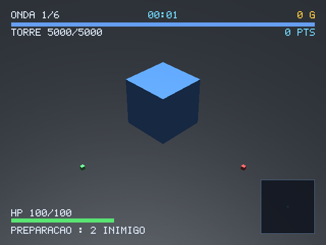
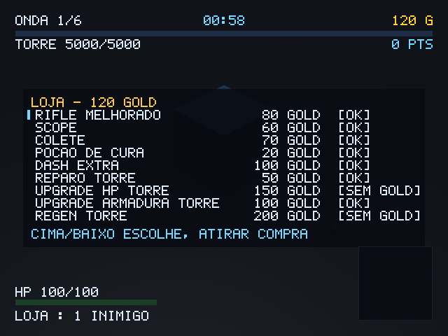

# STATUS — GIOCHI Tower Defense

Atualizado em 13/11/2026. Este arquivo é o resumo de uma página; o raciocínio de
cada decisão está em [`DECISIONS.md`](DECISIONS.md), o design em
[`docs/GDD.md`](docs/GDD.md) e o brief original em
[`docs/prompt.md`](docs/prompt.md).

## Em uma tela

| | |
| --- | --- |
| testes | **184** `cargo test --workspace`, `clippy -D warnings` limpo |
| binário aarch64 | 1,8 MB, 5 bibliotecas `NEEDED` (SDL2, SDL2_mixer, libgcc_s, libm, libc) |
| aparelho | R35S / RK3326, 640×480, **GLES 2 no Mali-G31** (acelerado) |
| FPS no aparelho | **59,8** (vblank de 16,7 ms), com e sem o HUD |
| HUD no aparelho | 406 instâncias, 9 chamadas de desenho, **3,31 ms** |
| loja no aparelho | 1 463 instâncias, 9 chamadas, **5,64 ms** |
| pixel a pixel | HUD idêntico no PC e no R35S (mesma contagem de cor, mesmo texto) |

## O que foi feito nesta rodada: o HUD passou a desenhar

Até aqui `src/ui/` era só modelo: `ui::build` devolvia números formatados e
ninguém desenhava nada, porque a GIOCHI-ENGINE-3D não tem texto nem 2D (D-009).
Agora existem **três camadas**, e cada uma responde uma pergunta diferente:

| Camada | Arquivo | Pergunta | GPU? |
| --- | --- | --- | --- |
| modelos | `src/ui/mod.rs` | quais são os **números** da tela? | não |
| layout | `src/ui/layout.rs` | onde cada coisa fica, em **pixels**? | não |
| fonte | `src/ui/font.rs` | como um glifo vira retângulo? | não |
| desenho | `engine_bridge/render.rs` | submissão de GPU | **sim** |

A ponte é a mesma que o `neon-drift` e o `giochi-defender` mediram: câmera na
origem, `fov` 90°, plano próximo 9,0, HUD a `PROFUNDIDADE = 10` unidades. Isso dá
profundidade normalizada ~0,10 — à frente de tudo. Com os planos padrão da
câmera o HUD cairia em ~0,99 e **sumiria atrás do chão**.

### Três defeitos que o desenho expôs, todos medidos

1. **A loja rodava a 29,9 fps.** Não era a loja: era a **contagem de
   instâncias**. Uma instância por ponto aceso de glifo dava 4 649 instâncias
   (14,9 por caractere) e cada uma custa **1,47 µs** de submissão no Cortex-A35.
   A decomposição em retângulos máximos (`font::retangulos`) dá **5,3 por
   caractere** — 3,2× menos — e o quadro voltou a **59,4 fps**. Cobertura
   idêntica: os dois quadros comparados dão **0 pixels diferentes**.
2. **Um bloco do rodapé encostava no outro.** Montado de baixo para cima a partir
   da margem, cada degrau sobe pela altura **real** do anterior. Há teste que
   mede a caixa dos seis blocos em quatro painéis e reprova se dois se tocarem.
3. **Barra de vida zerada gerava retângulo de largura zero.** O `lotes`
   descartava, então nada quebrava — e o plano carregava dado que não desenha.
   Agora zero não empilha retângulo.

### O que foi verificado, e como

```text
PC    640x480 · 405 instâncias · 9 chamadas · montar 0,02 ms + desenhar 0,11 ms
PC    liga as cores exatas do HUD na captura: texto 3 028 px, destaque 556, ouro 148
PC    margem respeitada nos 4 lados em 640x480, 800x600 e 1280x720 (0 px de erro)
PC    com UI × sem UI: 21 352 pixels diferentes (6,95% do quadro)
R35S  59,8 fps · 406 instâncias · desenhar 3,31 ms
R35S  loja: 59,4 fps · 1 463 instâncias · desenhar 5,64 ms
R35S  mesma contagem de pixels de texto que o PC (15 268) com a loja aberta
```

O `.github/workflows/validate.yml` passou a conferir três coisas na captura: as
cores exatas das constantes aparecem, o HUD muda mais de 2 % do quadro em relação
a `--sem-ui`, e o BMP sai 640×480. Um HUD que não desenha reprova no CI, não na
mão de quem olha a tela.

Capturas feitas **no R35S** (`--quadros 240`, renderer software porque com GLES
`--quadro` grava preto):





### Ferramentas novas

```bash
giochi-tower --benchmark 300            # FPS + custo por quadro, sem espera
giochi-tower --benchmark 300 --sem-ui   # o custo do HUD, por diferença
giochi-tower --demo-loja --quadro /tmp/loja.bmp   # a loja sem jogar 6 minutos
```

`--benchmark` mede o **trabalho de submissão** (até antes da troca de buffers) e
não o intervalo do quadro: incluí-la fazia todo jogo medir exatamente os 16,7 ms
do vblank, com e sem UI. Foi o que aconteceu na primeira versão do número.

## Onde o projeto está

| Bloco | Estado | O que existe |
| --- | --- | --- |
| M1 — fundação | **entregue** | engine vendorizada, janela GLES/EGL, câmera isométrica, loop fixo 60 Hz, 10 configs RON validadas, entrada (gamepad SDL, teclado/mouse, touch emulado) |
| M2 — rede e combate | **entregue** | protocolo `postcard`, AOI, stub loopback, 5 inimigos com IA, spawner por onda com teto de vivos, torre, placar, fases |
| M3 — bosses, nemesis, loja | **entregue** | 4 bosses com fases, Coronel por tier com item exclusivo, loja no host, **HUD, minimapa e tela da loja desenhando** |
| M4 — multiplayer real | **1 de 6 itens** | `net/host.rs` e `net/client.rs` sobre `giochi-net` (feature `real-net`) |
| M5 — handheld | parcial | o jogo roda no R35S por KMSDRM; falta o caminho evdev de entrada |
| M6 — polimento | não iniciado | — |

## O que NÃO foi feito, e por quê

1. **O jogo continua `scaffold` em `apps.json`.** O motivo mudou: já não é "não
   desenha", é **a entrada não ter sido verificada por dedo**. O SDL detecta o
   `r36s_Gamepad`, mas nenhum botão foi apertado neste aparelho, e a doc do
   módulo diz que no X55/X35H o caminho SDL não funciona. Promover a `ready` com
   essa dúvida seria declarar "funciona" sem ter rodado.
2. **M4 incompleto:** falta a fábrica de sessão (stub × real), mDNS, autoridade
   real do host (D-028), predição/smoothing e o teste de 4 clientes.
3. **A loja é desenhada em escala reduzida.** Nove linhas de 38 caracteres não
   cabem a 640 px na escala do HUD (2,0), então o bloco escolhe uma escala que
   caiba — e o texto da loja sai menor que o do HUD. É legível, não é bonito.

## O que falta, em ordem

1. **Verificar a entrada com o dedo** (ou trocar para evdev, M5). É o que separa
   o app de `ready`.
2. **M4:** mDNS, autoridade real do host, predição/smoothing, teste de 4 clientes.
3. **Arte:** hoje tudo é cubo. Modelos e áudio são o M6.

## Como reproduzir

```bash
cd app/jogos/giochi-tower
cargo test --workspace
cargo clippy --all-targets -- -D warnings
SDL_VIDEODRIVER=offscreen cargo run -- --benchmark 300          # FPS no PC
SDL_VIDEODRIVER=offscreen cargo run -- --benchmark 300 --sem-ui # sem o HUD

bash scripts/compilar-jogo-arm64.sh --jogo giochi-tower --instalar root@10.55.0.2
bash scripts/aparelho.sh verificar-jogo giochi-tower
```

Duas armadilhas que custaram rodada, as duas já conhecidas do repositório:

1. `SDL_VIDEODRIVER=dummy` **não tem OpenGL**; o erro é
   `OpenGL support is either not configured in SDL`, que parece defeito do jogo.
   Use `offscreen` (tem EGL).
2. Com backend acelerado, `--quadro` grava BMP **preto** — o swap esvazia o
   buffer. `aparelho.sh verificar-jogo` força `SDL_RENDER_DRIVER=software` por
   isso.

## O que NÃO fazer sem medir

- Não portar para a ABI C (`libgiochi.so`) "porque o prompt pede": o jogo precisa
  de `giochi-net`, que **não tem superfície C**. Ver D-002.
- Não reativar `rand` antes do M5: o spawn determinístico é o que torna
  `--frames` e `--benchmark` comparáveis (D-024).
- Não trocar `font::retangulos` por "um retângulo por ponto" de volta: custa
  3,2× mais instâncias e a loja cai para 30 fps no RK3326.
- Não tratar "compila" como "roda": a regra do repositório vale aqui.
