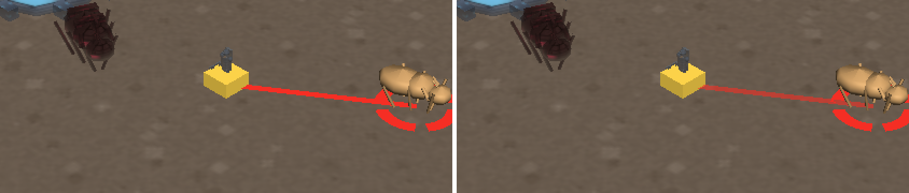
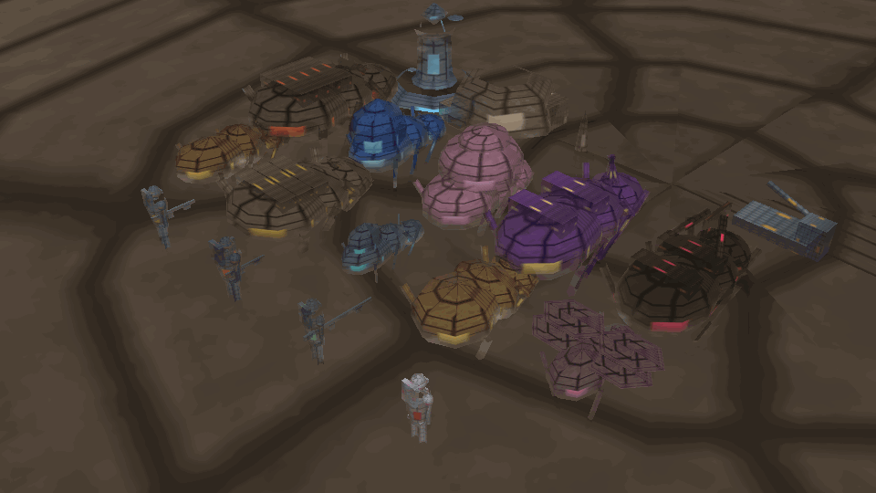
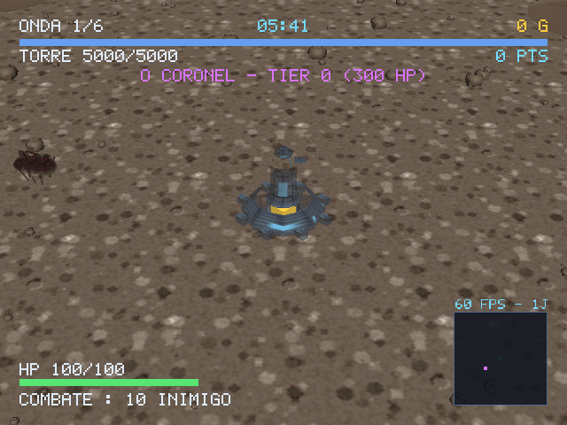
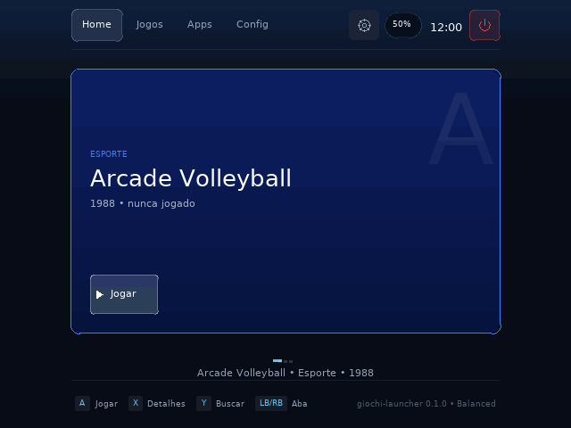
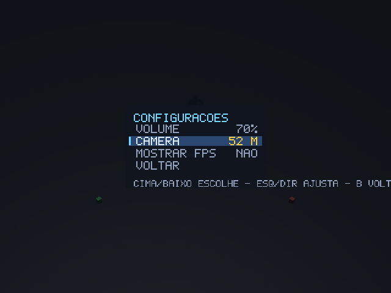
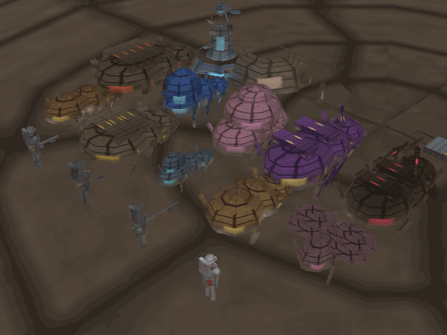
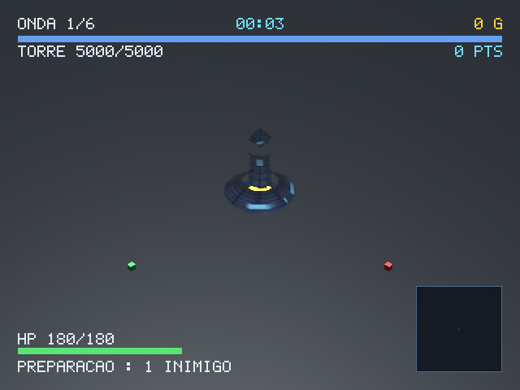
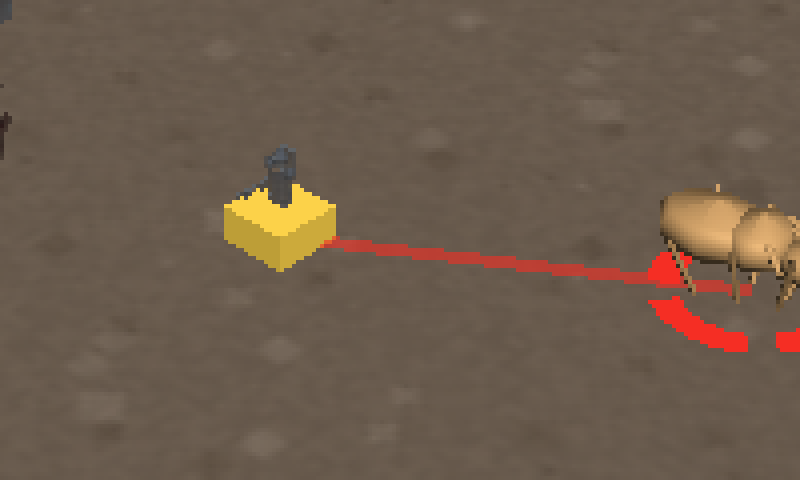

# STATUS — GIOCHI Tower Defense

Atualizado em 13/11/2026. Este arquivo é o resumo de uma página; o raciocínio de
cada decisão está em [`DECISIONS.md`](DECISIONS.md), o design em
[`docs/GDD.md`](docs/GDD.md) e o brief original em
[`docs/prompt.md`](docs/prompt.md).

## Em uma tela

| | |
| --- | --- |
| testes | **265** (`cargo test`), sendo 229 na lib e 36 de integração; `clippy -D warnings` limpo |
| binário aarch64 | 2,0 MB, **6** bibliotecas `NEEDED` (SDL2, SDL2_mixer, **SDL2_image**, libgcc_s, libm, libc) |
| aparelho | R35S / RK3326, 640×480, **GLES 2 no Mali-G31** (Panfrost) |
| modelos no aparelho | **20/20 carregados** (15 personagens + 5 do cenário), **22 texturas** na GPU |
| FPS no aparelho | **59,6** (vblank) sem UI **com o cenário** · **59,7** com UI e HUD |
| trabalho por quadro | **2,56 ms** sem UI (com cenário) · **6,19 ms** com UI + HUD |
| cenário | 473 peças em **5 malhas fundidas**: custa **0,76 ms** por quadro |
| mira | linha **40 % transparente** (α 0,60 medido nos dois lados), retículo opaco |
| pixel a pixel | 4 254 cores no PC contra **4 807 no R35S**; **0,00 %** de quase-preto nos dois |
| multiplicador | host e cliente em dois processos, `jogador 1 entrou` dos dois lados |

## O que foi feito nesta rodada (13/11/2026, madrugada)

Três relatos do dono depois de jogar, mais um ajuste pedido no meio da rodada:

> "a visão de onde se está atirando está impossível (recomendo um alvo no inimigo
> que será atingido e uma linha vermelha linkando o personagem e o alvo), quando
> abro menu e tento o 'sair para o menu' não acontece nada. a textura do mapa
> está sobressaindo muito (não sei o que fazer rs)."
>
> "a linha que mostra a direção do tiro deixe 40 % de transparência"

| Relato | Causa | Como ficou |
| --- | --- | --- |
| atirar é ilegível | o tiro vai no inimigo **mais próximo dentro de um cone de ~70°**, e nada na tela dizia qual | linha vermelha soldado→alvo + **retículo em volta do escolhido**; sem alvo, traço de alcance na direção da mira |
| "Sair para o menu" não faz nada | a ação trocava `modo` e **não trocava a tela**: o menu continuava em `Tela::Pausa` e redesenha o mesmo painel | `Menu::sair_da_partida()` faz as duas coisas, e é o único lugar que faz |
| textura sobressai | não era o tile nem o padrão: era a **amplitude** (desvio 17,98) | textura regerada com metade do contraste (desvio **3,99**) |
| linha muito forte | opaca cobria o cenário e o próprio inimigo | alfa **0,60** só na linha; retículo e ponta continuam opacos |



### O bug que a imagem pegou: o retículo desenhava zero pixels

A primeira versão do retículo emitia **uma** face do decalque, e `cull_face:
true` é o padrão do `GlState` da engine. O resultado foi o pior tipo de defeito:
`draw` devolvia `Ok`, `take_gl_error()` devolvia 0, o alvo estava sendo
encontrado — e nada aparecia na tela.

Corrigido emitindo as duas faces, com teste (`o_reticulo_e_plano_e_sai_com_as_duas_faces`)
verificado contra a remoção da linha dos índices espelhados. É a mesma classe da
parede do morro do `neon-drift` (`AGENTS.md` §31).

### A mira não recalcula o cone

`GameState::alvo_em_mira()` chama a **mesma** `target_in_aim_de()` que o disparo
usa. Recalcular no desenho seria a segunda verdade que já dessincronizou o
carrossel do launcher (`AGENTS.md` §12), e o sintoma seria o pior possível: um
retículo que marca um inimigo e um tiro que acerta outro.

O teste `o_alvo_em_mira_e_o_mesmo_que_o_tiro_atinge` amarra as duas pontas — o
alvo exposto tem de perder HP no passo seguinte.

### O "Sair para o menu" trocava o estado e não a tela

`Menu::confirmar` na pausa devolvia `Acao::MenuPrincipal`, e `main.rs` só fazia
`modo = Modo::Menu`. A tela ficava em `Tela::Pausa`, então o laço redesenhava o
**mesmo painel de pausa** com o cursor onde estava: a impressão exata de botão
morto.

A correção move as duas coisas para dentro do menu (`sair_da_partida()`:
`marcar_partida(false)` + `abrir(Tela::Principal)`), porque navegação é do menu e
o `main.rs` só executa. A/B medido:

```text
sem a correção   --teclas start,baixo,baixo,baixo,a
                 -> tela pausa | cursor 3 | Sair para o menu      (nada aconteceu)
com a correção   -> tela principal | cursor 0 | Jogar
```

Dois testes fixam a regra: um para a pausa e outro para a tela de fim (que tinha
o mesmo defeito, com o cursor em 2).

### A textura: era contraste, não padrão

A tentação é mexer no tile ou trocar o padrão. Nenhuma das duas era o problema —
o tile já estava em 12 m por limite do interpolador do `mediump` (`D-041`), e o
padrão (grão de rocha) é o certo para um planeta morto.

O que "sobressaía" era a **amplitude**:

| | desvio-padrão da textura | contraste local no quadro |
| --- | --- | --- |
| antes | 17,98 | 6,20 |
| depois | **3,99** | **4,82** |

Mesma família de ruído, mesma semente. O que mudou é que a textura parou de
competir com os personagens — e num painel de 3,5" isso decide se o soldado ou o
chão é o assunto do quadro.

### A linha a 40 %: o número foi medido, não presumido

Alfa resolvido por mínimos quadrados pixel a pixel contra o mesmo quadro com
`--sem-mira`, nos dois lados:

| quadro | α = 1,00 (retículo) | α = 0,60 (linha) |
| --- | --- | --- |
| PC, 1280×720 | 754 px | 665 px |
| R35S, 640×480 | 347 px | 283 px |

Duas populações limpas, sem intermediários. O controle é o A/B com
`LINHA_TRANSPARENCIA = 0,00`: os mesmos 1 419 px caem **todos** em `240,40,40`,
que é o vermelho puro do `TARGET_COLOR`. Só a linha recebeu alfa — o retículo
translúcido sumiria justamente sobre a pedra clara, que é onde ele mais importa
(`D-046`).

### Duas ferramentas novas de bancada

`--posicionar x,z` e `--sem-entrada`. A primeira porque capturar um quadro **com
alvo marcado** exigia jogar até a horda encostar, e os inimigos de longo alcance
param a 17 m da torre, fora dos 14 m do Soldado.

A segunda foi descoberta por medição, não por desenho: o aparelho tem controle
conectado, e o analógico parado emite ruído. Esse ruído move o `aim` do soldado e
o alvo da mira muda — o mesmo `--frames` capturado no PC e no R35S divergia em
**273 387 px (68 % do quadro)**, e a comparação de quadro deixava de medir
qualquer coisa. Com `--sem-entrada` dos dois lados: **13 inimigos, 0 gold** nos
dois, e a mira no mesmo lugar.

### O que continua sendo afirmação

| Alegação | Estado |
| --- | --- |
| o retículo marca o alvo **com o dedo no controle** | **não exercitado** — a cadeia vai do estado ao pixel, mas sem aparelho de entrada humano |
| FPS **com a horda cheia** de 100 inimigos | **não medido** nesta rodada |
| 40 % é o valor certo num painel de 3,5" | **medido que chega ao pixel**; se 40 % é o número ideal, não — não há como medir gosto |
| a mira em **multijogador** | desenha só para `state.local_id`; para os outros jogadores não |

## O que foi feito na rodada anterior (13/11/2026, noite)

O pedido do dono foi de **arte e de cenário**:

> "a ideia desse jogo é ter os personagens parecidos com os do filme Tropas
> Estelares (pt-br), então seriam soldados se defendendo de uma horda de bugs.
> Então a modelagem tem que ter essa atmosfera de guerra estelar. O mapa e os
> personagens têm que representar uma batalha pelo posto (torre) em um local tipo
> um planeta sem vegetação e com pedras espalhadas."

| Pedido | Como ficou |
| --- | --- |
| soldados de infantaria móvel | 4 classes com **elmo, viseira, ombreira e mochila**; proporção humana (ombro 0,5 m, não 0,84 m) |
| horda de bugs | os **5 inimigos e os 4 bosses** deixaram de ser humanoides pintados e passaram a ser aracnídeos: corpo alongado, 6–8 pernas, mandíbulas, placas de quitina |
| atmosfera de guerra estelar | sol atrás da câmera, céu de poeira, paleta de aço + quitina; a torre virou **bunker com sacos de areia, antena e farol** |
| planeta sem vegetação, com pedras | cenário novo: **473 peças** (rochas, espigões, crateras, mesas de horizonte, destroços), chão de regolito com UV de mundo |





### A capa também é a cena

`capa.png` deixou de ser um gradiente com um círculo: é um recorte 320×320 do
quadro do jogo, com a torre, os soldados e a horda. O cartão do launcher passa a
mostrar o que o jogo é antes de alguém apertar A.



### Quatro defeitos que só a imagem mostrou

Nenhum destes aparecia em teste, log ou contagem de arquivos — todos precisaram
de **quadro renderizado** e de olhar o quadro.

1. **O sol estava do lado errado.** `DirectionalLight::direction` é a direção
   para onde a luz **viaja**; a câmera isométrica olha de `+X,+Y,+Z` e a luz
   viajava para `+X,-Y,+Z`, ou seja, vinha de trás. Toda face virada para o
   jogador ficava com `lambert = 0` e sobrava só o ambiente: **pedra preta sobre
   chão claro**. Corrigido invertendo o vetor.
2. **O plano distante cortava o horizonte.** 420 m contra um chão de 600 m: o
   canto mais distante do plano fica a ~470 m do olho, então o "horizonte" era o
   plano de corte — uma linha reta. Passou a **900 m**.
3. **Os soldados eram duas vezes mais largos que altos.** `ombro: 0.42` é
   **raio**: 84 cm de ombro a ombro num soldado de 1,85 m. A silhueta lia como
   caixa empilhada. As medidas foram para proporção humana.
4. **Sem normal por vértice o corpo virava um totem de placas.** O loader da
   engine deriva uma normal **por face** quando o OBJ não traz `vn`, e cada
   quadrilátero do lathe ganhava o seu tom. O gerador passou a emitir `vn`
   (radial no lathe, da face na caixa) e o soldado virou um boneco de ombros
   redondos.

### O chão tem limite de shader, e o limite é medido

A textura de regolito repete a cada **12 m**, e não a cada 3 m. A 3 m o chão
aparecia com uma **grade de quadrados**: o `v_uv` chega a `600/3 = 200` e o
interpolador de UV do GLES 2 é `mediump`, então a quantização da coordenada vira
degrau visível a cada repetição. Medido em cinco tamanhos (3, 6, 8, 12 e 20 m) —
a grade some a partir de 12.

### O cenário sai fundido, não instanciado

`draw_instanced` só faz uma chamada por modelo no GLES 3. No R35S o contexto é
**GLES 2** e o caminho de reserva desenha **uma vez por instância**: as 473 peças
custavam **2,77 ms** por quadro. As cópias passaram a ser fundidas em uma malha
por modelo na abertura (matriz aplicada aos vértices, normal girada sem escala),
e o custo caiu para **0,76 ms** — uma chamada por modelo, em qualquer driver.

### Ferramenta nova: `--vitrine`

```bash
giochi-tower --vitrine --tamanho 1280x720 --quadro /tmp/vitrine.bmp
```

Desenha os 20 modelos em quatro fileiras, com câmera a 26 m (o dobro do tamanho
na tela), grava o quadro e sai. Existe porque "o modelo carregou" os testes já
respondem, mas **"o modelo parece o que devia"** só se responde olhando — e jogar
até a onda do boss para ver o Tanker Bug é caro.

### O que continua sendo afirmação

| Alegação | Estado |
| --- | --- |
| FPS **com horda cheia** de bugs no aparelho | **não medido** nesta rodada — os 100 inimigos do perfil Balanced não foram exercitados |
| o cenário num **X55/X35H** | **não medido** — só R35S (640×480) e PC |
| animação dos modelos | **não existe** — todos são estáticos; a única animação é o giro pelo rumo |

## O que foi feito na rodada anterior

### 1. Os personagens têm modelo, e a prova é a contagem de cores

`scripts/gerar-modelos.mjs` escreve **15 OBJ + 15 BMP** de forma determinística
(`--conferir` reprova qualquer divergência): 4 classes, 5 inimigos, 4 bosses, o
Coronel e a torre. Nada de PNG — o `SDL2_image` do aparelho já apareceu compilado
sem `--enable-png` (AGENTS.md §24).

A prova de que o modelo substituiu o cubo **não** é "o arquivo abriu":

```text
com modelos     2 795 cores distintas · 13,63 % dos pixels diferentes
sem modelos       113 cores distintas  (cubos de face plana)
```

113 cores é o que um cubo dá; 2 795 é o que uma superfície texturizada dá. E o
teste `tests/modelos.rs` carrega os 15 arquivos **pelo loader da engine** e mede
a geometria (altura, largura, número de vértices), então um OBJ vazio ou com a
face invertida reprova sem abrir janela.

Custo medido: a horda sai em **um lote instanciado por modelo** (`agrupar`), não
um por inimigo. Com 12 inimigos na tela: **0,32 ms** e **0,47 chamada/quadro**.

### 2. Multiplayer de verdade, e o `local_id` que o handshake manda

`SessaoJogo::{Host, Cliente}` é a única porta de rede no laço. Verificado com
**dois processos**:

```text
host    rede: hospedando em 0.0.0.0:7793
host    net: cliente 1 entrou (AOI 55 m)
cliente rede: conectando; o id de jogador chega no handshake
cliente rede: assumindo o jogador 1
cliente net: handshake aceito, jogador 1
```

O crate `giochi-net` **consome** o `HandshakeOk` e guarda o id em `jogador()` —
nunca o repassa ao jogo. O jogo tinha um braço `Mensagem::HandshakeOk` que por
isso nunca podia rodar, e o `local_id` ficava no 0 de nascimento, que é **o id do
host**: o cliente dirigia o avatar do outro. Agora o id vem de
`cliente.jogador()`, e `state.local_id` acompanha.

A feature `real-net` foi **removida**: rede atrás de `--features` é rede que o
jogador não tem.

### 3. O menu, e o `--teclas` que mentia

Cinco telas (Principal, Multijogador, Configurações, Pausa, Fim), 21 testes,
incluindo um de propriedade com 5 telas × 200 entradas aleatórias. O menu é
**estado puro** — não toca em GL, arquivo nem socket.

O `--teclas` chamava `Menu::entrada` antes do laço e **descartava a ação**:

```text
antes   --teclas "a" -> tela partida · 60 quadros · 0 passo(s) de simulação
depois  --teclas "a" -> partida: nova  · 60 quadros · 60 passo(s) de simulação
```

A tela mudava, o log dizia que sim, e nada começava — a mesma classe do
`--teclas` do launcher (AGENTS.md §24). Agora a tecla entra pela **fila de
eventos**, uma por quadro, com um quadro de soltura: a repetição do menu é de
0,22 s e sem a soltura a tecla seguinte era engolida (`baixo,baixo` parava em
"Multijogador").

Os quatro caminhos verificados no CI:

| Sequência | O que prova |
| --- | --- |
| `a` | inicia a partida (`partida: nova` **e** passos de simulação) |
| `start,baixo,a` | Start pausa, Reiniciar reinicia |
| `cima,a` | Sair encerra o processo |
| `baixo,baixo,a,esq,esq` | grava `settings.json` com volume 60 |

## Capturas no R35S

Menu, partida e vitrine, todas lidas **antes** da troca de buffers — o BMP não é
preto e não foi preciso forçar o backend por software. As capturas da rodada de
arte são as três primeiras:




### A capa também é a cena

`capa.png` deixou de ser um gradiente com um círculo: é um recorte 320×320 do
quadro do jogo, com a torre, os soldados e a horda. O cartão do launcher passa a
mostrar o que o jogo é antes de alguém apertar A.






## Onde o projeto está

| Bloco | Estado | O que existe |
| --- | --- | --- |
| M1 — fundação | **entregue** | engine vendorizada, janela GLES/EGL, câmera isométrica, loop fixo 60 Hz, 10 configs RON validadas, entrada (gamepad SDL, teclado/mouse, touch emulado) |
| M2 — rede e combate | **entregue** | protocolo `postcard`, AOI, stub loopback, 5 inimigos com IA, spawner por onda com teto de vivos, torre, placar, fases |
| M3 — bosses, nemesis, loja | **entregue** | 4 bosses com fases, Coronel por tier com item exclusivo, loja no host, HUD, minimapa e tela da loja desenhando |
| M4 — multiplayer | **3 de 6** | host/cliente reais, descoberta por UDP, `local_id` pelo handshake; falta mDNS, predição e o teste de 4 clientes |
| M5 — handheld | parcial | roda no R35S por KMSDRM com modelos; falta o caminho evdev de entrada |
| M6 — polimento | **começado** | modelos, texturas, menu e volume de áudio; falta animação e som por evento |

### A engine nova trouxe uma dependência de link: `libSDL2_image`

O `vendor/Cargo.toml` liga `image`, `mixer` e `ttf` do crate `sdl2`, e o
`sdl2-sys` emite `-lSDL2_image`. O binário passou de 5 para **6** `NEEDED`:

```text
libSDL2_image-2.0.so.0 · libSDL2_mixer-2.0.so.0 · libSDL2-2.0.so.0 · libgcc_s · libm · libc
```

Presente no R35S (`libSDL2_image-2.0.so.0.800.2`) e por isso o jogo abre lá. Mas
é dependência de **carga**, não de uso: numa imagem sem ela o processo **não
sobe** (`cannot open shared object file`), exatamente como o `libasound` do
launcher no R35S (AGENTS.md §23). O CI precisou de `libsdl2-image-dev` e falhou
com `The system library SDL2_image ... was not found` até isso entrar.

## O que NÃO foi feito, e por quê

1. **O jogo continua `scaffold` em `apps.json`.** Já não é "não desenha" nem
   "não tem modelo": é **a entrada não ter sido verificada por dedo**. O aparelho
   não tem `/dev/uinput`, então `--teclas` cobre o menu e não o evdev.
2. **M4 incompleto:** mDNS (o crate não tem), predição/smoothing, autoridade real
   do host para dano, e o teste com 4 clientes.
3. **Os modelos não têm animação.** São estáticos com giro derivado do rumo. O
   inimigo aponta para a torre porque é para lá que ele anda — custa uma conta em
   vez de um campo novo no protocolo.
4. **A loja é desenhada em escala reduzida.** Nove linhas de 38 caracteres não
   cabem a 640 px na escala do HUD (2,0).

## O que falta, em ordem

1. **Verificar a entrada com o dedo** (ou trocar para evdev, M5). É o que separa
   o app de `ready`.
2. **M4:** predição/smoothing, autoridade de dano no host, teste de 4 clientes.
3. **Animar os modelos** (balanço de passo) e som por evento.

## Como reproduzir

```bash
cd app/jogos/giochi-tower
cargo test --workspace
cargo clippy --all-targets -- -D warnings
node scripts/gerar-modelos.mjs --conferir            # assets reprodutíveis
SDL_VIDEODRIVER=offscreen cargo run -- --benchmark 300          # FPS no PC
SDL_VIDEODRIVER=offscreen cargo run -- --benchmark 300 --sem-ui # sem o HUD
SDL_VIDEODRIVER=offscreen cargo run -- --menu --teclas "baixo,baixo,a,esq,esq"

bash scripts/compilar-jogo-arm64.sh --jogo giochi-tower --instalar root@10.55.0.2
bash scripts/aparelho.sh verificar-jogo giochi-tower
```

Três armadilhas que custaram rodada, as três já conhecidas do repositório:

1. `SDL_VIDEODRIVER=dummy` **não tem OpenGL**; o erro é
   `OpenGL support is either not configured in SDL`, que parece defeito do jogo.
   Use `offscreen` (tem EGL).
2. Com backend acelerado, `--quadro` gravava BMP **preto** — o swap esvazia o
   buffer. Aqui a captura passou a ler **antes** de `render.end()`, o que resolve
   na origem em vez de obrigar o backend por software.
3. `timeout` não mata o jogo no aparelho: o `SIGTERM` só posta `SDL_QUIT`.

## O que NÃO fazer sem medir

- Não portar para a ABI C (`libgiochi.so`) "porque o prompt pede": o jogo precisa
  de `giochi-net`, que **não tem superfície C**. Ver D-002.
- Não reativar `rand` antes do M5: o spawn determinístico é o que torna
  `--frames` e `--benchmark` comparáveis (D-024).
- Não trocar `font::retangulos` por "um retângulo por ponto" de volta: custa
  3,2× mais instâncias e a loja cai para 30 fps no RK3326.
- Não editar `vendor/`: é cópia do upstream (regra R1). Atualizar é copiar de
  novo, e o `glam` do jogo segue o que o código da engine chama (0.34).
- Não tratar "compila" como "roda": a regra do repositório vale aqui.

### A mira no aparelho

Captura de `/tmp` no R35S, 640×480, GLES 2 no Mali-G31 — o retículo desenha
sozinho em volta do bug mais próximo e a linha sai translúcida:


