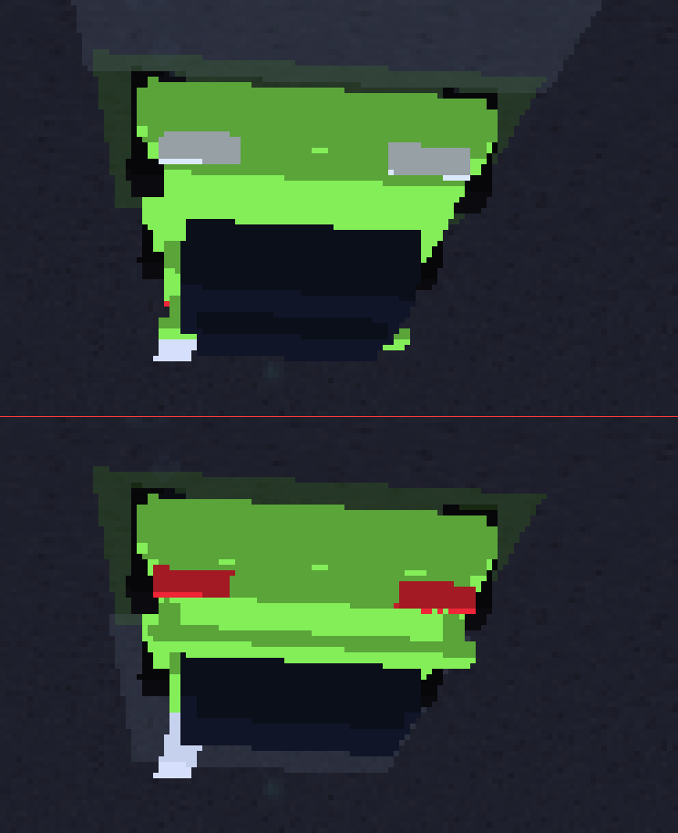

# Neon Drift

Corrida arcade 3D noturna, em Rust, sobre a **GIOCHI-ENGINE-3D** e o KMSDRM do
aparelho. Um jogador, três adversários, **cinco pistas** e um teto rígido de
**75 fps**.

O teto é de **simulação**, não de desenho: a física roda em passo fixo de 75 Hz e
o laço só desenha o que couber. Quanto cada aparelho entrega está na tabela de
[desempenho](#desempenho-medido-nos-três-aparelhos) — e o que sobra até 75 é do
painel, não do jogo: no R35S, cujo display é de 60 Hz, **uma malha só** já marca
59,7 fps, então nenhum jogo passa disso ali.

```bash
cargo test --workspace                        # 123 (ui-sdl) + 128 (core)
cargo build --release
SDL_VIDEODRIVER=offscreen ./target/release/giochi-neon-drift --quadro /tmp/q.bmp
./target/release/giochi-neon-drift --mapa boavista --tela corrida --passos 800 --piloto
```

## Rodar no aparelho

Quatro passos, e cada um responde uma pergunta diferente:

```bash
bash scripts/compilar-jogo-arm64.sh --jogo neon-drift        # 1. compila aarch64
node scripts/empacotar.mjs app/jogos/neon-drift              # 2. assina o .giochi
bash scripts/aparelho.sh instalar-pacote dist/pacotes/neon-drift.giochi  # 3. instala
bash scripts/aparelho.sh verificar-jogo neon-drift           # 4. prova que desenha
```

1. **Compila** e deixa em `bin/giochi-neon-drift` (656 216 bytes, `NEEDED` = SDL2 +
   `libgcc_s` + `libm` + `libc`). O script pergunta ao aparelho se ele tem
   `SDL2_ttf`, mas este jogo **não usa** — o texto é a fonte 5×7 em dados.
2. **Assina** (Ed25519) e recusa pacote sem `.sig` ou com `.sig` de tamanho
   errado. O empacotamento é reprodutível: dois do mesmo conteúdo dão o mesmo
   SHA-256.
3. **Instala** em `/user/apps/neon-drift` — e não em `/opt`, porque
   `distribution: store` significa "não faz parte da imagem assinada". É o que
   permite vender app GPL sem entregar chave. O `aparelho.sh` verifica a
   assinatura com a **chave do próprio aparelho**, não com uma do PC: verificar
   contra a chave errada produz um veredito, e veredito errado é pior que nenhum.
4. **Verifica** rodando com `--quadro`, trazendo o BMP e contando cores, preto
   puro e tamanho. "O processo subiu" e "desenhou" são afirmações diferentes, e
   só a segunda interessa.

`aparelho.sh catalogo` republica o índice depois da instalação, senão o jogo fica
**invisível sem erro**: o launcher lê `/opt/giochi/apps/index.json`, e um app
instalado fora dele não vira cartão.

### O que o aparelho precisa ter

| Item | Obrigatório? | Por quê |
| --- | --- | --- |
| `libSDL2-2.0.so.0` | **sim** | é a única biblioteca que o binário pede, além de `libgcc_s`, `libm` e `libc` |
| GLES 2.0 | **sim**, com fallback | tenta GLES 3 e cai para 2.0; sem GPU, o backend `software` do SDL2 também desenha |
| `/dev/dri` com KMSDRM | **sim** no aparelho | é por ali que o quadro chega ao painel, sem X11 e sem Wayland |
| `libasound.so.2` | **não** | sem ela o SDL2 não abre o dispositivo e o jogo **avisa** (`som: não abri o dispositivo … o jogo segue mudo`) em vez de morrer |
| `SDL2_ttf` e fonte TTF | **não** | o texto é a fonte 5×7 em dados (`crates/core/src/fonte.rs`) |
| `SDL2_image` e `libpng` | **não** | o leitor de BMP é escrito à mão e nenhuma textura vem de arquivo |

Seis linhas, e cinco delas são "não" — é o que faz o mesmo binário abrir no X55,
no X35H e no R35S sem uma linha de código por aparelho.

### Desempenho medido nos três aparelhos

| Aparelho | Painel | fps | O que limita |
| --- | --- | --- | --- |
| X35H (RK3566, Mali-G52) | 640×480 | **36,6 a 37,1 nos cinco mapas** | o conjunto: o `cobrinha` mede 49,3 no mesmo instante e `--so asfalto` 49,2 |
| X55 (RK3566, painel 720×1280) | 720×1280 | **39,5** | pixel: o dobro de área do X35H, e o piso de apresentação é 16,7 ms |
| R35S (RK3326, Mali-G31) | 640×480 | **não medido** | — (a rodada de 09/11 só mediu quadro e HUD) |

Medido no X35H em 10/11/2026, `--quadros 600`, sem o launcher segurando o DRM:

| Mapa | fps | ms de CPU | desenhos | partículas |
| --- | --- | --- | --- | --- |
| avenida | 37,0 | 9,70 | 51 | 663 |
| boavista | 36,7 | 9,86 | 52 | — |
| circuito | **37,1** | 9,45 | 53 | 682 |
| porto | 36,6 | 9,96 | 51 | — |
| salar | 35,6 | 9,77 | 53 | 671 |

**Os três mapas novos custam o mesmo que o antigo.** É o que a regra "cenário
novo não cria malha nova" compra: o circuito tem barreiras, torres de luz e
arquibancada a mais, e isso deu **2 desenhos**, não 20.

Os quadros do aparelho, medidos nos BMPs: boavista 1882 cores/39,8 de média/0,45 %
quase preto · circuito 915/30,3/0,04 % · porto 1158/35,0/0,44 % · salar
749/35,4/0,04 %. Nenhum tem chapa chapada.

O número do X35H não é "o jogo é pesado": com **uma** malha só o jogo marca 49,2
e o `cobrinha` — outro jogo — marca 49,3 no mesmo minuto. O piso de apresentação
daquele painel naquele momento era ~49 fps, e o neon-drift fica ~5 ms acima dele.
`--sem-vsync` (37,4 contra 37,9) não muda nada, o que tira o vsync da conta.

**Correção de uma medição anterior:** a rodada de 09/11 registrou
"`GIOCHI_GLES=0` → 36,9, o mesmo número, logo não é GPU". A conclusão não vale,
porque **este jogo não lê `GIOCHI_GLES`** — essa variável é do launcher. As duas
execuções rodaram com a mesma GPU e a diferença de 1 fps era ruído. O que existe
aqui é `GIOCHI_GL_VERSION=2`, que pede GLES 2.0 em vez de 3.0 (ainda GPU, e o
jogo **não** tem caminho por software: ele desenha por GL direto, não pelo
renderer do SDL). Alguém que "desligue a GPU" com `GIOCHI_GLES=0` vai medir duas
vezes a mesma coisa.

## Cinco mapas

| `--mapa` | Pista | Desnível | Dificuldade | Cenário |
| --- | --- | --- | --- | --- |
| `avenida` (padrão) | 962 m, tudo plano | 0 m | 3 | cidade noturna: arcos de neon, passarelas, outdoors |
| `boavista` | 1 309 m, 2 voltas | **74 m** | 4 | serra: paredão de pedra, mata, guarda-corpo, cidade lá embaixo |
| `circuito` | **2 081 m** (o dobro da avenida) | 0 m | 5 | autódromo: barreiras, torres de luz, arquibancada, **3 rampas** |
| `porto` | 1 030 m, **3 voltas** | 0 m | 3 | cais: contêineres, guindastes, mar com reflexos |
| `salar` | **2 188 m** | 0 m | 2 | planície de sal: pista larga, montanhas, **1 rampa** na reta de 500 m |

O mapa é **dado**, não código (`crates/core/src/mapa.rs`): pontos de controle,
largura mínima e máxima da pista, trechos de túnel, perfil de altura, **rampas**,
voltas, tempo limite, dificuldade e qual cenário construir. Acrescentar um sexto
é acrescentar uma constante e uma linha em `TODOS`.

A **dificuldade declarada não é enfeite**: o teste de promessa
(`cada_mapa_constroi_uma_pista_com_comprimento_utilizavel`) cobra curva fechada
de verdade (`>= 1,2 rad em 45 m`) só de quem declara `>= 3`. O salar promete
"larga e reta" e é medido por isso — antes o piso era fixo e reprovava o mapa
por ele ser exatamente o que promete.

A **descida** usa o Alto da Boavista (Rio de Janeiro) como referência de
*forma*, não como cópia: serpenteia para baixo, tem uma curva fechada de raio
pequeno, um trecho de túnel e uma reta longa onde o nitro vale. Onde a avenida
é plana de propósito, aqui a altura da pista é **real** e entra na física — a
gravidade puxa o carro na descida e o segura na subida (ver
[Relevo](#relevo-a-gravidade-entrou-na-física)).

## Texturas

Sete materiais, todos **gerados em código** (`crates/ui-sdl/src/texturas.rs`):
asfalto, concreto, rocha, mata, guarda-corpo, painel de neon e o xadrez da
largada. Nenhum arquivo de imagem.

Gerar em vez de carregar PNG não é preferência estética, é reduzir superfície de
falha. A primeira motivação era medida: na imagem de 07/11 do R35S o
`libSDL2_image` foi compilado sem `--enable-png` e `IMG_Load` respondia *"PNG
images are not supported"*. **A imagem de 09/11 corrigiu isso** (`libpng16`
presente, a mensagem não existe mais), mas o jogo mantém a decisão por um motivo
que não depende de imagem nenhuma: **ele não linka `SDL2_image`**. O `NEEDED` do
binário é SDL2 + `libgcc_s` + `libm` + `libc`, e nada mais.

Os outros motivos, que também não mudaram: uma textura é uma fórmula (asfalto é
ruído com pedrisco, concreto são blocos com junta, mata é ruído em duas escalas
— vinte linhas cada), não há arquivo para empacotar nem caminho para faltar no
aparelho, e o `tint` continua valendo sem uma textura por cor.

As texturas nascem **neutras e claras**, e a cor vem do `tint` do material
(`amostra × tint`). É o que permite a mesma textura de concreto ser o muro
azulado da avenida e o paredão da serra. Textura escura × tint escuro = preto —
foi exatamente o que aconteceu na primeira tentativa, com 28 % do quadro quase
preto; a correção foi clarear as texturas, não o tint.

O sorteio é um xorshift com semente fixa: duas execuções geram bytes idênticos.
Sem isso a comparação de quadro PC × aparelho deixaria de valer.

E a **engine ganhou textura** para isto: o snapshot vendorizado em `vendor/`
não tinha criação de textura GL nem desenho texturizado, embora já tivesse
`uv` no vértice, shader `textured` e `set_texture`. Hoje tem
`create_texture_rgba`, `draw_mesh_textured`, `texture_size` e `destroy_texture`
(`vendor/giochi-engine-3d/src/render3d/texture.rs`). A engine original continua
intocada — atualizar é copiar de novo.

**Para pintar as suas:** [`TEXTURAS.md`](TEXTURAS.md) tem a ficha completa —
64×64 RGBA, cinza-claro neutro, 3 m por tile, faixa útil de luminância, a
tabela de qual malha usa qual material e as três armadilhas de BMP. O molde sai
do próprio jogo:

```bash
giochi-neon-drift --texturas /tmp/texturas.bmp   # as 7 lado a lado, 480x72
```

## Sprites: as partículas deixaram de ser quadrados

Oito formas num atlas de 128×128, também **geradas em código**
(`crates/ui-sdl/src/atlas.rs`): nuvem, gota, faísca, risco de nitro, risco de
chuva, halo, borrão de pneu e anel. Antes disto toda partícula era um
**quadrilátero sólido** — e num painel de 3,5" isso não lê como fumaça, lê como
quadrado.

| Forma | Onde aparece |
| --- | --- |
| `puff` | fumaça de pneu na derrapagem |
| `gota` | respingo de água no asfalto molhado |
| `faisca` | raspão na mureta e batida |
| `risco` | rastro de nitro no escapamento |
| `chuva` | gota caindo, alinhada à velocidade relativa |
| `halo` | mote de neon flutuando na cidade |
| `borrao` | marca de pneu deitada no chão |
| `anel` | (reservada) fragmento de vidro |

O atlas é **máscara de alfa**: RGB branco em toda parte, e quem desenha é o
canal `a`. A cor vem do `tint` e o desbotamento vem da faixa de vida, então uma
nuvem nasce branca, fica cinza e some sem precisar de uma textura por cor.

Cada célula vira uma **malha** cujo UV cobre só aquele retângulo
(`malha::quad_celula`), e o desenho usa `draw_instanced_textured`. A célula é
escolhida pela geometria, não por uniforme: é isso que permite as centenas de
cópias de um tipo saírem em **uma** chamada. O número de desenhos por quadro
não mudou — continua um por (tipo, faixa de vida).

O ganho de tamanho existe num lugar só: a `gota` é desenhada 1,30× maior, porque
o raio dela (0,72 do meio-quadrado) é menor que o quadrado cheio que ela
substituiu. Sem isso o respingo encolheria 28 % sem ninguém ter mexido no
tamanho dele.

### Usar a sua própria folha de sprites

Se você tem uma folha pronta (um `.bmp`), não precisa mexer em código:

```bash
GIOCHI_SPRITES=minha-folha.bmp GIOCHI_SPRITES_COLUNAS=8 giochi-neon-drift
```

- **`GIOCHI_SPRITES`** — caminho de um BMP **sem compressão, 24 ou 32 bits**.
- **`GIOCHI_SPRITES_COLUNAS`** — quantas colunas a folha tem (padrão 4). As
  linhas saem de `8 ÷ colunas`, então uma faixa 8×1 e uma grade 4×2 desenham
  igual.

A folha é **normalizada** para o mesmo 128×128 de quatro colunas: a célula *i*
vai para a posição da forma *i*. Nada do desenho sabe de onde ela veio, então
não há um segundo caminho de código que possa envelhecer diferente.

O RGB da sua folha é descartado (a cor vem do `tint`) e o que vale é o **alfa**.

A ficha de arte (grade 4×4, margem de 1e-4, por que o `gota` cresce 1,30×, BMP de
24 bits usando a luminância como máscara) está em [`TEXTURAS.md`](TEXTURAS.md). E
o arquivo para conferir é `--atlas /tmp/atlas.bmp`, que sai com fundo **magenta**:
alfa 0 sobre preto é indistinguível de "não desenhou".
Num BMP de 24 bits, que perdeu o alfa, a **luminância** vira máscara: branco
opaco, preto transparente — a convenção das folhas de efeito.

PNG **não** é aceito, e o motivo é do jogo, não da imagem do aparelho: o
`giochi-neon-drift` **não linka `SDL2_image`** (`NEEDED` = SDL2 + `libgcc_s` +
`libm` + `libc`), e o leitor de BMP é escrito à mão em `atlas.rs`. Aceitar PNG
seria uma dependência nova, num binário que hoje abre em qualquer imagem que
tenha SDL2. Converta para BMP — sai de qualquer editor.

Se o arquivo não abrir, não for BMP ou não couber no número de colunas, o jogo
**avisa** e cai no atlas procedural:

```text
neon-drift: folha de sprites ignorada — não consegui abrir /tmp/x.bmp: No such file or directory
neon-drift: atlas de sprites 128x128 [...] (origem: procedural)
```

O aviso existe porque a alternativa é pior: cair no procedural **em silêncio**
faz o usuário concluir que a folha dele não serve, quando o que falhou foi o
caminho.

```bash
giochi-neon-drift --atlas /tmp/atlas.bmp     # o atlas em BMP, fundo magenta
```

O `--atlas` respeita as duas variáveis: uma ferramenta que mostra o atlas
procedural enquanto o jogo desenha a folha do usuário mede outra coisa.

O fundo é magenta de propósito: alfa 0 sobre preto é indistinguível de "não
desenhou", e o arquivo mentiria sobre ter gerado as formas.

E a engine vendorizada ganhou o par que faltava: `BuiltinShader::TexturedInstanced`
(`shaders/textured_instanced.vert`) e
`RenderContext3D::draw_instanced_textured`. O fragmento é o mesmo do `Textured`,
então um sprite recebe exatamente a mesma luz que uma malha texturizada ao lado.

## Faísca no raspão, destroço na batida

Duas respostas diferentes para dois contatos diferentes:

| Situação | Sinal na física | Efeito |
| --- | --- | --- |
| encostou e continuou andando | `carro.raspando` | faíscas laranja contínuas, som de raspagem, **sem** zerar o combo |
| bateu de frente | `carro.impacto > 0,35` | rajada de **destroços 3D** (cubos girando em três eixos, com quique no chão) + tremor de câmera |

Separar os dois é o que faz o raspão ser divertido em vez de punitivo: antes
todo contato era `Evento::Bateu`, e raspar a mureta de leve zerava o combo como
uma batida a 200 km/h.

O tamanho da rajada é proporcional ao impacto — um raspão solta 2 ou 3 lascas,
uma batida forte solta 18. `--json` traz `"impacto"` e `"fragmentos"`; zero ali
é resposta legítima (não bateu), e é por isso que existe um teste que **prova**
que a rajada dispara — durante uma sessão inteira ela disparou zero vez e o
diagnóstico dizia `"fragmentos":0`, indistinguível de "não implementado".

## Relevo: a gravidade entrou na física

`Amostra.altura` carrega o perfil do mapa, e `Pista::inclinacao_em(s)` devolve a
rampa em radianos. O carro sente isso como aceleração ao longo da frente:

- descendo, acelera sozinho;
- subindo, perde velocidade;
- de ré, o sinal inverte (senão o carro aceleraria sem limite descendo de ré).

Uma armadilha medida: com a gravidade **real** (9,81 m/s²), uma rampa de 11 % dá
1,08 m/s² — menos que o atrito de rolagem constante, que era 4,5. O carro
**parava** no meio da descida. A correção foi dupla: gravidade arcade
(`9,81 × 3,5`, como todo jogo de corrida faz) e atrito de rolagem em 1,6.

### O nitro dava velocidade permanente

Achado ao medir o salar, o mapa mais aberto: a corrida fechava com média de
**78,2 m/s** contra um teto de **82**. Com tanque de 100, gasto de 30/s e recarga
de 8/s, o ciclo ativo do nitro é **21 %** — a média não podia passar de ~66.

A causa: o motor zera no topo (`sobra = 0`), mas isso só **impede acelerar mais**.
Nada trazia o carro de volta, e o arrasto com o acelerador preso é uma constante
de 0,55 m/s². Medido: **82 → 62 levava 36 s**, mais que uma volta inteira. O nitro
emprestava velocidade e ela nunca era devolvida.

A correção é uma parcela que só existe **acima** do topo:

```rust
let excesso = (vel - vel_topo).max(0.0) * FREIO_EXCESSO;   // 1,0 s⁻¹
let resistencias = arrasto + atrito_extra + excesso;
```

Ela não pode entrar no arrasto geral: lá também age **abaixo** do topo, e foi
exatamente esse erro que deixava o carro em 32,7 m/s numa versão anterior desta
conta (o comentário no código registra isso).

| Mapa | Média antes | depois |
| --- | --- | --- |
| salar | **78,2 m/s** | **67,1 m/s** |
| circuito | 63,6 m/s | **56,3 m/s** |
| boavista | 53,1 m/s | 50,6 m/s |
| avenida | 46,4 m/s | 46,4 m/s |
| porto | 32,9 m/s | 32,9 m/s |

`o_nitro_nao_deixa_velocidade_permanente` exige o carro de volta ao topo em 4 s;
revertendo a correção ele reprova com *"ainda estava a 79,8 m/s"*. E
`abaixo_do_topo_o_freio_de_excesso_nao_aparece` guarda o outro lado: a parcela é
zero em qualquer velocidade legal.

A descida assenta em **65–67 m/s** quando o nitro acaba: a gravidade sustenta
parte do excesso (`62 + 4,5 m/s² ÷ 1,0 s ≈ 66,5`), e é isso que faz a serra ter
caráter sem o carro passar a corrida acima do topo.

E as texturas de chão usam **UV pela posição no mundo**, não 0..1 por
quadrilátero: com UV por segmento, a textura reiniciaria a cada 4 m de serra e a
emenda apareceria como uma faixa correndo ao lado do carro.

## Rampas de salto: o carro sai do chão

Uma rampa **não** é um morrinho no relevo. Um morrinho é uma ladeira suave: a
física mantém o carro grudado no chão e ele nunca decola. Para o carro **sair do
chão** o piso tem de cair mais rápido do que a gravidade conseguiria trazê-lo de
volta — ou seja, um **corte seco** depois da subida, e isso não cabe num perfil
de `(fração, altura)` interpolado entre dois pontos.

Por isso a rampa é **dado declarado**, com `s` exato:

```rust
Rampa { fracao: 0.500, comprimento: 30.0, altura: 3.3 }
```

`RampaS::altura_em(s)` devolve a subida e **zero depois do topo** — é esse corte
que faz o carro voar. E o topo é **encaixado numa amostra** da pista
(`encaixar_em_amostra`): o asfalto é desenhado ligando a altura de amostras
vizinhas, e um topo no meio de um segmento faria o piso descer suave, de novo sem
decolagem. A decolagem é decidida por `pista.rampa_cruzada(s_anterior, s)`, não
por "o piso caiu".

No ar: não colide com mureta nem obstáculo, o drift não acumula e o nariz do
carro sobe e desce com `atan2(velocidade_vertical, velocidade)`. O voo entra na
física como fato, com `Decolou`/`Aterrissou` avisando a cena e o som.

Medido na rampa 1 do circuito a 62 m/s: decola com 11,6 m/s verticais, **pico de
6,8 m** e aterrissa **1,73 s** depois.

Duas constantes existem porque a física "correta" não é divertida:
`BONUS_SALTO = 1,7` (fisicamente `v·inclinação` daria 2,8 s de voo, que é longo
demais) e `GRAVIDADE_VOO = 15,0`, mais fraca que a `GRAVIDADE = 34,3` da ladeira.

### O `s` salta no ar, e isso quase creditou uma volta

Voando, o `localizar` pode trocar de referência ao atravessar o miolo de uma
curva: medido, o `s` saltou **96,76 m num único quadro** de 1/75 s. O progresso
da corrida passou a usar o **deslocamento real projetado na pista**
(`pos_anterior: Ponto`), que é imune a isso por construção — um teto arbitrário
seria o próximo número mágico a dar errado.

## O que o jogo tem

| Peça | Como está |
| --- | --- |
| Pista | **cinco mapas**: avenida (962 m, túnel de 157 m, curva de raio 20 m), descida (1 309 m, 74 m de desnível), **circuito (2 081 m com 3 rampas)**, porto (1 030 m, hairpin de raio 22 m) e salar (2 188 m, 1 rampa) |
| Salto | rampa é dado do mapa; o carro decola com **6,8 m de pico** e 1,7 s de voo, e no ar não colide nem acumula drift |
| Carro | física arcade: 62 m/s no asfalto, **82 m/s com nitro** (e o carro **volta** ao topo em ~3 s quando ele acaba), derrapagem que só existe com o freio de mão; rolagem e arrasto **freiam até zero e nunca empurram o carro para trás** |
| Drift | combo até ×5, pontos por segundo de derrapagem; bater zera o combo e mantém o que já foi somado |
| Adversários | três, com linha própria e freando na curva; ~9 s atrás de um piloto competente em duas voltas |
| Câmera | terceira pessoa com atraso exponencial, inclinação na derrapagem, tremor na batida e **FOV que abre no nitro** |
| HUD | volta, posição, tempo, velocímetro, marcha, barra de nitro, pontos e combo de drift |
| Efeitos | **7 tipos de partícula**, cada um com a sua forma no atlas de sprites (fumaça, respingo, faísca, nitro, chuva, poeira de neon, marca de pneu), raios de velocidade, clarão de nitro, aura de neon sob os carros, feixe de farol no asfalto e **áudio sintetizado em runtime** (motor, derrapagem contínua e nitro) |
| Cenário | avenida: cidade noturna com **arcos de neon a cada 26 m**, três passarelas, outdoors luminosos, refletores na mureta, faixas de neon nas torres distantes e **pulos de luz em duas fases** no túnel |
| Telas | título com instruções, corrida e resultado com "reiniciar" |

Nada aqui usa marca, carro ou logo real: os carros são caixas com proporções de
carro e o cenário é aritmética.

## Controles

| Tecla | Ação |
| --- | --- |
| `W`/`↑` | acelerar |
| `S`/`↓` | frear (e ré, parado) |
| `A`/`D` ou `←`/`→` | virar |
| `Espaço` | freio de mão — **é o que liga o drift** |
| `Shift` | nitro |
| `Enter` | jogar / reiniciar |
| `Esc` | sair |

No controle do aparelho os mesmos comandos chegam por evdev, pelo `buttons.map`
do sistema: A acelera, B freia, direcional vira, L1 é o freio de mão, R2 é o
nitro e START confirma.

## Como o teto de 75 fps é garantido

Não é um `sleep` no fim do quadro. O núcleo roda em **passo fixo de 75 Hz**: a
física, o drift e a corrida avançam em incrementos de `1/75 s`, e o laço só
desenha o que couber. Um aparelho que desenhe mais rápido que 75 Hz espera; um
que desenhe mais devagar perde quadros de desenho, **nunca de simulação**. A CLI
recusa `--fps-teto` fora de 1..75.

## Diagnóstico sem dedo no aparelho

| Comando | Para quê |
| --- | --- |
| `--quadro q.bmp` | desenha um quadro e sai (offscreen no PC) |
| `--tamanho 640x480` | painel simulado |
| `--passos 1500` | adianta a simulação |
| `--piloto` | o piloto artificial dirige durante os `--passos` |
| `--tela corrida` | força uma tela |
| `--mapa porto` | escolhe o mapa (`avenida`, `boavista`, `circuito`, `porto`, `salar`) |
| `--em 1240` | posiciona o carro em `s = 1240 m` já a 48 m/s — é como se cai **em cima** de uma rampa sem dirigir até ela |
| `--so asfalto_t` | desenha **uma** malha só (nome da malha; `GIOCHI_SEM` usa o nome da textura) |
| `--so mundo` | desenha toda a geometria estática e mais nada |
| `--teclas w,a,space` | teclas seguradas |
| `--quadros N` | desenha N quadros e sai (mede fps quando há relógio) |
| `--fps-teto 75` | baixa o limite de quadros (1 a 75; 75 é o padrão e o máximo) |
| `--sem-som` | não abre o dispositivo de áudio |
| `--sem-vsync` | pede troca de buffer sem espera (`GIOCHI_VSYNC=0`). No KMSDRM do aparelho **não tem efeito**: o `drmModePageFlip` continua esperando o campo, e é por isso que se mede comparando configurações, não buscando o "custo puro" |
| `--escala 0.75` | desenha em resolução menor e estica (Upscaler da engine; `GIOCHI_ESCALA`) |
| `--atlas a.bmp` | grava o atlas de sprites e sai, **sem abrir janela** |
| `--texturas t.bmp` | grava as 7 texturas lado a lado, **sem abrir janela** — o molde para pintar |
| `--json` | estado da corrida em uma linha de máquina, com `fps`, `ms_cpu`, `desenhos`, `mapa`, `altitude`, `impacto`, `fragmentos`, `largou`, `progresso`, `no_ar`, `v_vertical`, `altura_solo`, `nitro`, `nitro_usando`, `derrapando` e a contagem de cada tipo de partícula |

`GIOCHI_SEM=carros,particulas,hud` desliga partes do quadro; `GIOCHI_CULL=0`
desliga o descarte de faces (para comparar). Os dois existem para **medir**, não
para jogar: num painel de 720×1280 o quadro é dominado por pixel, e sem separar
as partes "está lento" não diz o que cortar.

`--piloto` existe porque `--passos` sozinho media outra coisa: com o acelerador
preso, o carro batia no primeiro muro e ficava a 2,6 m/s encostado — e o quadro
capturado mostrava a linha de largada como se a corrida não tivesse começado.

O salto se confere numa linha, sem dirigir até a rampa — **com `--quadro`**, que
é o que faz o processo sair depois de imprimir:

```bash
giochi-neon-drift --mapa circuito --em 1240 --teclas up --passos 60 \
                  --quadro /tmp/j.bmp --json
# no_ar:true  v_vertical:8.43  s:1279.9   ← subindo
# passos 90:  no_ar:true  v_vertical:2.43   ← perto do ápice
# passos 120: no_ar:true  v_vertical:-3.57  ← caindo
```

`--em` também marca a largada (`marcar_largou`): sem isso o carro teleportado
apareceria com volta 0 e o diagnóstico mediria outra coisa.

**`--passos` sozinho não para o processo.** Ele adianta a simulação antes do
laço e o laço continua até `Esc` ou `--quadros`; o `--json` que sai no fim é do
estado **depois** da corrida inteira. Sem `--quadro` a medição do salto reporta
`no_ar:false` porque o carro já pousou — o número é verdadeiro e responde outra
pergunta.

`--so` existe porque "o quadro está estranho" não diz **qual** malha está
errada. Foi ele que mostrou o asfalto ausente com a malha tendo 2 560 vértices:
o quadrilátero do chão estava com a ordem dos cantos invertida e o descarte de
faces o removia em silêncio.

## `scripts/traco-voltas.mjs`: a linha do tempo das voltas

```bash
node scripts/traco-voltas.mjs --teclas up --ate 400 --passo 10
node scripts/traco-voltas.mjs --mapa boavista --teclas up
```

Varre `--passos` crescentes e imprime **só as transições** de volta, fase e
largada:

```text
  passos   tempo       s   volta  fase       o que mudou
      270     0.6     0.3      1  Correndo   largou false → true
```

Existe porque "registrou uma volta na partida" é um defeito de **linha do
tempo**, e um quadro parado não o mostra. Três decisões fazem dela uma medida e
não um palpite:

- **`--passos` é determinístico** — o passo é fixo em 1/75 s, sem relógio,
  então a varredura dá a mesma linha do tempo em qualquer máquina;
- **`--teclas up` e não `--piloto`** — o piloto acelera no mesmo passo em que a
  contagem acaba e **esconde** o defeito. O percurso tem de reproduzir o
  jogador;
- **sai com 1** se achar volta creditada antes de 5 s.

Foi ela que mostrou que a avenida e a Boavista tinham causas diferentes: a
avenida creditava a volta no primeiro metro, a Boavista em **1,1 s** com o carro
a 14 km/h. A regra de contagem hoje é **progresso acumulado com correção de
volta** — `s` sozinho oscila entre ~0 e ~comprimento quando o carro está perto
da linha, porque o último trecho passa geometricamente ao lado do primeiro.

## Efeitos: o que custa o quê, medido no X55

O aparelho de 720×1280 é **dominado por pixel**, e não por triângulo: cada
chamada de desenho custa ~0,15 ms de CPU, mas o que decide o quadro é a área
desenhada. Três medições mudaram o desenho da cena:

| Mudança | Antes | Depois |
| --- | --- | --- |
| descarte de faces ligado (`cull_face`) | 29,8 fps | **39,5 fps** |
| carro: 5 malhas × 4 carros em 8 chamadas | 20 desenhos | **8 desenhos** |
| cenário novo (arcos, passarelas, outdoors) | — | **0 chamada a mais** |

O `cull_face` foi o maior ganho isolado e a causa é uma armadilha: com
`blend` ligado no quadro inteiro, o Mali **não** rejeita a face de trás por
profundidade, então metade da cidade era sombreada para nada. Ligar o descarte
obrigou a acertar o sentido de quatro quads (aura, feixe, marca de pneu e
partícula) — e o defeito, quando errado, é silencioso: o quad simplesmente não
aparece.

O cenário novo entra nas malhas que já existiam (um arco é uma caixa em `muros`
e uma tira em `neon`). Uma malha por tipo de objeto custaria uma chamada por
tipo; um arco custa **zero**.

Medido no X55, com o jogo completo: **39 fps**, 45 desenhos, 770 partículas
vivas, 26,7 MB de pico de RAM. No X35H/R35S o painel tem 1/3 dos pixels.

## Som sintetizado, sem um `.wav` no repositório

Três sons, gerados em runtime a 22 050 Hz (`crates/ui-sdl/src/audio.rs`):

| Som | Como é feito |
| --- | --- |
| motor | dente-de-serra com frequência ligada ao RPM da marcha, mais ruído filtrado — a aspereza do dente-de-serra é o que o ouvido lê como motor |
| derrapagem | ruído com passa-banda ressonante, ligado ao deslize lateral; **contínuo** enquanto derrapa |
| nitro | varredura ascendente com ruído, somada ao motor |

Nenhum arquivo de áudio, e os três motivos já custaram caro neste projeto:

1. **Empacotamento** — um `.wav` é mais um caminho que pode faltar, e o sintoma
   seria silêncio, indistinguível de "o mixer não abriu".
2. **Licença** — som de motor baixado da internet é exatamente o conteúdo
   protegido que o projeto não usa. Sintetizar é original por construção.
3. **Memória** — 2 s de motor em 22 kHz são 88 KB; três sons disso num aparelho
   de 964 MB que divide RAM com o sistema.

Custa ~300 amostras por quadro a 75 Hz: nada. E os pesos vêm de `EstadoSom`, um
struct de sete campos — o áudio **não conhece o jogo**, então dá para testar a
síntese sem abrir dispositivo.

Sem `libasound` na imagem o SDL2 não abre a saída e o jogo **avisa** em vez de
morrer:

```text
som: não abri o dispositivo (...) — o jogo segue mudo
```

`--sem-som` faz o mesmo por escolha, e é o que o CI usa.

## As duas armadilhas de matriz de quad

Um quad é uma matriz de modelo de 4×4, e dois campos dela enganam:

1. **Identidade não é o ponto de partida.** `Mat4::IDENTITY` deixa `m[1]` e
   `m[5]` em 1,0, e esses campos são a componente **Y** dos eixos X e Y. Quem
   monta a matriz campo a campo sem zerá-los cisalha o quad para cima: a aura
   do carro virou um painel vertical de 5 m, e o defeito passou por três
   rodadas como "o efeito está feio".
2. **O sentido do eixo decide se o quad existe.** Com `cull_face` ligado, uma
   normal que aponta para longe da câmera faz o desenho sumir sem erro nenhum.
   Há teste para os dois casos (`o_quad_deitado_do_carro_fica_com_a_normal_para_cima`,
   `a_normal_do_quad_deitado_aponta_para_cima`).

## Os carros corriam de ré — corrigido, com prova

Relatado pelo dono: *"parece que os carros estão correndo de ré."* Era exatamente
isso, e a causa era **180° entre o modelo e o rumo**:

| Onde | O que dizia |
| --- | --- |
| `core/carro.rs` — `direcao()` | `(sin θ, cos θ)` → com θ = 0 o carro **anda para +Z** |
| `ui-sdl/malha.rs` — `carro()` | faróis em `z = -2,14`, lanternas em `z = +2,14` → a **frente desenhada é -Z** |

Girar `(0,0,-1)` por `θ` em Y dá `(-sin θ, -cos θ)`, que é **menos** a
`direcao()`. A câmera fica atrás do movimento, então o jogador via os faróis
apontando para ele.

A correção é uma linha — `matriz_de_carro` gira por `θ + π` — e **não toca a
física nem a malha**. O teste que a sustenta,
`o_carro_desenhado_aponta_para_onde_ele_anda`, pega o centro dos vértices dos
faróis, aplica a matriz e compara com `direcao()`: revertendo o `+ π`, ele falha
com produto escalar `-1.000`.

E a prova em imagem, contando pixels na área do carro no mesmo comando
(`--tela corrida --piloto --passos 900`):

```text
antes     lanternas  1 px   ·  faróis 41 px    ← de ré
depois    lanternas 149 px  ·  faróis 54 px    ← de frente
```



## O que este jogo **não** faz

- Não tem multijogador, não tem save, não tem placar persistente.
- Não lê analógico: os botões chegam por evdev e o eixo exigiria `absinfo` por
  ioctl, que nenhum jogo deste repositório implementou ainda.
- Não usa `SDL2_ttf`: o texto é uma fonte 5×7 em dados (`crates/core/src/fonte.rs`),
  porque o aparelho pode não ter a biblioteca e um jogo que depende dela não
  abre.

## Estrutura

```text
crates/core/     regras puras: mapa, pista, carro, drift, IA, corrida, fonte,
                 HUD, relógio e o piloto artificial. Sem SDL, sem janela e sem
                 arquivo: 128 testes.
crates/ui-sdl/   cena 3D, efeitos, malhas, texturas e atlas de sprites
                 procedurais (ou folha externa em BMP), áudio, evdev, entrada e o
                 laço. É a única parte que precisa de tela: 123 testes.
vendor/          cópia isolada da GIOCHI-ENGINE-3D. A engine original é outro
                 repositório e **não** é editada por este app.
TEXTURAS.md      guia de arte: tamanho, canais, escala no mundo, faixa de
                 luminância, as três armadilhas de BMP e onde mexer para cada
                 mudança.
```
