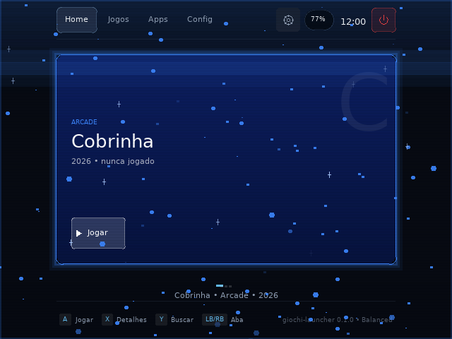

# Giochi Star Dust

O **launcher de produção com a camada de efeitos visuais** que nasceu no
[`launcher-teste`](../launcher-teste/README.md). Mesma base, mesma navegação,
mesmo catálogo, mesma integração com o sistema — e oito efeitos desenhados por
cima das telas.

```bash
cargo build --release
SDL_VIDEODRIVER=dummy ./target/release/giochi-launcher-star-dust \
  --tamanho 640x480 --demo --dump-frame /tmp/star-dust.bmp

bash scripts/verificar-star-dust.sh                    # as cinco provas
bash scripts/compilar-launcher-arm64.sh --app launcher-star-dust --instalar
```

- **Runtime:** `native` (Rust + SDL2) · **Distribuição:** `image` ·
  **Licença:** `Proprietary` · **Entrypoint:** `bin/giochi-launcher-star-dust`

## Os oito efeitos

| Efeito | O que é |
| --- | --- |
| `brasas` | partículas de luz subindo na cor do jogo em foco |
| `brilho` | estrelinhas de quatro pontas acendendo e apagando |
| `varredura` | banda de luz descendo a tela a cada 4 s |
| `vinheta` | topo e base escurecidos, em bandas de alfa |
| `scanlines` | textura de CRT, em **um** lote de ~120 tiras |
| `halo` | brilho pulsante no item em foco |
| `rastro` | riscos horizontais a cada comando do jogador |
| `borda` | tira de luz respirando na borda da tela |

`GIOCHI_EFEITOS_SO=brasas,halo` desenha só os listados — é como cada efeito é
medido sozinho. `GIOCHI_EFEITOS_FPS` (padrão 30) muda a cadência da animação.

## Ligado por padrão, e por quê

No `launcher-teste` a camada é **opcional**: aquele app existe para provar que o
porte desenha 100 % igual ao launcher de produção, e efeito desenhado por padrão
destruiria a medida. Aqui o raciocínio se inverte — a camada **é** o motivo de o
app existir — então ela vem ligada.

`--sem-efeitos` (ou `GIOCHI_EFEITOS=0`) desliga, e aí vale a propriedade que
importa: **o quadro é idêntico byte a byte ao do launcher de produção**. É o que
prova que o clone não regrediu nada ao receber a camada, e é uma das cinco
verificações de `scripts/verificar-star-dust.sh`.

## O que mudou em relação ao launcher de produção

Três coisas, e nenhuma toca o desenho das telas:

1. **`crates/ui-sdl/src/efeitos.rs`** — a camada, vinda do `launcher-teste` sem
   alteração de lógica.
2. **Quatro primitivas novas no `Painter`** — `fill_rects`, `fill_circles`,
   `line` e `desenhos()`. As três primeiras existem porque **uma chamada por
   partícula** é o custo que a camada não pode pagar: 130 brasas em 130
   `fill_circle` custavam 130 chamadas ao backend; em lote é uma.
3. **Cadência de animação própria** no laço — a UI redesenha só quando algo
   muda, e um efeito animado muda sempre. Redesenhar a 60 Hz para animar brasas
   gastaria bateria de um portátil, então a animação tem cadência de 30 Hz e é
   ela que marca o quadro como sujo.

## Medido no X35H (640×480, Mali-G52)

```text
instalado            /opt/giochi/apps/launcher-star-dust/bin/giochi-launcher-star-dust
quadro no aparelho   640x480 · 2099 cores · luminância 31,1 · quase-preto 29,92 %
camada inteira       29 chamadas de desenho · 129 brasas · 11 brilhos
muda no aparelho     59,70 % dos bytes do quadro
```

O número que fecha o argumento é a comparação entre os dois lados:

| | dentro de 12 níveis | byte a byte diferente |
| --- | --- | --- |
| **sem** efeitos, PC × aparelho | **98,10 %** | 2,99 % |
| **com** efeitos, PC × aparelho | **98,15 %** | 2,97 % |

A camada acrescenta **zero** divergência entre PC e aparelho. O resíduo de ~2 %
é o que já existia antes dela: `SDL2_ttf` **2.22** no aparelho contra **2.24** no
PC, mais o texto de estado do sistema (volume e rádio diferem por máquina).



## Determinismo

Nada na camada lê relógio: a animação avança por **contagem de quadro**
(`tick`), e `--dump-frame` adianta 90 quadros antes de desenhar
(`--efeitos-quadros N` muda). Duas execuções do mesmo comando produzem o mesmo
BMP byte a byte — sem isso "o efeito ficou bom" não seria comparável e não
haveria teste de regressão de imagem.

## O que este app **não** faz

- **Não substitui o launcher.** Quem sobe no boot é
  `/opt/giochi/apps/launcher/bin/giochi-launcher`. Star Dust é um app à parte,
  instalado com o próprio slug, e trocar um pelo outro é decisão explícita de
  quem monta a imagem.
- **Não entra no catálogo.** `role: shell` no `apps.json` — sem isso o launcher
  listaria a si mesmo e o cartão abriria um segundo processo brigando pelo DRM
  master (o defeito já medido, §12 do `AGENTS.md`).
- **Não tem efeito na tela de sono.** Dormir apaga o backlight e mostra a lua;
  brasa subindo ali diria que o aparelho está acordado.

---

O resto deste documento é o README herdado do launcher de produção: vale para
esta cópia porque **é o mesmo código**. O que é específico do Star Dust está
acima.

Interface do console. **Reescrito em Rust**, a partir de um protótipo HTML.

- **Runtime:** `native` (Rust + SDL2)
- **Distribuição:** `image`
- **Licença:** `Proprietary`
- **Entrypoint:** `bin/giochi-launcher-star-dust`

## Stack

**SDL2 + renderer próprio** (decidido em 02/11/2026).

| Alternativa | Por que não |
| --- | --- |
| egui | desenho custom (gradiente, glow) fica limitado |
| Slint | DSL própria e runtime grande para 1 GB de RAM |
| **SDL2** | já está no Buildroot; backend KMSDRM dispensa compositor; controle total do desenho |

O custo é desenhar a UI, mas o layout é simples — cartões, gradientes, texto — e
não justifica carregar um toolkit.

## Estrutura

```text
launcher/
├── Cargo.toml                  # workspace
├── prototipo/
│   └── launcher.html           # protótipo corrigido — abre no navegador
└── crates/
    ├── core/                   # núcleo puro: sem pixel, janela ou GPU
    │   └── src/
    │       ├── cmd.rs          # comandos como enum
    │       ├── state.rs        # estado completo
    │       ├── focus.rs        # zonas e navegação espacial
    │       ├── reduce.rs       # estado + comando → estado
    │       ├── gamepad.rs      # controle → comandos
    │       └── viewport.rs     # escala e área segura
    └── ui-sdl/                 # SDL2 + renderer próprio
        └── src/
            ├── main.rs         # janela, laço, controle
            ├── app.rs          # eventos → comandos → desenho
            ├── theme.rs        # paleta e métricas
            ├── draw.rs         # primitivas: retângulo, gradiente, círculo, texto
            ├── icons.rs        # ícones vetoriais (dados, não PNG)
            ├── views.rs        # telas + áreas tocáveis
            ├── backlight.rs    # brilho do painel: dormir, acordar, persistir
            ├── display.rs      # orientação declarada pelo sistema
            ├── power.rs        # botão de energia: toque dorme, segurar abre menu
            ├── system.rs       # poweroff/reboot de verdade, e diagnóstico
            └── volume.rs       # teclas de volume → mixer ALSA, com repetição
```

## Decisões de desenho

**Sem PNG para ícone.** Cada ícone é uma lista de linhas, polilinhas e círculos
no espaço 24×24, igual ao SVG do protótipo. Nitidez em qualquer DPI e nenhum
asset binário para versionar.

**Sem shader para gradiente.** `SDL_Renderer` não tem gradiente; ele é
aproximado por faixas de 4 px. Com 4 px a diferença é invisível e o custo é
~80 chamadas por cartão.

**Escala pelo SDL, não à mão.** `set_logical_size(1280, 720)` faz o letterbox.
O protótipo calculava à mão e cortava 106 px de cada lado em 640×480.

**Toque escolhe alvo direto.** Cada elemento interativo registra seu retângulo
durante o desenho; o toque consulta essa lista. Quem desenha sabe onde o
elemento está, então é quem registra — separar os dois garante que fiquem
dessincronizados.

## Rodar

```bash
# PC (x86-64), resolve o SDL2 inclusive sem root:
bash scripts/compilar-launcher.sh

# Aparelho (aarch64):
bash scripts/compilar-launcher-arm64.sh --app launcher-star-dust --instalar
```

O script acha o aparelho na rede (o IP muda a cada boot), delega o cross-compile
e instala em `/opt/giochi/apps/launcher-star-dust/bin`. `aparelho.sh instalar`
continua instalando **o launcher**, não este app. Detalhes e armadilhas em
[docs/compilar-launcher.md](../../docs/compilar-launcher.md).
Se o SDL2 já está instalado no sistema:

```bash
cd app/launcher
cargo run                     # janela 1280x720
cargo run -- --fullscreen     # tela cheia
cargo run -- --font caminho/para/fonte.ttf
cargo test --workspace        # 121 testes, sem tela e sem placa
```

Fonte: **DejaVu Sans**. O código procura nesta ordem:

1. `assets/fonts/DejaVuSans.ttf` — junto do app, vai para o aparelho
2. `/usr/share/fonts/truetype/dejavu/DejaVuSans.ttf` (Debian/Ubuntu)
3. `/usr/share/fonts/TTF/DejaVuSans.ttf` (Arch)
4. `app/launcher/assets/fonts/DejaVuSans.ttf` (rodando da raiz)

Ou `--font /caminho/DejaVuSans.ttf`.

**O arquivo não foi incluído no repositório** — copie `DejaVuSans.ttf` para
`assets/fonts/`. Detalhes e licença em
[assets/fonts/README.md](assets/fonts/README.md).

Sem a fonte, o desenho continua e o texto é omitido, com aviso no console.

> DejaVu é mais larga que Inter/Segoe. Se algum rótulo estourar — o rodapé é o
> candidato — reduza `F_TINY`/`F_SMALL` em `theme.rs`.

No aparelho: `GIOCHI_GLES=1` seleciona o backend `opengles2`. No desktop, deixe
vazio.

## O que está verificado e o que não está

Verificado em 03/11/2026, no PC (x86-64) **e no aparelho** (aarch64, Buildroot
2024.02, SDL2 2.28.5, painel DSI 720×1280):

| Item | Estado |
| --- | --- |
| `prototipo/launcher.html` | funciona — HTML puro, abre no navegador |
| `crates/core` — 64 testes | **passam** |
| `crates/ui-sdl` — 57 testes | **passam** |
| `cargo build --workspace` | **sem erro e sem aviso**, com e sem a feature `texto` |
| x86-64 | **roda** — Home desenhada e gravada em BMP |
| **aarch64** | **roda no aparelho** — `KMSDRM` real, frame capturado |
| Rotação para painel retrato | **funciona** — 0 % de letterbox, 99,9 % igual à referência x86 |
| Mapa de botões do aparelho | **parseia 13/13** (antes 1/13, por causa de comentário na linha) |
| Cobertura das capacidades do kernel | **20/20** códigos declarados têm entrada no app |
| Despertar por botão | **corrigido** — qualquer entrada acorda e é consumida |
| Backlight ao dormir | **apaga e restaura** — verificado no painel (833 → 0 → 833) |
| Brilho do painel | **controlado e persistido** — 333/1166/833 em 20/70/50 % |
| Orientação do painel | **lida do sistema** (`fbcon/rotate`), sem nome de aparelho no código |
| Botão de energia físico | **funciona** — toque dorme, segurar 1 s abre o menu |
| Teclas de volume | **funcionam** — passo de 5 %, repetição ao segurar, mixer real |
| Desligar / reiniciar | **desliga de verdade** — `poweroff` cortou a energia no teste |
| Volume no mixer ALSA | **confirmado por `alsactl`** — 70→100 % virou 255/255 |
| Entrada por evdev no aparelho | **exercitada** — power, volume e os 13 botões mapeados |
| Texto no aparelho | **não** — falta `libSDL2_ttf`; ver [docs/dependencias-aparelho.md](../../docs/dependencias-aparelho.md) |
| Analógico | **não lido** — calibração parseada, eixos sem `absinfo` |

As três suposições de API do `sdl2` 0.37 anotadas como risco foram resolvidas:

1. `load_font` devolver `Font<'static, 'static>` — **procede**; o caminho vai para
   `Box::leak` para satisfazer o tempo de vida.
2. `GameControllerSubsystem::open` — **não é usado**: a entrada é por evdev.
3. `Canvas::window_to_logical` — **não existe** na 0.37. A conversão foi refeita
   em `Painter::window_to_logical`, com a mesma matemática do
   `SDL_RenderWindowToLogical`.

Falta validar: backend GLES2 (o testado foi o renderer software sobre KMSDRM),
leitura dos eixos analógicos e o desempenho no RK3326.

Para exercitar no aparelho sem passar pela UI:

```bash
bash scripts/aparelho.sh subir
bash scripts/aparelho.sh verificar          # processo + DRM + frame comparado
bash scripts/aparelho.sh input 20           # o que o kernel entrega
bash scripts/aparelho.sh capacidades        # o que o kernel promete
```

O guia das ferramentas está em [docs/ferramentas.md](../../docs/ferramentas.md).

## Relação com o protótipo

O HTML e o Rust usam a **mesma** arquitetura: mesmos nomes de comando, reducer
puro, foco `(zona, índice)`, overlays separados da aba. O port é mecânico, não
reinterpretação. O diagnóstico dos defeitos do mockup original está em
[docs/diagnostico-prototipo.md](../../docs/diagnostico-prototipo.md).

## O que falta

- **Texto no aparelho** — depende de `SDL2_ttf` + freetype + uma fonte na imagem
  ([docs/dependencias-aparelho.md](../../docs/dependencias-aparelho.md)).
- **Backend GLES2** e medição de FPS no RK3326.
- **Fonte TTF** dentro do pacote (`assets/fonts/DejaVuSans.ttf`).
- **Leitura real** de bateria, temperatura e apps instalados; hoje a UI mostra
  `—` onde não há sensor.
- **Lançar apps de verdade** — o código registra a intenção e mostra aviso.
- **Empacotar** para `bin/` no alvo aarch64.
