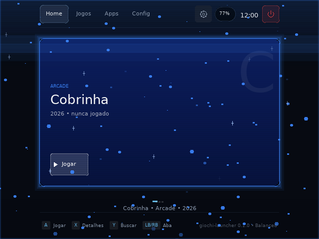
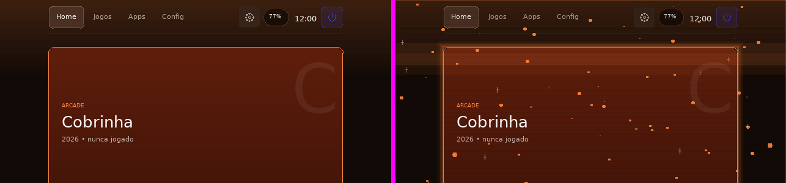

# Star Dust — o launcher com a camada de efeitos

`app/launcher-star-dust` é o **launcher de produção** com os oito efeitos que
nasceram no [`launcher-teste`](../app/launcher-teste/README.md). Medido em
10/11/2026.

```bash
bash scripts/verificar-star-dust.sh                                   # cinco provas
bash scripts/compilar-launcher-arm64.sh --app launcher-star-dust --instalar
```

> **Não confundir com o `launcher-teste`.** Aquele existe para responder *"o
> launcher desenhado sobre a GIOCHI-ENGINE sai igual ao de produção?"* — e a
> resposta, 100,0 % pixel a pixel, depende de a camada de efeitos estar
> **desligada**. Este existe para o efeito, então a camada vem **ligada**.

## Por que um app separado, e não uma flag no launcher

Três motivos, e o primeiro é o que decide:

1. **O launcher é o processo que não pode falhar no boot.** Ele é o `::respawn:`
   do `inittab`, tem histórico de defeito medido em campo e é o único caminho
   para desligar o aparelho pela tela. Efeito animado é código novo rodando 30
   vezes por segundo sobre a única superfície de recuperação do sistema.
2. **Custo de bateria é decisão de produto, não padrão silencioso.** Um portátil
   que redesenha a 30 Hz com a tela parada gasta energia; quem quiser o efeito
   escolhe o app.
3. **A comparação byte a byte continua existindo.** Com a camada desligável, a
   propriedade "sem efeitos é idêntico ao launcher" é verificável — e é ela que
   prova que o clone não regrediu nada.

## O que é reusado, e o que é novo

O app é uma **cópia** de `app/launcher` — mesmo `crates/core`, mesmas telas,
mesmo `catalogo.rs`, `semfio.rs`, `energia.rs`, `power.rs`, `volume.rs`. Copiar e
não reusar por `#[path]` (como o `launcher-teste` faz) é deliberado: o Star Dust
troca **o binário**, não a camada de desenho, e um app que compartilha arquivos
com o processo de boot não pode ser instalado sozinho no aparelho.

| Peça | Origem |
| --- | --- |
| núcleo, telas, tema, ícones, catálogo, sistema | `app/launcher` (cópia) |
| `crates/ui-sdl/src/efeitos.rs` | `app/launcher-teste/src/efeitos.rs`, sem mudança de lógica |
| `fill_rects`, `fill_circles`, `line`, `desenhos()` | **novo** no `Painter` desta cópia |
| cadência da animação no laço | **novo** no `App` desta cópia |

### As quatro primitivas novas, e por quê

A camada desenha 129 brasas e 11 brilhos num quadro de 640×480. Uma chamada por
partícula seria 140 chamadas ao backend **por quadro** — o mesmo defeito que o
`launcher-teste` pagou com +7,3 ms por quadro antes de lotear.

| Primitiva | O que faz |
| --- | --- |
| `fill_rects` | N retângulos num `SDL_RenderFillRects` |
| `fill_circles` | as varreduras de N círculos num lote só |
| `line` | linha em espaço de projeto (os ícones já tinham a versão privada) |
| `desenhos()` | contador **no ponto em que se chama o backend** |

Com recorte ativo as três primeiras caem para uma por elemento: `fill_rects`
recebe uma cor para o lote inteiro e o `clip_rect` do canvas não é respeitado
por todo driver, então um efeito que ignorasse o recorte apareceria por cima de
um overlay que deveria cobri-lo.

O contador vive no `Painter`, e não dentro do módulo de efeitos. **É a terceira
vez que este projeto tropeça nisso**: no `launcher-teste` o contador local
imprimia "25 desenhos" com 182 chamadas saindo, porque media a intenção. Um
número que mede intenção não mede custo.

### A cadência: 30 Hz, e não 60

A UI do launcher redesenha **só quando algo muda** (`dirty`) — é o que evita
gastar CPU e bateria desenhando uma tela idêntica 60 vezes por segundo. Um efeito
animado muda sempre, então alguém precisa marcar o quadro como sujo.

Quem marca é `App::tick`, com acumulador e cadência própria
(`GIOCHI_EFEITOS_FPS`, padrão 30). Não é 60 porque a diferença visual em brasas
de 1–3 px é nula e o custo não: a animação é contínua, não é interação. Valor
inválido vindo de fora cai no padrão — um número que não parseia não pode zerar
a animação em silêncio.

## Medido no X35H (640×480, Mali-G52)

```text
instalado        /opt/giochi/apps/launcher-star-dust/bin/giochi-launcher-star-dust (748 728 B)
quadro           640x480 · 2099 cores · luminância 31,1 · quase-preto 29,92 %
camada inteira   29 chamadas de desenho · 129 brasas · 11 brilhos
muda no quadro   59,70 % dos bytes
```

E a comparação que fecha o argumento:

| | dentro de 12 níveis | byte a byte diferente |
| --- | --- | --- |
| **sem** efeitos, PC × aparelho | **98,10 %** | 2,99 % |
| **com** efeitos, PC × aparelho | **98,15 %** | 2,97 % |

A camada acrescenta **zero** divergência entre PC e aparelho. O resíduo de ~2 %
é anterior a ela e conhecido: `SDL2_ttf` **2.22** no aparelho contra **2.24** no
PC (registrado em `AGENTS.md` §24), mais texto de estado do sistema que difere
por máquina (volume 60 % no aparelho contra 87 % no PC).



E o antes/depois no mesmo aparelho — `--sem-efeitos` à esquerda, efeitos à
direita:



## `scripts/verificar-star-dust.sh`

Cinco perguntas, e nenhuma se responde olhando a tela:

| # | Pergunta | Como |
| --- | --- | --- |
| 1 | desenhou? | compara com `--sem-efeitos` e exige diferença |
| 2 | é determinístico? | duas execuções dão o mesmo BMP byte a byte |
| 3 | **desligado é o launcher?** | compara com o binário de produção, byte a byte |
| 4 | cabe? | conta chamadas ao backend e reprova acima de 40 |
| 5 | cada efeito desenha? | `GIOCHI_EFEITOS_SO`, um por vez |

Mais duas que só existem porque o defeito apareceu: `rastro` **com** comando
tem de desenhar, e **sem** comando não pode desenhar nada.

A 3 é a prova mais forte, e ela só existe porque a camada é desligável.

O relógio, a bateria e a temperatura são congelados nos dois lados
(`GIOCHI_HORA_FIXA`, `GIOCHI_BATERIA_FIXA`, `GIOCHI_TEMPERATURA_FIXA`). Sem
isso a comparação byte a byte falha por motivo que não é desenho — foi o que
derrubou o X35H para 99,5 % antes de essas variáveis existirem.

## Um defeito que o Star Dust encontrou, e o `launcher-teste` não

A rajada de `rastro` estava ligada ao **estado mudar**, e não a uma tecla. No
`launcher-teste` isso nunca apareceu porque lá a rajada só é chamada no caminho
de `--teclas`, e o laço dela não tem telemetria.

Aqui o `App` tem telemetria — bateria, temperatura, "controle conectado", aviso
de Wi-Fi. Medido: `rastro` sozinho custava **20 chamadas de desenho** num quadro
em que ninguém tinha apertado nada, e o efeito perdia o significado ("algo
aconteceu") virando ruído permanente.

A correção é uma guarda de uma linha, `cmd.is_user_input()` — a mesma função que
o modo sono usa desde 03/11 para separar "um dedo apertou" de "o sistema
reportou". E o teste que a fixa está no script (`sem comando o rastro não
aparece`), porque sem ele a guarda volta na primeira refatoração.

## O que continua sendo afirmação

| Alegação | Estado |
| --- | --- |
| FPS do Star Dust no aparelho | **não medido** — o número reportado é chamada de desenho, não fps |
| efeito com o controle na mão | **não exercitado** — a rajada foi medida por `--teclas`, não por dedo |
| energia gasta a 30 Hz | **não medida** — o argumento da cadência é de desenho, não de watt |
| custo em painel 720×1280 (X55) | **não medido** — só 640×480 do X35H |
